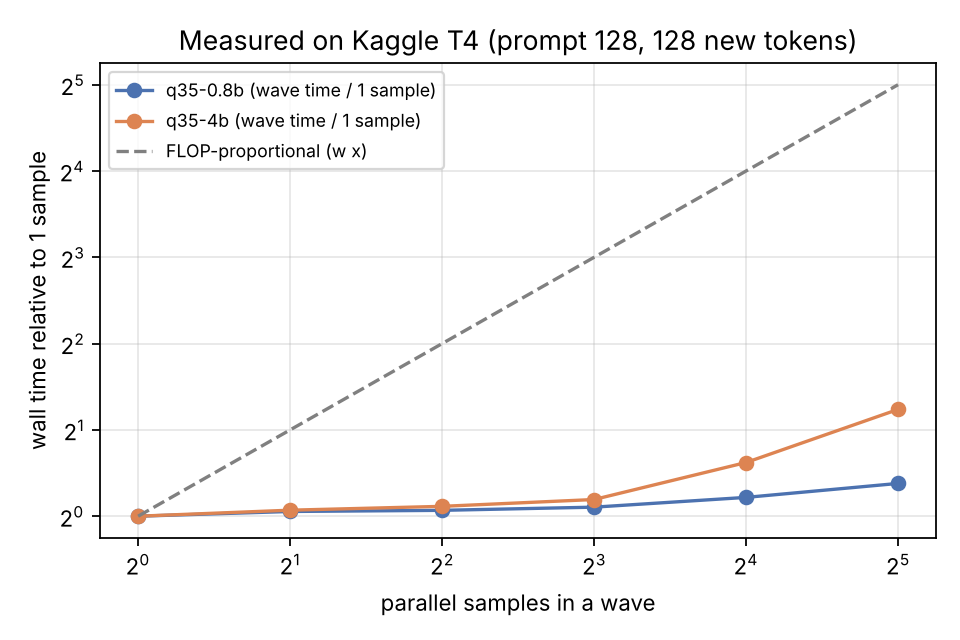
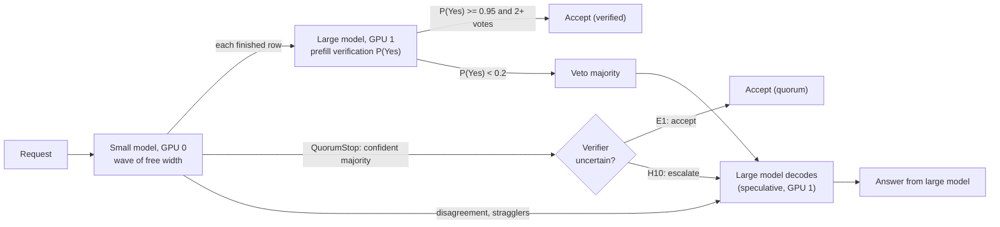

<a id="top"></a>

# FreeWidth: Hardware-Aware Test-Time Compute for Small Language Models

[](https://github.com/Tejascodz/freewidth/actions/workflows/ci.yml)
[](https://github.com/Tejascodz/freewidth/actions/workflows/security.yml)


**Abstract.** Test-time compute strategies (parallel sampling with voting, sequential sampling, escalation to a larger model, verification) are usually compared by FLOPs. On a single-tenant, memory-bandwidth-bound accelerator, that cost model is wrong in a specific, measurable way: a decoding step reads the model's weights once regardless of batch width, so up to a device- and model-specific *free width*, additional parallel samples add at most a fixed latency budget (here 25%) over a single sample.

FreeWidth does three things:

- It **measures** the free width per device and model by fitting a parametric cost curve to timed decodes. On an NVIDIA T4: 16 for Qwen3.5-0.8B and 4 for Qwen3.5-4B (in-sample fit R² ≥ 0.997; held-out validation is part of E6). The criterion is the sample-axis counterpart of *near-free parallelism* (He et al. 2026), which uses the same latency test for decode positions per forward pass.
- It **runs** small-to-large model ladders live: waves sized to the free width, an in-wave Bayesian early stop (QuorumStop), and single-pass prefill verification by the larger model, streamed across a second GPU.
- It **evaluates** them under a pre-registered protocol: exact paired tests with Holm correction, Wilson intervals, paired bootstrap and power analysis.

**Main result.** On 300 GSM8K problems on two free Kaggle T4 GPUs, the best ladder (`overlap`) reaches 89.3% accuracy at a 19.3 s median latency and 2.85 kJ per question. The 4B model alone, run data-parallel on both GPUs, reaches 95.7% at 40.2 s and 5.71 kJ.

Both pre-registered superiority claims failed:
- `overlap` is 6.3 points less accurate than the large model alone (Holm-adjusted p = 6×10⁻⁴).
- The proposed Read-Locate-Fork repair policy is less accurate and slower than `overlap`.

Error analysis attributes almost all of `overlap`'s deficit to a single acceptance path. On 28 of 300 questions, a small-model majority was accepted after the verifier was uncertain; `overlap` answered 13 of them correctly, the large model 26. A follow-up (H10) that escalates instead is implemented and pre-registered.

---

## Contents

1. [Problem](#1-problem)
2. [Free width: measuring the real cost of parallel samples](#2-free-width-measuring-the-real-cost-of-parallel-samples)
3. [System design](#3-system-design)
4. [Evaluation methodology](#4-evaluation-methodology)
5. [Results](#5-results)
6. [Discussion](#6-discussion)
7. [Limitations and threats to validity](#7-limitations-and-threats-to-validity)
8. [Reproducing the results](#8-reproducing-the-results)
9. [Engineering: API, security, testing](#9-engineering-api-security-testing)
10. [Related work](#10-related-work)
11. [References](#11-references)

Appendices: [A. Pre-registered experiments](#appendix-a) · [B. Engine and server reference](#appendix-b) · [C. Offline research pipeline](#appendix-c) · [D. Code architecture](#appendix-d) · [E. Earlier runs](#appendix-e)

---

## 1. Problem

A deployment that answers questions with a small model can spend extra inference compute in three ways:

- **Wider:** sample *n* answers and vote.
- **Longer:** reason for more tokens, or sample sequentially until confident.
- **Escalate:** hand the question to a larger model, which can either *write* its own answer (decode) or only *read* the small model's answers (verify).

The compute-optimal choice has been studied extensively (Snell et al. 2024; Wu et al. 2024; Kinetics 2025). Those studies price strategies in FLOPs, or in memory traffic of a multi-tenant datacenter. Neither matches a common deployment: **one user, one or two commodity GPUs, small batch sizes**. Two questions follow:

1. What does a parallel sample actually cost on such hardware, and how should a ladder be scheduled around that cost?
2. Measured end to end, with honest baselines and statistics, does a small-to-large ladder beat simply running the large model?

## 2. Free width: measuring the real cost of parallel samples

**Cost model.** For a wave of *w* parallel samples with prompt length *P* and *L* generated tokens, wall time on a single-tenant device is fitted as

```
T(w, L, P) = e + d·w·P + a·L + b·w·L + g·w·(L·P + L(L+1)/2)
```

with non-negative least squares over timed, forced-length decodes. The grid is widths {1, 2, 4, 8, 16, 32} × generation lengths {1, 32, 128} × prompt lengths {128, 512}, with a warm-up pass per shape (Triton JIT) and 2 repeats. Calibration is repeated automatically if R² < 0.97. The `a·L` term is the per-step cost that does not depend on width (dominated by reading the weights); the `w` terms are the per-sequence work. Energy is fitted the same way from NVML counters.

**Definition.** The *free width* is the largest *w* with `T(w) ≤ (1 + ε)·T(1)` at the deployment's typical prompt and generation length (ε = 0.25).

**Relation to prior definitions.**
- He et al. (2026) define *near-free parallelism* with the same test, `T(N) ≤ (1 + ε)·T(1)` with ε = 0.2. There, *N* is the number of decode positions in one forward pass (speculative verification, multi-token prediction, diffusion blocks), on datacenter GPUs with vLLM and SGLang. They show that a roofline estimate can over-predict the boundary by up to 23×.
- Serving systems use the analogous batch-axis notion of a saturation batch size, or "knee" (*Mind the Memory Gap*, 2025).
- Free width applies the same latency criterion to the number of independent samples per question, on consumer GPUs, as a scheduling parameter for test-time scaling.

**Measurement** (Kaggle T4, 16 GB, fp16, transformers + flash-linear-attention; identical across three independent sessions):

| model | architecture | free width | fit R² |
|---|---|---|---|
| Qwen3.5-0.8B | hybrid (Gated DeltaNet + attention) | **16** | 0.998 |
| Qwen3.5-4B | hybrid (Gated DeltaNet + attention) | **4** | 0.997 |

<p align="center"></p>

*Figure 1.* Wave time relative to a single sample (log–log). Under a FLOP model, 16 samples cost 16×. Measured, they cost about 1.2× (0.8B). The 4B curve bends earlier; this run did not isolate why.

**Consequence.** Within the free width, self-consistency costs at most 1.25× the latency of one sample. This is near-free under the stated budget, not literally free. Beyond it, cost grows close to linearly. A scheduler that ignores this either leaves cheap samples unused or pays full price for samples it believes are cheap.

**What R² does and does not show.** The R² values are in-sample: they measure how well the curve fits the calibration points it was fitted to. They do not show that the curve predicts unmeasured widths, other models or other GPUs. The atlas (E6) adds two out-of-sample checks:
- the curve is fitted on widths ≤ 16 and scored on the measured widths 32 and 64;
- the free width read from the fitted curve is compared with the free width read directly from timings.

## 3. System design

### 3.1 Overview

FreeWidth has two parts that share the cost model:

- **Live engine:** an OpenAI-compatible server and Python library that answers requests on a model ladder.
- **Offline pipeline:** profile, bank samples, verify, then replay 12 strategy families under three cost models ([Appendix C](#appendix-c)).



*Figure 2.* The `overlap` policy. The small model's wave and the large model's verification run concurrently on separate GPUs.

### 3.2 QuorumStop: early stopping inside a lock-step wave

In a static batch, the slowest row sets the wave's cost, and rows finish at different steps. Wrong reasoning chains tend to be longer. QuorumStop evaluates, each time a row finishes, the posterior probability that the current leading answer is the true mode. It uses the top-two Beta reduction of Adaptive-Consistency (Aggarwal et al. 2023):

```
p_lead = P(θ > 0.5),  θ ~ Beta(n₁ + 1, n₂ + 1)
```

Here *n₁* and *n₂* are the vote counts of the two most frequent extracted answers. When `p_lead ≥ τ` (τ = 0.9) with at least 2 finished rows, the whole wave stops, and unfinished rows are cut and do not vote. It is implemented as a `transformers` `StoppingCriteria`, so the saving is real wall time, not a replayed estimate.

### 3.3 Prefill verification

The large model never decodes to verify. A candidate solution is placed in a grading prompt, and one forward pass gives

```
P(Yes) = p(Yes) / (p(Yes) + p(No))
```

over the next-token distribution, summed over the tokenizer's Yes/No variants. The cost is one prefill, which is far below a decode of comparable length. The framing of this prompt turned out to matter more than any threshold (§5.4).

### 3.4 Policies

| policy | role | mechanism |
|---|---|---|
| `freewidth` | proposed (sequential) | Small-model waves at free width with QuorumStop. If not confident, the large model prefill-verifies the top candidates. If none is verified, the large model decodes. |
| `overlap` | proposed (concurrent) | As Figure 2. Each finished small-model row is verified immediately on the second GPU. The table below lists the decision rules. |
| `repair` | proposed | **Read-Locate-Fork.** One large-model pass gives the verdict and the first flawed token: the first solution token with probability < 0.05 while the large model prefers another token with ≥ 0.5. The large model writes that one token, and the small model resamples from the fork in a free-width batch. |
| `big_sc` | baseline | The large model alone, 8 samples, majority vote, one GPU. |
| `big_sc2` | baseline | The large model alone on both GPUs (4 + 4 samples at its free width) with one QuorumStop shared across devices. |
| `sc`, `hwave`, `single` | baselines | Self-consistency, free-width waves without verification, one sample. |

`overlap` decision rules, evaluated each time a row finishes:

| rule | condition | action |
|---|---|---|
| verified accept | an answer has ≥ 2 votes and verifier P(Yes) ≥ 0.95 | accept |
| quorum accept | QuorumStop fires, the answer has been verified, and 0.2 ≤ P(Yes) < 0.95 | accept (E1). With H10 (`quorum_accept: false`), escalate instead |
| veto | the leading answer's best P(Yes) < 0.2 | block acceptance; start the large model |
| disagreement trigger | ≥ 4 rows finished and `p_lead` < 0.6 | start the large model speculatively |
| straggler cut | ≥ 4 rows finished and step > 2 × median finished length | cut running rows; trigger if a third or more of the rows are still running |

If the small model accepts after the large model has started, the large model's run is cancelled.

## 4. Evaluation methodology

| item | setting |
|---|---|
| Hardware | Kaggle, 2 × NVIDIA T4 (16 GB, about 320 GB/s), free tier |
| Models | Qwen3.5-0.8B (GPU 0) and Qwen3.5-4B (GPU 1), fp16, non-thinking mode |
| Software | PyTorch, transformers 5, flash-linear-attention; FreeWidth 0.5.0 for E1 |
| Data | GSM8K test. 300 questions sampled with seed 0 (a superset of the 100 used in earlier runs) |
| Decoding | temperature 0.7, top-p 1.0, at most 1,024 new tokens, `\boxed{}` answer format |
| Grading | numeric exact match after normalisation; math-verify for symbolic answers |
| Metrics | accuracy; wall-clock seconds per question (mean, median, p90); energy per question (NVML, GPUs used); share of questions where the large model decoded |

**Statistical protocol.**
- **Pre-registration.** For each experiment, the primary comparisons, the sample size and the pass/fail criteria are committed before the run ([Appendix A](#appendix-a)). Only primary comparisons support claims; everything else is reported as exploratory.
- **Accuracy:** Wilson 95% intervals.
- **Paired accuracy differences:** exact McNemar test on the questions both policies answered, with Holm correction within the primary family.
- **Paired differences in accuracy and latency:** bootstrap 95% intervals, 10,000 resamples, fixed seed.
- **Sample size:** chosen with McNemar power analysis (80% power, α = 0.05) using the previous run's discordance rates. That analysis gave about 280 questions for the `overlap` vs large-model contrast, so E1 used 300.
- **Provenance.** Every reported number is produced by `python -m freewidth report` from the committed per-question rows. None is computed by hand.

## 5. Results

### 5.1 Main results (E1)

All policies were run in the same session on the same 300 questions.

| policy | accuracy (95% CI) | mean s | median s | p90 s | energy (kJ) | large model decoded |
|---|---|---|---|---|---|---|
| `big_sc2` (4B, both GPUs) | **95.7%** (92.7–97.5) | 43.4 | 40.2 | **62.0** | 5.71 | 100% |
| `overlap` | 89.3% (85.3–92.3) | **34.5** | **19.3** | 73.9 | **2.85** | 34% |
| `repair` | 84.0% (79.4–87.7) | 60.0 | 22.5 | 185.2 | 3.97 | 14% |

<p align="center"></p>

*Figure 3.* Accuracy (Wilson 95% interval) against median latency.

### 5.2 Pre-registered tests

Holm correction is applied over the two primary comparisons.

| comparison (A → B) | B better / worse | Holm p | Δ accuracy, points (95% CI) | Δ mean s (95% CI) | criterion | outcome |
|---|---|---|---|---|---|---|
| `big_sc2` → `overlap` | 4 / 23 | 6.2×10⁻⁴ | −6.3 (−9.7, −3.0) | −9.0 (−12.0, −6.0) | faster *and* not significantly less accurate | **fails** on accuracy |
| `overlap` → `repair` | 7 / 23 | 5.2×10⁻³ | −5.3 (−9.0, −2.0) | +25.6 (+20.1, +31.1) | not significantly less accurate than `overlap` | **fails** |

`overlap` is a latency–energy trade-off against the large model: half the median latency and half the energy, for 6.3 points of accuracy. It is not a dominant system.

### 5.3 Error analysis

**`overlap`, by acceptance path:**

| acceptance path | n | accuracy | mean s |
|---|---|---|---|
| verified accept (P(Yes) ≥ 0.95) | 188 | 93.6% | 17.2 |
| large model decoded | 82 | 95.1% | 77.1 |
| quorum accept with uncertain verifier (0.2 ≤ P(Yes) < 0.95) | **28** | **46.4%** | 19.0 |
| other | 2 | — | — |

- **Excluding the 28 quorum accepts, `overlap` is 93.8% accurate (255/272).** On those 28, `big_sc2` was correct on 26.
- **The deficit is therefore concentrated in one decision rule.** If those questions were escalated, and the large model were as accurate on them as `big_sc2` was, the upper bound is about 93.7% overall at roughly +4–5 s mean latency.
- This motivates **H10**: implemented as `quorum_accept: false` and pre-registered as E1b. It is an estimate, not a result.

**`repair`, by acceptance path:**

| acceptance path | n | accuracy | mean s |
|---|---|---|---|
| small-model quorum | 224 | 83.5% | 25.5 |
| large model decoded after a failed repair | 43 | 90.7% | 205.1 |
| verified candidate | 26 | 73.1% | 104.0 |
| repaired (fork succeeded) | 7 | 100% | 110.7 |

- **The fork rarely succeeded.** It was attempted on 50 questions and succeeded on 7, all correct.
- **Failed repairs are what make `repair` slow.** They fall back to a full large-model decode after the repair attempt (205 s mean).
- **Repair's main weakness is upstream.** It inherits the weak small-model quorum gate (83.5% on 224 questions).

### 5.4 The verifier is sensitive to who appears to have written the answer

In the first version of `repair` (run 2), the candidate solution was placed in the large model's *own* assistant turn. On the same candidates, the median P(Yes) was:
- **0.99** with self-attribution;
- **0.10** in a third-party grading prompt.

Self-attribution made the verifier accept almost everything; verified accepts were 42% accurate. This matches the self-correction blind spot reported by Tsui (2025): models fail to correct errors they believe are their own. The third-party framing used since 0.4.1 raised verified-accept accuracy to 73%, which is still below what a gate needs.

### 5.5 Earlier runs and repeatability

Runs 1–2 used 100 questions each and the one-GPU `big_sc` baseline ([Appendix E](#appendix-e)). Exploratory results on the 100 questions shared with E1:

- **Free width** was identical in all three sessions (16 and 4).
- **`freewidth` across runs 1 and 2:** same answer on 96 of 100 questions (78% vs 80% accuracy).
- **`overlap` across run 2 and E1:** 88 vs 86 correct (McNemar p = 0.79); same answer on 85 of 100.
- **Concurrency (H6, run 2).** On questions the sequential ladder could not settle, `overlap` was faster: 68.8 s vs 111.8 s.
- **Veto (H7, run 2).** On the 13 questions where the verifier vetoed the small model's majority, `overlap` was right on 12; the sequential ladder on 8.
- **Two-GPU baseline speed.** On identical questions, `big_sc2` (two GPUs, Python threads) had a *higher* median than `big_sc` (one GPU): 40.3 s vs 31.0 s (§7).

### 5.6 Hypothesis status

| id | hypothesis | status | evidence |
|---|---|---|---|
| — | Free width is stable and measurable | supported (one GPU type, two models) | identical free widths across three sessions; in-sample R² ≥ 0.997 (out-of-sample checks pending, H15) |
| H6 | Concurrent verification lowers escalation latency | supported | 68.8 s vs 111.8 s on hard questions (run 2) |
| H7 | A live veto rescues confident-but-wrong majorities | supported | 12/13 vs 8/13 (run 2; small n) |
| H8 | Read-Locate-Fork replaces large-model writing | refuted | §5.2–5.3 |
| H9 | The large model is better used as a reader than a writer | refuted | −6.3 points, Holm p = 6.2×10⁻⁴ |
| H10 | Escalating uncertain-verifier quorums closes the gap | pending | E1b, [Appendix A](#appendix-a) |
| H11–H15 | Free-width atlas: roofline gap, size dependence, predictability, hybrid vs dense, held-out accuracy of the cost model | pending | E6, [Appendix A](#appendix-a) |
| H1–H5 | Offline cost-model and strategy hypotheses | not yet run | [Appendix C](#appendix-c) |

## 6. Discussion

**What the evidence supports.**
1. **Free width is real, large on small models, and stable.** It changes how parallel sampling should be priced on single-tenant hardware.
2. **Concurrency matters more than cleverness.** Putting the second GPU to work while the small model decodes (streaming verification, speculative escalation) reduced latency on hard questions by about 40%.
3. **A small-to-large ladder is a trade-off, not a free lunch.** On GSM8K with a 0.8B/4B pair, the large model alone is more accurate. The ladder buys half the latency and energy.

**What it does not support.**
- **That a single verifier prompt is a reliable gate.** Prefill verification is cheap, but its calibration depends on framing (§5.4). A threshold between 0.2 and 0.95 left a band in which a majority was accepted and was wrong more often than right.

**Practical guidance (T4 class, two GPUs):**
- Use `big_sc2` when accuracy is the priority.
- Use `overlap` when latency or energy is constrained and a few points of accuracy are acceptable.
- Do not use `repair` in its current form.

**Novelty, stated narrowly.** A literature review (November 2026, §10) found prior work for every individual mechanism:

| component | closest prior work | status here |
|---|---|---|
| Latency test for "free" parallelism | Near-free parallelism (He et al. 2026); saturation and knee batch sizes in serving (*Mind the Memory Gap* 2025; SLIM 2026) | not new; FreeWidth applies it to the sample axis of test-time scaling |
| Parallel test-time scaling on memory-bound devices | Latency-aware TTS (2025); EdgeReasoning (2025); Efficient Reasoning on the Edge (2026); mobile-NPU TTS (EuroSys 2026); FastTTS (ASPLOS 2026); *Sample Count Is Not Enough* (2026) | not new |
| Resource-aware sampling budgets | ATEST (Oct 2026, live GPU-load energy cost); ATTS (ICLR 2026) | not new; ATEST adapts to load, FreeWidth measures a static device and model property |
| Early stopping of self-consistency | Adaptive-Consistency, ESC, RASC, ReASC, CASE; in-batch truncation: ST-BoN, Speculative Rejection | QuorumStop is an engineering variant (posterior stop over finishing order in a static batch) |
| Small model with large-model verification | Speculative cascades, SplitReason, MSV, MARS | `overlap` is an integration on two GPUs, measured end to end |
| Error localisation and repair | StepBack, decision-token correction, SpecAgent | `repair` was tested and failed |

What remains distinct is narrow:
1. **An end-to-end, pre-registered evaluation** of these mechanisms together on free consumer hardware, including the negative results.
2. **Measurements on hybrid Gated-DeltaNet models on consumer GPUs**, a setting the near-free parallelism study does not cover. The planned free-width atlas (E6, [Appendix A](#appendix-a)) tests whether its principles hold on the sample axis there.

This repository should be read as a careful systems evaluation, not as a new algorithm.

## 7. Limitations and threats to validity

**Scope**
- One GPU type (T4), one model family (Qwen3.5), one dataset with numeric answers (GSM8K).
- MATH-500, a second model pair, the P100 and a dense-model control are planned and pre-registered (Appendix A).

**Serving stack**
- Timings use transformers' static-batch `generate`, not a paged-attention server such as vLLM or SGLang. Free widths and absolute latencies will differ there.

**Concurrency**
- `overlap` and `big_sc2` drive both GPUs from Python threads in one process.
- The two-GPU baseline was slower than the one-GPU baseline on identical questions. The leading explanation is interpreter-lock contention at small batch sizes (unconfirmed). A process-per-GPU baseline is planned (E1c). If the explanation holds, the fair large-model baseline is faster than reported, which would widen, not narrow, the gap in §5.2.

**Reproducibility**
- Concurrent waves are not bit-reproducible.
- Before 0.5.1, each wave reseeded all GPUs. The data shows E1's samples were not duplicated: wave token counts matched on 11 of 300 questions. Seeding is now per device.

**Energy**
- NVML energy covers the GPUs a policy used. Idle GPUs are not charged, which favours one-GPU policies.

**Statistics**
- Cross-session comparisons (§5.5, and H10 against E1) are exploratory unless repeated within one session.
- Runs 1–2 (100 questions) were underpowered for differences of about 5 points.

**Verifier**
- All verifier results are specific to the prompt templates in `freewidth/engine/overlap_run.py` and `repair.py`.

## 8. Reproducing the results

Everything runs on free compute. The per-question rows and generated reports for every run are committed under [`results/`](results).

```bash
git clone https://github.com/Tejascodz/freewidth && cd freewidth
pip install -r requirements-dev.txt
make lint test                     # 111 tests on a simulated device; no GPU needed

# recompute every statistic in Section 5 from the committed rows
python -m freewidth report results/t4_gsm8k_E1_2026-11-16 --out /tmp/e1 \
    --primary big_sc2:overlap,overlap:repair --ladder q35-0.8b,q35-4b
```

**On Kaggle** (GPU T4 x2, internet on). Clone the repository in a notebook cell, then run one script per commit:

| experiment | script | GPU time |
|---|---|---|
| E1 (`overlap`, `big_sc2`, `repair`) | `bash scripts/kaggle_final.sh` | about 11.8 h |
| E1b / H10 | `bash scripts/kaggle_h10.sh` | about 3.5–4 h (capped at 5 h) |
| E6 free-width atlas (T4 x2, calibration only) | `bash scripts/kaggle_atlas_t4.sh` | about 2–2.5 h (capped at 3.5 h) |
| E6 free-width atlas (P100) | `bash scripts/kaggle_atlas_p100.sh` | about 1 h (capped at 1.5 h) |
| any pre-registered experiment | `CONFIG=... DATASET=... POLICIES=... bash scripts/kaggle_experiment.sh` | varies |

**How the scripts protect a run:**
- Each script calibrates the device first.
- It stops starting new questions before Kaggle's session limit (`bench --max-hours`), writes every finished row to disk immediately, and builds the statistics report at the end.

## 9. Engineering: API, security, testing

**API.** The server is OpenAI-compatible, and the method can be chosen per request:

```python
from openai import OpenAI
client = OpenAI(base_url="http://localhost:8000/v1", api_key=KEY)
client.chat.completions.create(model="freewidth", messages=[{"role": "user", "content": "What is 17 * 23?"}],
                               extra_body={"freewidth": {"name": "overlap", "quorum_accept": False}})
```

```bash
python -m freewidth serve --config configs/engine_mock.yaml       # simulated device, no GPU
FREEWIDTH_API_KEY=$(openssl rand -hex 32) python -m freewidth serve --config configs/engine_t4.yaml
python -m freewidth calibrate --config configs/engine_t4.yaml     # measure free width
python -m freewidth bench --config configs/engine_t4.yaml --dataset gsm8k --limit 300 \
    --policies overlap,big_sc2 --max-hours 5
```

**Security model** (full threat model in [SECURITY.md](SECURITY.md)):
- **Exposure:** the server binds to loopback by default, and refuses to serve without authentication on any other interface.
- **Authentication:** Bearer token, compared in constant time.
- **Request limits:** body size, message count, prompt length, samples, waves and new tokens are capped, with an optional policy allow-list. The queue is bounded (503) and each request has a deadline (504).
- **Information exposure:** the only public endpoint is a liveness probe. API docs are disabled, and errors return no internal details.
- **Model loading:** `trust_remote_code` is off, with optional pinning to a Hub revision.
- **Remote backends:** they refuse to send credentials over plain HTTP.
- **Container:** non-root Docker image.

**Testing and CI.**
- 111 tests run on a simulated device: controller logic, policies, statistics, server security and limits, and configs. The real `transformers` path is tested on a tiny model on CPU.
- CI runs on Python 3.10–3.12 with SHA-pinned Actions and read-only permissions.
- A security workflow runs bandit, pip-audit, detect-secrets and CodeQL on every push and weekly. Dependabot is enabled.

## 10. Related work

**Near-free parallelism and batch saturation.**
- He et al. (2026) define near-free parallelism, `T(N) ≤ (1+ε)·T(1)`, for decode positions per forward pass. They explain its boundary by idle compute for dense FFNs, and by kernel granularity for MoE and attention. They also show the roofline over-predicts by up to 23×.
- *Mind the Memory Gap* (2025) finds that large-batch decoding stays memory-bound. It attributes part of the gap to the hardware limit to CPU idle time between decode steps, and it recommends a knee batch size.
- SLIM (2026), Vidur (2024), GenZ, LLMCompass, NeuSight and KernelSight-LM (2026) predict LLM latency and throughput from profiles or datasheets, some on unseen GPUs.
- FreeWidth's free width is the sample-axis instance of the same idea. The atlas experiment tests these principles on hybrid models and consumer GPUs instead of re-deriving them.

**Parallel test-time scaling on constrained hardware.**
- Latency-aware TTS (2025) shows that latency-optimal and compute-optimal test-time scaling differ.
- EdgeReasoning (2025, Jetson Orin), Efficient Reasoning on the Edge (2026, Qualcomm), mobile-NPU TTS (EuroSys 2026) and FastTTS (ASPLOS 2026) exploit memory-bound decoding for parallel sampling on edge devices.
- *Sample Count Is Not Enough* (2026) shows that batched generation of 8 candidates uses about 4.6–4.9× less GPU energy than 8 serial calls on A100s.
- ATEST (2026) adapts the number of samples to live GPU load and energy cost. ATTS (ICLR 2026) introduces asynchronous arithmetic intensity and conformal-prediction-based asynchronous scaling.

**Compute-optimal test-time scaling.**
- Snell et al. (2024) and Wu et al. (2024) establish compute-optimal inference under FLOPs.
- Kinetics (2025) adds memory traffic in multi-tenant serving.
- Latency-aware test-time scaling (EMNLP Findings 2025) shows that compute-optimal is not latency-optimal on datacenter GPUs.
- FreeWidth measures the single-tenant device curve directly and schedules on it live.

**Early-stopped sampling.** (ESC, RASC, ReASC, CASE, ST-BoN and Speculative Rejection also stop or prune samples early.)
- Adaptive-Consistency (Aggarwal et al. 2023) stops sequential sampling with a Beta criterion.
- short-m@k (Hassid et al. 2025) stops when the first *m* of *k* finish.
- DeepConf (Fu et al. 2026) filters by trace confidence.
- QuorumStop applies the posterior stop to the finishing order inside a static batch, where the slowest row sets the cost. short-m@k and DeepConf are baselines in the offline pipeline.

**Verification and cascades.**
- Singhi et al. (2025) find self-consistency beats generative verification under FLOPs.
- FrugalGPT and speculative cascades (Narasimhan et al. 2025) route between models.
- ConfSpec, MSV and MARS gate or stop generation with verifiers.
- `overlap` differs in running cross-model prefill verification concurrently on a second device, with veto and speculative escalation.

**Error localisation and repair.**
- StepBack (2026) localises the first error and resamples.
- Shen et al. (2026) show a few decision tokens carry most of the gap between a base model and a reasoning model.
- SpecAgent (2026) repairs a weak draft with a strong model.
- Read-Locate-Fork combines verdict and location in one pass with a one-token intervention. It did not outperform simpler ladders here (§5.3).

**Verifier bias.**
- Tsui (2025) documents the self-correction blind spot that explains §5.4.

## 11. References

- Aggarwal et al. *Let's Sample Step by Step: Adaptive-Consistency for Efficient Reasoning.* EMNLP 2023.
- Agrawal et al. *Vidur: A Large-Scale Simulation Framework for LLM Inference.* MLSys 2024. arXiv:2405.05465.
- Bondarenko et al. *Efficient Reasoning on the Edge.* arXiv:2603.16867.
- *FastTTS: Accelerating Test-Time Scaling for Edge LLM Reasoning.* ASPLOS 2026. arXiv:2509.00195.
- He, Zhang, Liu, Zhou, Liu. *How Much Parallelism Is "Free"? A Principle of Near-Free Parallelism for Parallel Decoding.* arXiv:2605.30851.
- Hao et al. *Scaling LLM Test-Time Compute with Mobile NPU on Smartphones.* EuroSys 2026. arXiv:2509.23324.
- Kashaniyan, Jannesari. *ATEST: Adaptive Resource-Aware Test-Time Scaling for LLM Inference.* arXiv:2610.25519.
- Kubwimana, Huang. *EdgeReasoning: Characterizing Reasoning LLM Deployment on Edge GPUs.* arXiv:2511.01866.
- *KernelSight-LM: A Kernel-Level LLM Inference Simulator.* arXiv:2606.28565.
- *Mind the Memory Gap: Unveiling GPU Bottlenecks in Large-Batch LLM Inference.* arXiv:2503.08311.
- *Sample Count Is Not Enough: Candidate-Generation Strategy Shapes the Energy and Performance of LLM Test-Time Scaling.* arXiv:2609.19499.
- *SLIM: Saturation-Aware Lightweight Performance Modeling for LLM Serving.* arXiv:2607.29575.
- Sun et al. *Fast Best-of-N Decoding via Speculative Rejection.* NeurIPS 2024. arXiv:2410.20290.
- Xiong et al. *ATTS: Asynchronous Test-Time Scaling via Conformal Prediction.* ICLR 2026. arXiv:2509.15148.
- Chen, Zaharia, Zou. *FrugalGPT.* 2023.
- Fu, Wang, Zhang, Tian, Zhao. *Deep Think with Confidence.* ICLR 2026. arXiv:2508.15260.
- Hassid, Synnaeve, Adi, Schwartz. *Don't Overthink It: Preferring Shorter Thinking Chains.* arXiv:2505.17813.
- *Faster and Better LLMs via Latency-Aware Test-Time Scaling.* Findings of EMNLP 2025.
- Narasimhan et al. *Faster Cascades via Speculative Decoding.* ICLR 2025.
- Sadhukhan et al. *Kinetics: Rethinking Test-Time Scaling Laws.* NeurIPS 2025. arXiv:2506.05333.
- Shen et al. *Reasoning Can Be Restored by Correcting a Few Decision Tokens.* arXiv:2605.16874.
- Singhi et al. *When To Solve, When To Verify.* COLM 2025. arXiv:2504.01005.
- Snell, Lee, Xu, Kumar. *Scaling LLM Test-Time Compute Optimally Can Be More Effective than Scaling Model Parameters.* ICLR 2025. arXiv:2408.03314.
- *StepBack: Step-Level Error-Localized Resampling for Efficient Test-Time Reasoning.* arXiv:2611.08403.
- *Trajectory-Level Speculation with Semantic Verification for Tool-Using Agents* (SpecAgent). arXiv:2610.21463.
- Tsui. *Self-Correction Bench: Uncovering and Addressing the Self-Correction Blind Spot in Large Language Models.* arXiv:2507.02778.
- Wang et al. *Self-Consistency Improves Chain of Thought Reasoning.* ICLR 2023.
- Wu et al. *Inference Scaling Laws.* arXiv:2408.00724.

The full bibliography of the offline pipeline is in [Appendix C](#appendix-c).

---

## Appendices

<a id="appendix-a"></a>

### Appendix A. Pre-registered experiments

<details>
<summary>Show</summary>

Each experiment's primary comparisons, sample size and pass/fail criteria are written here **before** it runs. This file is version-controlled, so the commit history shows that the plan came first.

**Rules**
- **Primary comparisons are the only basis for a claim.** Holm correction is applied within the primary family (`freewidth report --primary ...`).
- **Everything else is exploratory.** It is corrected as its own family and reported as a lead, not a finding.
- **A failed criterion is reported as a failure.** It is not reworded or moved to a different subset.
- **Sample sizes come from the power estimates** in `freewidth report` (80% power, α = 0.05, exact McNemar) using the previous run's discordant rates.
- **All runs are free:** Kaggle T4 x2 or P100, open-weight models.

#### Status

| id | question | setting | status |
|---|---|---|---|
| E0 | first live results | T4 x2, GSM8K, 100 q | done (runs 1–2): `docs/results-t4-gsm8k*.md` |
| E1 | does overlap still win against a fair two-GPU big-model baseline; does repair work once its verifier is fixed | T4 x2, GSM8K, 300 q | **done**: E1.1 failed (overlap is 6.3 points less accurate, faster); E1.2 failed (repair worse than overlap). See `docs/results-t4-gsm8k-E1.md` |
| E1b | H10: overlap with uncertain majorities escalated (`quorum_accept: false`) | T4 x2, GSM8K, 300 q | **ready**: `scripts/kaggle_h10.sh` (about 3.5–4 h, capped at 5 h) |
| E1c | process-per-GPU big_sc2 with a same-session one-GPU control | T4 x2, GSM8K, 300 q | planned (after the weekly GPU quota resets) |
| E2 | does it hold on harder problems | T4 x2, MATH-500, 200 q | planned |
| E3 | does it hold for another model pair | T4 x2, Qwen3.5-2B → 4B, GSM8K, 300 q | planned |
| E4 | does the strategy ranking change with the hardware | P100 (one GPU), GSM8K, 300 q | planned |
| E5 | do hybrid (linear-attention) models change the small-vs-big trade-off (H2) | T4 x2, dense Qwen3 0.6B → 4B, GSM8K, 300 q | planned |
| E6 | free-width atlas: do the near-free-parallelism principles hold on the sample axis for hybrid models on consumer GPUs (H11–H15) | T4 x2 and P100, 10 + 3 settings, calibration only | **ready**: `scripts/kaggle_atlas_t4.sh`, `scripts/kaggle_atlas_p100.sh` |

#### E1: fair baseline and the repair retest

**Run.** `bash scripts/kaggle_final.sh`. Policies `overlap,big_sc2,repair` on GSM8K test, 300 questions (sampler seed 0; a superset of the 100 used before), Qwen3.5-0.8B on GPU 0 and Qwen3.5-4B on GPU 1. `big_sc2` runs the 4B on both GPUs: 8 samples split 4 + 4 (the 4B's free width), with a shared QuorumStop.

**Why 300.** From run 2's discordant rates:
- overlap vs the 4B alone needs about 280 questions;
- overlap vs freewidth needs about 145.

**Primary comparisons (Holm over these two)**
1. **overlap vs big_sc2**
   - *Claim if:* overlap's mean seconds are lower with a 95% interval below 0, and its accuracy is not significantly lower (Holm p ≥ 0.05, or overlap higher).
   - *Fail if:* big_sc2 is as fast or faster (interval includes 0 or favours big_sc2). Then the headline becomes "on two GPUs, run the big model on both", and overlap's speed claim is withdrawn.
2. **repair vs overlap**
   - *Claim if:* repair is not significantly less accurate than overlap (Holm p ≥ 0.05, or repair higher) **and** the largest model decodes on fewer questions.
   - *Fail if:* repair is significantly less accurate. Then H8 is refuted in this setting.

**Secondary, exploratory**
- **H8 as originally stated**, repair vs `freewidth`: on the 100 questions shared with run 2. These are cross-session, so the result is exploratory.
- **Overlap repeatability:** overlap run 2 vs overlap E1, on the shared 100 questions.
- **Verifier calibration under the 0.4.1 framing:** the distribution of repair's P(Yes) on correct vs incorrect candidates.
- **How often big_sc2's shared QuorumStop fires**, and its effect on latency.

#### E1b: escalate majorities the 4B is unsure about (H10)

**Motivation (from E1, written before E1b runs).**
- Overlap accepted 28 of 300 questions on the 0.8B's majority after the 4B had checked the answer and was unsure (0.2 ≤ P(Yes) < 0.95; `accept_reason = quorum`).
- It was right on 13 of them; `big_sc2` was right on 26.
- On every other question, overlap was 93.8% accurate (255/272).

**H10.** With `quorum_accept: false`, overlap does not accept such a majority. It starts the 4B on the question at that moment (trigger `uncertain_quorum`). Confidently verified answers (P(Yes) ≥ 0.95 with two or more votes) are still accepted. Everything else is unchanged from E1.

**Run.** `bash scripts/kaggle_h10.sh`: `configs/engine_t4_h10.yaml`, policy `overlap`, the same 300 questions and seeds as E1, one Kaggle commit with the session capped at 5 h.

**Primary comparisons**, against E1's rows on the same questions (Holm over the two):

1. **overlap(H10) vs big_sc2(E1).**
   - *Claim if:* accuracy is not significantly lower (Holm p ≥ 0.05, or H10 is higher) **and** mean seconds are lower (95% interval below 0).
   - *Fail if:* either condition fails.
2. **overlap(H10) vs overlap(E1).**
   - *Claim if:* accuracy is higher with Holm p < 0.05.
   - The expected mean-time cost is +3 to +6 s. This is reported, not tested.

**Caveat, stated in advance.** These comparisons are cross-session: same hardware type, code and questions, but a different Kaggle session. E1 showed overlap is repeatable across sessions: 86 vs 88 correct on 100 shared questions, the same answer on 85.
- If (1) passes, E1c reruns `big_sc2` (process-per-GPU) in the same session before the claim goes in the README headline.
- If (1) fails, the trade-off stands as reported.

**Analysis command, fixed before the run.** The H10 rows are committed to `results/t4_gsm8k_H10/`. The report names a policy that appears in both runs after its folder, so the two overlap runs are `overlap@t4_gsm8k_H10` and `overlap@t4_gsm8k_E1_2026-11-16`; `big_sc2` appears only in E1 and keeps its name:

```bash
python -m freewidth report results/t4_gsm8k_E1_2026-11-16 results/t4_gsm8k_H10 \
    --out results/t4_gsm8k_H10/vs_E1 --ladder q35-0.8b,q35-4b \
    --primary "big_sc2:overlap@t4_gsm8k_H10,overlap@t4_gsm8k_E1_2026-11-16:overlap@t4_gsm8k_H10"
```

**Known inefficiency, left unchanged on purpose.** After an uncertain-majority escalation, the 0.8B wave keeps decoding until its rows finish or are cut, although with verification stopped it can no longer produce an accept. That costs the small GPU's time, and possibly some Python-thread contention with the 4B. Stopping the wave early would also change latency, so it is not part of H10. The change tested is only the acceptance rule.

#### E2: MATH-500

**Run.**
```bash
CONFIG=configs/engine_t4_math.yaml DATASET=math500 LIMIT=200 \
  POLICIES=overlap,big_sc2 PRIMARY=overlap:big_sc2 bash scripts/kaggle_experiment.sh
```
Answers are graded with math-verify. `max_new_tokens` is 2048, with its own calibration, because free width depends on the generation length.

**Primary.** overlap vs big_sc2, with the same criteria as E1.1.

**Secondary.** Results by MATH level (1–5). We expect the gap to grow with difficulty, but this is exploratory.

**Size.** 200 questions keeps the run under 12 h. If E1 shows an accuracy gap smaller than 5 points, E2 is reported as a latency comparison with an accuracy confidence interval, not an accuracy claim.

#### E3: second model pair

**Run.**
```bash
CONFIG=configs/engine_t4_2b.yaml POLICIES=overlap,big_sc2,freewidth \
  PRIMARY=overlap:big_sc2,overlap:freewidth bash scripts/kaggle_experiment.sh
```
**Primary.** As in E1.1, plus overlap vs freewidth (overlap more accurate, Holm p < 0.05).

**Note.** The 2B and the replica 4B on GPU 0 need about 14 GB. If the replica does not fit, `big_sc2` runs on one GPU and the run notes say so. In that case the fair-baseline comparison is **not** claimed for this pair.

#### E4: different hardware (P100)

**Run.**
```bash
CONFIG=configs/engine_p100.yaml POLICIES=freewidth,big_sc,sc \
  PRIMARY=freewidth:big_sc bash scripts/kaggle_experiment.sh
```
**Claim (hardware-conditional ranking).**
- The measured free widths differ from the T4's.
- The ordering of `freewidth` vs `big_sc` by mean seconds at matched accuracy differs from the T4 ordering.

*Fail if* the free widths and the ordering both match the T4. In that case the paper does not claim that the ranking depends on hardware.

**Risk.** Qwen3.5's linear-attention kernels may not run on the P100's sm_60 architecture. If calibration falls back to the slow path, switch to the dense pair as described in the config header, and report it.

#### E5: dense control (H2)

**Run.**
```bash
CONFIG=configs/engine_t4_dense.yaml POLICIES=overlap,big_sc2,freewidth \
  PRIMARY=overlap:big_sc2 bash scripts/kaggle_experiment.sh
```
**Claim.** Free widths and the overlap vs big-model trade-off differ between hybrid Qwen3.5 and dense Qwen3 at similar sizes. This is reported descriptively, since model families also differ in accuracy.

#### E6: free-width atlas (H11–H15)

**Motivation.**
- Near-free parallelism (He et al. 2026) and batch-saturation studies (*Mind the Memory Gap* 2025) establish the latency criterion. They show that roofline estimates over-predict it, and explain the boundary by idle compute, kernel granularity and CPU overhead.
- They study decode positions per forward pass, or serving batches, on datacenter GPUs with vLLM and SGLang, with dense and MoE models.
- E6 asks whether their conclusions hold on the **sample axis** of test-time scaling, for **hybrid Gated-DeltaNet** models, on **consumer GPUs**, with the transformers stack. Since these are replications and extensions, a failure to replicate is reported as such.

**Run.** Calibration only; no benchmark questions.

| | T4 x2 (`configs/atlas_t4.yaml`) | P100 (`configs/atlas_p100.yaml`) |
|---|---|---|
| fp16, hybrid | Qwen3.5 0.8B, 2B, 4B | — (kernel support uncertain on sm_60) |
| fp16, dense | Qwen3 0.6B, 1.7B, 4B | Qwen3 0.6B, 1.7B, 4B |
| 4-bit NF4 | Qwen3.5 0.8B, 4B, 9B; Qwen3 8B | — |

- **Grid:** widths 1–64 (doubling), generation lengths {1, 32, 128}, prompt lengths {128, 512}, 2 repeats each.
- **Operating points (L, P):** (32, 128), (128, 128), (128, 512).
- **Measured free width:** the largest measured width whose mean time is within 1.25× of a single sample. When the widest measured width still qualifies, the value is flagged as censored (a lower bound).
- **Sharding:** one process per GPU, so there is no shared Python interpreter.

**Hypotheses and criteria.**
- **H11 (replication: the roofline over-predicts).** A weights-only roofline predicts a free width of (1 + ε) · peak FLOP/s · bytes per parameter / (2 · bandwidth), about 254 for fp16 on a T4, independent of model size.
  - *Supported* if the roofline over-predicts the measured free width by at least 4× in every T4 fp16 measurement.
  - *Refuted* if the median over-prediction is below 2×.
- **H12 (free width falls with model size).** Within each group of the same GPU, architecture, format and operating point that has 3 or more models, the Spearman correlation between weight bytes and free width is negative.
  - *Supported* if it is negative in at least 80% of groups.
  - *Refuted* if it is negative in 50% or fewer.
  - A size dependence would contradict the size-independent idle-compute term for dense FFNs, and point to attention, recurrent state or per-step overhead as the binding limit.
- **H13 (predictability, exploratory).** A ridge regression on setting features, evaluated leave-one-model-out (fp16 and 4-bit versions of a model are held out together), reaches a mean absolute error of at most 0.5 in log2 units and beats both the roofline and the median baseline. It is reported regardless of outcome. With only 2 GPU types, leave-one-GPU-out results are descriptive only.
- **H15 (the cost model predicts unmeasured widths).** For each setting, the curve is fitted on widths ≤ 16 and used to predict the measured times at widths 32 and 64.
  - *Supported* if the median absolute percentage error over settings is at most 15%, and the free width from the full fit equals the directly measured free width (within one doubling) in at least 80% of measurements.
  - *Refuted* if the median error exceeds 30%.
  - Settings that ran out of memory before width 32 are excluded and counted.
- **H14 (hybrid vs dense).** At matched size (0.8B vs 0.6B, 2B vs 1.7B, 4B vs 4B) and P = 512, the hybrid model's free width is at least the dense model's in all 3 pairs, and strictly greater in at least 2. The reasoning: Gated-DeltaNet layers keep a fixed-size state instead of a growing KV cache, so per-sample cost should rise more slowly with width.

**Pilot first.** `scripts/kaggle_atlas_t4.sh` with `CONFIG=configs/atlas_t4_pilot.yaml` measures 4 of the 10 T4 settings (Qwen3.5 0.8B and 4B, Qwen3 0.6B and 4B, fp16) in about 1 h. The full run later reuses the same output folder and skips settings already measured. No hypothesis is evaluated on the pilot alone.

**Analysis.** `python -m freewidth atlas analyze <runs> --out <dir>` writes:
- `ATLAS.md` (all measurements, H11–H13 and H15 tables);
- `atlas_summary.json`;
- `atlas.png` (free width vs model size, with the roofline).

H14 is read from the measurement table.

#### Budget

| id | approx. GPU hours |
|---|---|
| E1 | 8 |
| E1b (H10) | 3.5–4 |
| E2 | 8–10 |
| E3 | 8 |
| E4 | 6 |
| E5 | 8 |
| E6 | 2.5 (T4) + 1 (P100) |

Kaggle gives about 30 GPU hours a week, so the plan takes about two weeks of free quota.

</details>

<a id="appendix-b"></a>

### Appendix B. Engine and server reference

<details>
<summary>Show</summary>

The research pipeline (`profile → bank → verify → analyze`) studies strategies offline. The engine runs the same ideas **live**, on a ladder of local models, request by request.

#### How a request is answered (policy `freewidth`)

```
question
  │
  ▼
small model: wave of w = free width samples ──► QuorumStop inside the wave
  │   rows finish at different times; once the finished rows agree
  │   (Beta posterior ≥ tau) the wave stops and still-running rows are cut
  │
  ├─ confident? ──► answer (shortest chain that supports the winning answer)
  │
  ├─ up to max_waves waves, votes pooled across waves
  │
  ▼ still unsure
big model: ONE forward pass over the top candidates, P(Yes | "is this correct?")
  │
  ├─ best candidate (vote share + P(Yes)) has P(Yes) ≥ verify_accept ──► answer
  │
  ▼ rejected
big model decodes its own waves (same QuorumStop) ──► answer
```

##### Policy `overlap` (two-device ladder, proposed in 0.3.0)

`freewidth` is a sequential cascade: the big model only works after the small model has given up. In the T4 run, that left GPU 1 idle 90% of the time, and escalated questions spent about 99 s on the small model before escalating. `overlap` puts the idle GPU to work while the small model is still decoding:

```
GPU 0 (small)  ── wave of free width ─────────────┬── answer (big model run cancelled)
                 │ row finishes ─► queue           │
GPU 1 (big)      ├─► prefill P(Yes) per row ───────┘  streaming verification
                 └─► failure signal ─► big model starts decoding NOW (speculative escalation)
```

- **Streaming verification.** Each finished small-model row is scored by the big model at once, overlapping with the remaining decode.
- **Veto.** A confident small-model majority is not accepted if the big model scores all of its chains below `veto_lo`. That targets confident-but-wrong answers: 17 of the 82 quorum answers in the T4 run were wrong.
- **Verified accept.** An answer with at least 2 votes and a big-model score ≥ `accept_hi` (0.95) is accepted even without a quorum. In the T4 run, the wrong answers the verifier accepted all scored between 0.78 and 0.91.
- **Speculative escalation.** The big model starts decoding as soon as the wave signals failure: the finished rows disagree (`trigger_lead_prob`), the lead answer is vetoed, or stragglers outlive the finished rows by `runaway_factor`. If the small model then accepts, the big model's run is cancelled.
- **Straggler cut.** Rows still running beyond `runaway_factor` × the median finished length stop and do not vote.

It needs two ladder models, ideally on different GPUs (the default T4 config). On a single GPU it still runs, but the two models compete for the device. `wall_seconds` reports the overlapped end-to-end time, and `notes` records the trigger, the accept reason, verified rows and cut rows.

##### Policy `repair` (Read-Locate-Fork, proposed in 0.4.0)

The big model reads once and writes at most one token:

1. **Read.** The small model's candidate is shown to the big model as a third-party proposed solution in a grading prompt ("Is the final answer of the proposed solution correct?"). One forward pass gives the verdict, P(Yes), and the big model's next-token distribution at every solution token. (In 0.4.0 the candidate was framed as the big model's own answer, which made the verdict almost always Yes; see Section 5.4.)
2. **Locate.** The flaw is the first solution token (after a short warm-up) that the big model rates below `flaw_p` (0.05) while preferring another token with at least `flaw_conf` (0.5).
3. **Fork.** The big model's token replaces the small model's at the flaw. The small model continues from there in a full free-width batch with QuorumStop, and the samples vote.
4. **Accept or escalate.** A verified candidate (P(Yes) ≥ `accept_hi`) is accepted without repair. A repaired answer is accepted if its batch reaches a quorum and the big model does not veto it. Otherwise the big model decodes as a last resort.

It needs both models to share a tokenizer (one model family); otherwise it falls back to verification and escalation. `notes` records `repaired_from`, `flaw_token`, `repair_failed` and the accept reason.

**Closest prior work:**
- **StepBack (2026):** first-error localization plus suffix resampling, using the same model or an external scorer.
- **Shen et al. 2026:** a few decision tokens carry the gap between a base model and a reasoning model.
- **SpecAgent (2026):** the strong model prefill-verifies a weak draft and repairs the first rejected step itself.

What's new here: the verdict and the location come from the **same pass**, the strong model writes **one token**, and the repair is a **parallel free-width batch** of the weak model.

##### Baselines `big_sc` and `big_sc2`

`big_sc`: `sc_n` samples from the **largest** ladder model in one batch on its own device, with a majority vote. Other devices stay idle.

`big_sc2` is the fair "just run the big model on all the GPUs" baseline. The largest model is also loaded on every device in its `replica_devices` list, the first time the policy is used:

```yaml
- {tag: q35-4b, backend: hf, model_id: Qwen/Qwen3.5-4B, device: "cuda:1", dtype: float16,
   replica_devices: ["cuda:0"]}
```

- **Data-parallel waves.** The `sc_n` samples are split evenly over the copies (8 over 2 GPUs = 4 each, the 4B's free width on a T4), and all waves run at the same time.
- **One shared QuorumStop.** The waves pool their votes in a `SharedQuorum`, so every device stops as soon as the pooled votes are confident. `quorum: false` turns this off.
- **Degrades instead of failing.**
  - A replica that fails to load (for example, out of memory next to the small model) is skipped. The policy runs on the devices that did load, and the error appears in `/v1/info` and in the request's `notes`.
  - A replica that runs out of memory mid-request has its share rerun on the primary.
- **Timing.** The reported time is the real wall-clock of the parallel waves. Energy is the sum over all devices used.

Other policies, chosen per request with `freewidth.name`:

| policy | behaviour |
|---|---|
| `single` | one sample from the first model |
| `sc` | `sc_n` parallel samples, majority vote |
| `hwave` | free-width waves with QuorumStop, escalate by decoding (no verification) |
| `freewidth` | `hwave` plus prefill verification before every escalation (default) |
| `overlap` | two-device ladder: streaming verification, veto, verified accept, speculative escalation, straggler cut |
| `repair` | Read-Locate-Fork: one big-model pass gives verdict + flaw; one-token correction; free-width small-model repair batch |
| `big_sc` | baseline: vote over `sc_n` samples of the largest model, one device |
| `big_sc2` | baseline: largest model on every device holding a copy, samples split evenly, one shared QuorumStop |

**Free width** is measured, not guessed. `calibrate` times forced-length decodes at several widths, fits the cost curve `T(w, L, P)`, and picks the widest wave that costs at most (1 + `eps`) times a single sample. The result is stored per model and per device in `calibration/<tag>/device_fit.json`. If the device name changes, the stored calibration is ignored and measured again.

#### Commands

```bash
python -m freewidth calibrate --config configs/engine_t4.yaml          # one-time per device
python -m freewidth solve     --config configs/engine_t4.yaml "question" [--policy hwave] [--json]
python -m freewidth serve     --config configs/engine_t4.yaml [--port 8000] [--log-json]
python -m freewidth bench     --config configs/engine_t4.yaml --dataset gsm8k --limit 100 \
                              --policies single,sc,hwave,freewidth --out runs/bench
```

`bench` measures every number live (wall seconds, NVML joules, tokens) and writes `BENCH.md`, `bench_summary.csv` and per-question `bench_rows.jsonl`. Use it to check the offline replay's predictions on real hardware.

#### HTTP API

`POST /v1/chat/completions` is OpenAI-compatible:

```json
{
  "model": "freewidth",
  "messages": [{"role": "user", "content": "What is 17 * 23?"}],
  "temperature": 0.7,
  "max_tokens": 1024,
  "seed": 1,
  "freewidth": {"name": "freewidth", "tau": 0.9, "max_waves": 2, "verify": true}
}
```

The response has the standard `choices` and `usage`, plus a `freewidth` object:

```json
"freewidth": {
  "request_id": "…", "policy": "freewidth", "answer": "391", "confidence": 0.94,
  "model": "q35-0.8b", "escalated": false, "verified": false, "free_form": false,
  "waves": [{"model": "q35-0.8b", "width": 16, "finished": 9, "cut": 7, "tokens": 3120,
             "seconds": 4.1, "joules": 290.5, "quorum_hit": true}],
  "verifications": [], "tokens": 3120, "seconds": 4.1, "joules": 290.5
}
```

`usage.completion_tokens` counts tokens across **all** samples, because that is the real compute spent.

Allowed `freewidth` keys: `name`, `tau`, `max_waves`, `quorum`, `min_finished`, `width`, `max_width`, `verify`, `verify_accept`, `top_c`, `sc_n`, `free_form_fallback`, `raw_prompt`, and for `overlap`: `veto_lo`, `accept_hi`, `require_verified`, `stream_verify`, `speculative`, `trigger_min_finished`, `trigger_lead_prob`, `runaway_factor`, `runaway_min_finished`, `verify_wait_s`, and for `repair`: `flaw_p`, `flaw_conf`. Values are validated, and server-side caps apply on top (`server.max_samples` for `sc_n`/`width`/`max_width`, `server.max_waves`, `server.max_new_tokens`, `server.allowed_policies`); anything else returns 400.

Other endpoints:

| endpoint | purpose |
|---|---|
| `GET /health` | liveness only (`{"status": "ok"}`); public, for load balancers and container probes |
| `GET /v1/info` | uptime, queue depth, version, ladder with devices, free widths and calibration R² (needs the API key) |
| `GET /v1/models` | the engine name plus every ladder tag |
| `GET /metrics` | needs the API key unless `server.public_metrics`. Prometheus text: requests, waves, quorum stops, escalations, verifications, tokens, joules, latency histogram, queue depth, free width per model |

`stream: true` is accepted for client compatibility. The whole answer arrives as one SSE chunk, because the answer is only known after voting.

#### Operations

- **Single tenant by design.** Requests run one at a time, because the engine owns the GPU and the free width assumes nothing else is running on it. Up to `server.max_queue` requests wait; beyond that the server returns `503` with `Retry-After`.
- **Deadlines.** Each request gets `server.request_timeout_s`. The engine checks the deadline before every wave and every verification pass and returns `504` once it is exceeded. A wave that has already started finishes first.
- **Auth.**
  - If the environment variable named by `server.api_key_env` (default `FREEWIDTH_API_KEY`) is set, every endpoint except `/health` needs `Authorization: Bearer <key>`. The key is compared in constant time.
  - The server binds to `127.0.0.1` by default. On any other address it refuses to start without a key, unless `server.allow_unauthenticated: true` or `--insecure-no-auth` is set.
- **Request limits.** These bound how much GPU time and memory one request can claim:
  - body size (`max_body_bytes`; POST requests must send `Content-Length`);
  - message count (`max_messages`) and prompt length (`max_prompt_chars`);
  - samples, waves and new tokens, as above.
- **Other hardening.**
  - `/docs` and `/openapi.json` are off unless `server.expose_docs` is set.
  - Responses carry `X-Content-Type-Options: nosniff` and `Cache-Control: no-store`.
  - Client-supplied request ids are accepted only if they match `[A-Za-z0-9._-]{1,64}`.
  - Errors return no internal details.
  - See [SECURITY.md](SECURITY.md).
- **Logs.** `--log-json` writes one JSON object per line. Every HTTP request and its solve share a `request_id`, which is also returned in the `x-request-id` header.
- **Docker.**
  - Build and run: `docker build -t freewidth . && docker run --gpus all -p 127.0.0.1:8000:8000 -e FREEWIDTH_API_KEY=<key> -v $PWD/calibration:/app/calibration freewidth`.
  - The image runs as a non-root user and listens on all interfaces inside the container, so it needs the key.
  - Mount `calibration/` so calibration survives restarts. Mount the Hugging Face cache at `/home/app/.cache/huggingface` to avoid re-downloading models.
- **Model provenance.**
  - Models load with `trust_remote_code` off, so no Python from a model repository runs.
  - Set `revision:` on a ladder entry to pin the exact Hub commit. Without it, the engine logs a warning at load.
- **Memory.** The default T4 config puts the small model on `cuda:0` and the big model on `cuda:1`. On one 16 GB GPU, 0.8B + 4B in fp16 fits, but keep `max_width` at 16–32 for 1k-token generations.

#### Limits

- **Checkable answers only.** The engine is built for questions with a checkable final answer (math, multiple choice, short factual answers): voting needs answers it can extract. For free-form prompts, `free_form_fallback` returns the most confident sample after the first wave and does not escalate.
- **No thinking-budget variants yet.** The research pipeline has them; the engine ladder does not.
- **Prompt-sensitive verification.** Prefill verification quality depends on the verifier prompt and model. Measure acceptance accuracy with `bench` before relying on it, and tune `verify_accept`.

</details>

<a id="appendix-c"></a>

### Appendix C. Offline research pipeline: literature gaps, hypotheses H1–H5, cost models, strategies, bibliography

<details>
<summary>Show</summary>

#### Coverage map: gaps found, and how this repo addresses them

| # | Gap in the literature (as of November 2026) | Closest prior work | What FreeWidth does |
|---|---|---|---|
| G1 | Frontiers are computed under one cost model. Latency-aware work shows compute-optimal is not latency-optimal on datacenter GPUs, but no measured per-device "free width" on single-user consumer hardware | Snell et al. 2024; Kinetics 2025; UniScale 2026; Latency-Aware Test-Time Scaling (EMNLP Findings 2025) | Prices identical traces under FLOPs, multi-tenant eFLOPs and a cost curve measured on the device. Reports Kendall tau, Pareto overlap, and a new **iso-accuracy overrun** metric (how much slower you run if you trust the wrong frontier) |
| G2 | Kinetics' conclusion that small models are over-estimated assumes full attention in every layer | Kinetics (dense Qwen3 models) | Runs hybrid Qwen3.5 (Gated DeltaNet) against a dense Qwen3 control on the same device; `compare` reports the KV-penalty ratio (H2) |
| G3 | Parallel early-stop methods use a fixed *m* (short-m@k) or per-trace confidence (DeepConf), priced in tokens | Hassid et al. 2025; Fu et al. ICLR 2026; Aggarwal et al. 2023 | **QuorumStop:** a posterior-adaptive stop over the order in which rows finish inside a lock-step wave, priced on static-batch hardware, where the slowest row sets the cost (H3) |
| G4 | Verification is priced as decoding (GenRM verification chains), so self-consistency wins under FLOPs | Singhi et al. COLM 2025; GenRM; SplitReason 2025 (uses prefill to decide hand-offs, not to verify answers) | **Prefill-Verified Escalation:** the big model never decodes; it scores the small model's distinct candidates in one forward pass. Tests whether "self-consistency beats verification" reverses under device cost (H4) |
| G5 | "Think longer" (thinking-mode budgets) and "think wider" are rarely compared on one measured-cost frontier | s1 budget forcing (Muennighoff et al. 2025); short-m@k | Thinking-budget variants (budget forcing) are banked as extra model tags and replayed on the same frontier (H5) |
| G6 | Answer-level cascades run sequentially, so on a multi-GPU single-user box the big model's device sits idle while the small model decodes, and escalated questions pay the small model's full time first | Speculative cascades (token level, Narasimhan et al. 2025); ConfSpec (step level, ACL 2026); MSV streaming verifier (single verifier, selection only, 2026); MARS mid-generation stopping (one model, simulated, 2026); Signed Rescue Routing (sequential, learned router, 2026) | **Overlap** (engine policy `overlap`): streaming cross-model verification with veto, verified accept, and speculative escalation triggered by the wave's own dynamics (disagreement, vetoed lead, stragglers), on separate GPUs. Measured live, not simulated |
| G7 | When a small model fails, either the big model writes a whole new answer (cascades) or someone locates the error with the same model or a separate scorer (StepBack) | StepBack (2026); Shen et al. *Reasoning Can Be Restored by Correcting a Few Decision Tokens* (2026); SpecAgent (2026) | **Read-Locate-Fork** (engine policy `repair`): one big-model forward pass gives both the verdict and the first flawed token; the big model writes one token; the small model repairs in a parallel free-width batch |

The literature check behind this table found **short-m@k** and **DeepConf** already published, so both are included as **baselines**, not claimed as new. Check arXiv again before calling anything a first. Searches cannot prove that something was never tried; they can only show that it was not found.

**Not covered (deliberately):** PRM-guided beam or tree search, multi-agent debate, and RL-trained adaptive-length models. All three need online generation with branching, which offline bank replay cannot reproduce. They are listed as future work.

#### Hypotheses (each one can be falsified)

The status of each hypothesis is in [Section 5.6](#56-hypothesis-status).

- **H1, regime flip.** Kendall tau(FLOPs, device seconds) is well below 1, the Pareto frontiers overlap little (Jaccard < 0.5), and the worst iso-accuracy overrun (FLOPs to device) is above 2×. *Refuted if* the frontiers match.
- **H2, hybrids weaken Kinetics.** The KV-penalty ratio (small model sampling wide vs. big model answering once, under eFLOPs) is lower for hybrid Qwen3.5 than for dense Qwen3 at similar sizes.
- **H3, QuorumStop.** At matched accuracy, `hwave(quorum=True)` costs fewer device seconds than both `short_mk` and full-wave voting, because wrong chains tend to be the long stragglers.
- **H4, prefill verification.** Under device seconds, `pverify` beats both self-consistency on the small model and decoding with the big model at matched accuracy. This reverses Singhi et al.'s FLOPs-based conclusion for a single-tenant device.
- **Status after E1:**
  - H6 and H7 supported (run 2).
  - H8 refuted: repair is less accurate and slower than overlap, and no better than freewidth.
  - H9 refuted: the 4B alone is 6.3 points more accurate than overlap (Holm p = 0.0006). Overlap keeps a latency and energy advantage.
  - H10 (escalate majorities the 4B is unsure about) is pre-registered for E1b.
- **H6, overlap cuts escalation latency.** On escalated questions, `overlap` has lower median wall time than `freewidth`, because the big model starts during the first wave instead of after two failed waves. *Refuted if* escalated-question latency does not drop.
- **H7, the veto rescues confident-wrong answers.** `overlap` is more accurate than `freewidth` on questions the small model answers with a quorum, at mean time within 15% of `freewidth`. *Refuted if* the accuracy gain is zero or the time cost is larger.
- **H8, read-locate-fork replaces writing.** On questions where the small model is unsure, `repair` reaches at least the accuracy of `freewidth` (which escalates to big-model decoding) with lower mean latency, and the big model writes a full answer on fewer than half as many questions. *Refuted if* repaired batches are no more accurate than fresh small-model batches.
- **H9, the big model is better as a reader than a writer.** `freewidth`, `overlap` or `repair` beats `big_sc` (the 4B model alone) on accuracy per second **and** accuracy per joule on the T4. *Refuted if* `big_sc` dominates.
- **H5, wide beats long below the free width.** At equal device seconds, *w* ≤ free-width parallel non-thinking samples beat one thinking chain with a matching token budget.

#### Method

##### Three cost models (`freewidth/costs.py`)

For a sample with prompt length *P* and *L* generated tokens, using a model with active parameters *N*, *ℓ* full-attention layers, *h* heads and head dimension *d*:

- **FLOPs:** `2·N·L + 4·ℓ·h·d·Σ_t (P+t)`
- **eFLOPs (multi-tenant):** FLOPs `+ I · bytes(KV + recurrent state)`. *I* is the reference accelerator's arithmetic intensity (default 295 FLOP/byte for H100 BF16). Weight reads are excluded because they are amortised across tenants.
- **Device (single tenant, measured):** a wave of width *w* costs `T(w, L, P) = e + d·w·P + a·L + b·w·L + g·w·(L·P + L(L+1)/2)`. This is fitted with non-negative least squares on microbenchmarks. Energy (joules, via NVML) is fitted the same way. A verification pass is priced as `T(c, 1, P_v)`: one forward pass over *c* candidates plus one decoded token. **Free width** is the widest wave costing at most (1+ε) times one sample.

##### Pipeline

1. `profile`: times forced-length decodes over widths × generation lengths (including L = 1, which anchors prefill) × at least two prompt lengths, then fits `T` and the free width. Check that R² > 0.98.
2. `bank`: draws *K* samples per (model, question) in waves and stores answer, correctness, tokens, self-certainty, entropy and text. Resumable. Thinking-mode tags use budget forcing: when the budget runs out, the thinking block is closed and an answer is forced.
3. `verify`: for each (small, big) pair, the big model scores every stored small-model solution with P(Yes | "is the final answer correct?"). This is one batched forward pass with no decoding.
4. `analyze`: replays every strategy across many random sample orders, prices each trace under every cost model, and writes `results.csv`, `disagreement.json` (tau, Jaccard, budget winners, overruns, saturating fits), `figures/` and `REPORT.md`.
5. `compare`: places several runs side by side (hybrid vs. dense, T4 vs. Mac) for H2.

Device cost always comes from the profile fit, never from the bank's own wall-clock. That means a bank generated with vLLM can be priced with an HF profile.

##### Strategies (`freewidth/strategies.py`)

| family | type | description |
|---|---|---|
| `single` | baseline | one sample |
| `sc` | baseline | *n* parallel samples, majority vote (Wang et al. 2023) |
| `sc_seq` | baseline | the same *n* samples, one per round (identical FLOPs, different device cost) |
| `wvote` | baseline | Borda vote weighted by self-certainty (Kang et al. 2025) |
| `adaptive` | baseline | one sample at a time, Beta stopping (Aggarwal et al. 2023) |
| `short_mk` | baseline | *k* parallel; stop all rows when the first *m* finish (Hassid et al. 2025) |
| `conf_filter` | baseline | keep the most confident fraction, confidence-weighted vote (DeepConf offline style; mean-confidence variant) |
| `cascade` | baseline | vote on the small model; escalate if agreement < τ (FrugalGPT style) |
| `proxy_alloc` | baseline | dataset-level budget split by first-wave disagreement (DIPA style) |
| **`hwave`** | proposed | waves sized to the device's free width; Beta stopping after each wave; escalate a size only after waves fail |
| **`hwave(quorum=True)`** | proposed | **QuorumStop** inside each wave: stop the whole wave once the rows finished so far form a confident quorum; unfinished rows are cut and priced at the stop length |
| **`repair`** (engine) | proposed | Read-Locate-Fork: one big-model pass gives verdict + first flawed token; one-token correction; free-width small-model repair batch |
| `big_sc` (engine) | baseline | vote over samples of the largest model alone, one device |
| `big_sc2` (engine) | baseline | largest model data-parallel over all devices, one shared QuorumStop: the fair "big model on every GPU" reference |
| **`overlap`** (engine) | proposed | two-device ladder: streaming prefill verification with veto and verified accept, speculative big-model escalation, straggler cut |
| **`pverify`** | proposed | **Prefill-Verified Escalation**: free-width wave on the small model; if it is not confident, the big model prefill-scores the top distinct candidates; pick by P(Yes) (`max`) or vote share + P(Yes) (`mix`) |

#### Full bibliography


- Snell, Lee, Xu, Kumar. *Scaling LLM Test-Time Compute Optimally Can Be More Effective than Scaling Model Parameters.* ICLR 2025. arXiv:2408.03314
- Wu et al. *Inference Scaling Laws.* arXiv:2408.00724
- Sadhukhan et al. *Kinetics: Rethinking Test-Time Scaling Laws.* NeurIPS 2025. arXiv:2506.05333
- Singhi et al. *When To Solve, When To Verify.* COLM 2025. arXiv:2504.01005
- Huang et al. *UniScale: Adaptive Unified Inference Scaling.* ICML 2026. arXiv:2605.30898
- *Resample or Reroute? Budget-Aware Test-Time Model Selection.* arXiv:2607.08665
- *Test-Time Scaling Makes Overtraining Compute-Optimal.* arXiv:2604.01411
- Hu, Shu, Ng, Low. *DIPA.* ICML 2026
- Zuo, Zhu. *Strategic Scaling of Test-Time Compute: A Bandit Learning Approach.* arXiv:2506.12721
- Hassid, Synnaeve, Adi, Schwartz. *Don't Overthink It: Preferring Shorter Thinking Chains.* arXiv:2505.17813
- Fu, Wang, Zhang, Tian, Zhao. *Deep Think with Confidence.* ICLR 2026. arXiv:2508.15260
- Aggarwal et al. *Let's Sample Step by Step: Adaptive-Consistency.* EMNLP 2023
- Muennighoff et al. *s1: Simple Test-Time Scaling.* 2025
- *SplitReason: Learning to Offload Reasoning.* arXiv:2504.16379
- Zhang et al. *Generative Verifiers: Reward Modeling as Next-Token Prediction.* 2024
- Wang et al. *Self-Consistency Improves Chain of Thought Reasoning.* ICLR 2023
- Kang et al. *Scalable Best-of-N Selection via Self-Certainty.* 2025
- Chen, Zaharia, Zou. *FrugalGPT.* 2023
- *Democratizing Agentic AI with Fast Test-Time Scaling on the Edge.* arXiv:2509.00195
- Narasimhan et al. *Faster Cascades via Speculative Decoding.* ICLR 2025
- *ConfSpec: confidence-gated cascaded verification for step-level speculative reasoning.* ACL 2026
- *Parallel Test-Time Scaling with Multi-Sequence Verifiers* (streaming MSV). arXiv:2603.03417
- *MARS: Margin-Adversarial Risk-controlled Stopping for Parallel LLM Test-time Scaling.* arXiv:2606.12935
- *Signed Rescue Routing: Harm-Aware Cascades for Efficient LLM Inference.* arXiv:2609.07786
- *Faster and Better LLMs via Latency-Aware Test-Time Scaling.* Findings of EMNLP 2025
- *StepBack: Step-Level Error-Localized Resampling for Efficient Test-Time Reasoning.* arXiv:2611.08403
- Shen, Sheng, Chen, Wang, Zhang. *Reasoning Can Be Restored by Correcting a Few Decision Tokens.* arXiv:2605.16874
- *Trajectory-Level Speculation with Semantic Verification for Tool-Using Agents* (SpecAgent). arXiv:2610.21463
- *DREAM-R: Multimodal Speculative Reasoning with Fully Parallel Execution.* arXiv:2605.28678
- Tsui. *Self-Correction Bench: Uncovering and Addressing the Self-Correction Blind Spot in Large Language Models.* arXiv:2507.02778

</details>

<a id="appendix-d"></a>

### Appendix D. Code architecture

<details>
<summary>Show</summary>

```
freewidth/
├── grading.py        answer extraction + equivalence (boxed, ####, numbers, fractions)
├── data.py           GSM8K, MATH-500, toy, jsonl -> Question
├── costs.py          ModelSpec, FLOPs / eFLOPs pricing, DeviceFit T(w, L, P), free width
├── hw.py             NVML energy meter
├── backends/         one interface, four implementations
│   ├── base.py         generate (one wave), timed_decode, score_yes, spec
│   ├── hf.py           transformers: waves, self-certainty, budget forcing, prefill P(Yes)
│   ├── openai_compat.py  vLLM / llama.cpp / Ollama / free-tier APIs
│   └── mock.py         simulated device for tests and smoke runs
├── profiler.py       measure + fit the device cost curve
├── bank.py           resumable sample bank
├── verify.py         prefill verification pass over a bank
├── replay.py         load banks, sample streams, price traces three ways
├── strategies.py     12 strategy families incl. hwave, QuorumStop, pverify
├── pareto.py         frontiers, Kendall tau, Jaccard, fits, plots
├── analyze.py        replay grid -> results.csv, disagreement.json, REPORT.md
├── compare.py        cross-run table (H2)
├── report.py         live-run statistics: Wilson CIs, McNemar + Holm, paired bootstrap, power
├── atlas.py          free-width atlas (E6): measure across settings, roofline and predictors
├── schema.py         validation for research configs
├── logs.py           text / JSON logging
├── engine/
│   ├── config.py       validated engine config
│   ├── runtime.py      live waves with a QuorumStop stopping criterion
│   ├── core.py         Engine: ladder, calibration, policies, traces
│   ├── metrics.py      Prometheus counters / gauges / histograms
│   ├── server.py       FastAPI app, OpenAI-compatible
│   └── bench.py        live benchmark of policies
└── cli.py            profile, bank, verify, analyze, all, compare, smoke,
                      calibrate, solve, serve, bench
```

**Research path:** profile → bank → verify → analyze → compare. Everything expensive runs once; every strategy is then a cheap replay.

**Production path:** calibrate → serve. The same ideas run online: free width comes from the same cost-curve fit, QuorumStop runs as a transformers `StoppingCriteria`, and verification is the same prefill `score_yes`.

**Shared contract.** A *wave* is `n` parallel samples of one prompt on one device. Strategies, the replay pricer and the live engine all reason in waves, which is what makes the offline predictions comparable with the live benchmark.

</details>

<a id="appendix-e"></a>

### Appendix E. Earlier runs (100 questions each)

<details>
<summary>Show</summary>

##### Run 2: four policies

**Setup.** FreeWidth 0.4.0, same 100 GSM8K questions and per-question seeds as run 1. Ladder: Qwen3.5-0.8B on GPU 0, Qwen3.5-4B on GPU 1, fp16, transformers with `flash-linear-attention`. Calibration: 0.8B free width 16 (R² 0.997), 4B free width 4 (R² 0.998), reproducing run 1. All numbers are measured live. Raw data: `results/t4_gsm8k_4way_2026-11-16/bench_rows.jsonl`.

###### Main table

| policy | accuracy (95% CI) | mean s | median s | p90 s | mean J | big model wrote an answer |
|---|---|---|---|---|---|---|
| **big_sc** (4B alone, 8 samples, vote) | **0.93** (0.88–0.98) | 37.9 | 31.0 | 78.6 | 2,579 | 100% |
| **overlap** | **0.88** (0.81–0.94) | **32.2** | **18.7** | **73.7** | 2,694 | 28% |
| freewidth | 0.80 (0.72–0.88) | 40.2 | 18.8 | 102.5 | 2,631 | 5% |
| repair (0.4.0) | 0.71 (0.62–0.80) | 38.1 | 18.6 | 101.6 | 2,501 | 1% |


###### Paired comparisons (same questions; exact McNemar; bootstrap CI on per-question time differences)

These are uncorrected p-values. Overlap vs freewidth and overlap vs big_sc were the two comparisons that mattered for this run. After Holm correction over those two, overlap vs freewidth is **p = 0.077**: suggestive, not significant. The full corrected table: `python -m freewidth report results/t4_gsm8k_4way_2026-11-16 --out <dir> --primary overlap:freewidth,overlap:big_sc`.

| A → B | B wins / loses | p | Δ mean seconds (95% CI) |
|---|---|---|---|
| freewidth → **overlap** | 10 / 2 | **0.039** | **−8.0 (−13.7 to −2.5)** |
| freewidth → big_sc | 16 / 3 | **0.004** | −2.3 (−9.3 to +4.4) |
| overlap → big_sc | 7 / 2 | 0.18 | +5.7 (+0.6 to +10.6) |
| freewidth → repair | 0 / 9 | **0.004** | −2.1 (−5.0 to +0.2) |

**Reproducibility.** `freewidth` scored 0.78 in run 1 and 0.80 in run 2 on the same questions and seeds. It gave the same answer on 96 of 100 questions.

###### Findings

1. **Overlap is the best ladder.** It is more accurate than `freewidth` (+8 points; p = 0.039 uncorrected, 0.077 after Holm over the two primary comparisons, so suggestive until E1's 300 questions) and faster (−8.0 s mean, CI excludes 0), with a 28% lower p90. On the 20 hard questions (those `freewidth` could not settle by quorum), it was 43 s faster on average (68.8 s vs 111.8 s) at similar accuracy (0.80 vs 0.85). **H6 supported.**
2. **The veto works.** On 13 questions the big model vetoed the small model's confident majority. On those questions, `freewidth`'s final answer was right 8 times; `overlap`'s was right 12 times. Most of overlap's gain comes from questions the small model had "already settled" (accuracy 0.79 → 0.90 on that set): confident-but-wrong majorities caught by streaming verification. **H7 supported.**
3. **The big model alone is the most accurate.** `big_sc` reaches 0.93. That is significantly better than `freewidth` (p = 0.004), and not significantly better than `overlap` (+5 points, p = 0.18). `overlap` is faster: 5.7 s lower mean, about 12 s lower median, and 5 s lower p90. Energy per question is within noise across all four. **H9, "the big model is better as a reader than a writer", is refuted on accuracy.** What survives is a latency trade-off: `overlap` answers the typical question in about 60% of `big_sc`'s median time, at an accuracy cost that this sample cannot distinguish from zero.
4. **Read-Locate-Fork failed, and the cause is informative.** Version 0.4.0 showed the candidate solution to the big model as **its own assistant turn**. In that framing, the same 4B model gave P(Yes) ≥ 0.95 to 75% of candidates (median 0.99). In `freewidth`'s third-party framing ("Proposed solution: … is it correct?"), the median was 0.10. Consequences:
   - 19 candidates were accepted as "verified", and only 42% of them were correct.
   - The locate-and-fork step ran on only one question.

   This is the self-correction blind spot (Tsui 2025: models fail to correct their own errors but fix identical errors from external sources) showing up as verifier miscalibration. **H8 was therefore not tested.** Version 0.4.1 reads the candidate as a third-party solution in the same single pass.

###### What this changes

- **Where to run what.** On a T4 x2, use `overlap` when latency matters (median 18.7 s, 88%). Use the big model alone when accuracy matters most (93%, median 31 s).
- **Verifier prompt design.** Verifier framing is not a detail. The same model and the same candidates go from a discriminating verifier to a rubber stamp when the candidate is presented as the model's own answer.
- **Device use (caveat).** Only `overlap` used both GPUs at the same time. `freewidth` and `repair` use them in turn. `big_sc` ran all 8 samples as one batch on GPU 1 (past the 4B's free width of 4) with GPU 0 idle and no early stopping. That favours the two-GPU ladders on latency. The fair baseline, `big_sc2` (4B on both GPUs, 4 samples each, shared QuorumStop), was added in 0.5.0 for the next run.
- **Limits.** 100 questions, one dataset, one GPU type. The paired tests are the reliable part. The overlap vs big_sc accuracy gap needs about 400–500 questions to resolve.

###### Next

1. Rerun `repair` (0.4.1, third-party read) to actually test H8, and compare `overlap` against `big_sc2` in the same session.
2. Run 300–500 questions for `overlap` vs `big_sc`.
3. Run MATH-500, where the 4B model alone is slower and the ladder's advantage may grow.

##### Run 1: first live results

**Setup.** FreeWidth 0.2.2 live engine. Ladder: Qwen3.5-0.8B on GPU 0 → Qwen3.5-4B on GPU 1, fp16, transformers with `flash-linear-attention` (causal-conv1d not available on T4). Workload: 100 GSM8K test questions (fixed sample, seed 0), temperature 0.7, up to 1024 new tokens per sample. All times and energies are measured live on the device (wall clock, NVML). Raw data: `results/t4_gsm8k_2026-11-15/`.

###### Calibration

| model | free width | fit R² |
|---|---|---|
| Qwen3.5-0.8B | 16 | 0.998 |
| Qwen3.5-4B | 4 | 0.997 |


At a 128-token prompt with 128 new tokens, 16 parallel samples on the 0.8B model take 1.14× the time of one sample (5.99 s vs 5.24 s). One sample from the 4B model takes 7.65 s. Free width also depends on the software stack: with the reference PyTorch kernels instead of `flash-linear-attention`, the 4B model's free width was 2.

###### Main table

| policy | accuracy (95% CI) | mean s | median s | p90 s | mean J | mean tokens | escalated | verified |
|---|---|---|---|---|---|---|---|---|
| single¹ | 0.53 | 22.1 | — | 41.9 | 915 | 531 | 0 | 0 |
| sc (8 samples) | 0.68 (0.59–0.77) | 38.5 | 45.5 | 46.4 | 2,529 | 4,255 | 0 | 0 |
| hwave | 0.79 (0.71–0.87) | 48.5 | 19.1 | 139.9 | 3,232 | 10,025 | 0.18 | 0 |
| **freewidth** | **0.78 (0.70–0.86)** | **41.5** | **19.2** | **105.2** | **2,713** | 9,591 | 0.07 | 0.11 |

¹ Same 100 questions, measured in an earlier commit with identical code paths. Per-question rows were not kept, so it is excluded from the paired tests.


###### Findings

1. **Free width shows up live.** `sc` generates 8× the tokens of `single` (and roughly 8× the FLOPs), but costs 1.75× the time and 2.8× the energy, for +15 accuracy points.
2. **QuorumStop + escalation beats plain voting on accuracy at similar mean cost.** Against `sc` on the same questions, `freewidth` wins 15 and loses 5 (exact McNemar p = 0.041). The mean-time difference is +3.0 s (bootstrap 95% CI −4.6 to +11.4, not significant). Median time drops from 45.5 s to 19.2 s, because 73% of questions finish in one wave. In `hwave`, 96 of 151 waves stopped early on a quorum, and 43% of all generated rows were cut before finishing.
3. **Prefill verification replaces most big-model decoding at no accuracy cost.** Against `hwave`, `freewidth` has the same accuracy (2 wins, 3 losses, p = 1.0) and is 7.0 s faster per question (CI −12.6 to −2.3 s), with a 25% lower p90 and 16% less energy. Escalations to 4B decoding fall from 18% to 7%. A verification pass costs 3.6 s, compared with about 150 s for an escalated question, and big-model decode time per question falls from 11.2 s to 3.3 s.
4. **Stragglers dominate fixed-width voting.** In 61 of 100 `sc` waves, at least one sample ran to the 1024-token cap. Those waves averaged 46.0 s, against 26.8 s for waves where every sample finished.

###### Weak spots

- **The verifier's "accept" is only moderately reliable.** It accepted 11 candidates and 7 of them were correct; the accepted wrong answers scored P(Yes) between 0.78 and 0.91. Its "reject" was reliable: 6 of the 7 rejected questions were then solved by escalation. Every correct acceptance scored at least 0.82 and four scored at least 0.98, so a higher `verify_accept` (for example 0.95) is the next thing to test.
- **Runaway generations.** 14–17% of all samples hit the 1024-token cap. They rarely finish with an answer, and they set the wave time.
- **Answer format.** Question 906 accepted "4 blue and 6 red shoe boxes" as the answer, which the numeric grader can't match. Answer formatting matters to the grader as well as to the verifier.
- **Small sample.** 100 questions, one dataset, one GPU type, one seed; accuracy CIs are about ±9 points. The paired tests above are the right comparison; absolute accuracies should be read with the CIs.

###### Next experiments

1. Rerun `freewidth` with `verify_accept: 0.95`.
2. Add a repetition/runaway stop, or lower `max_new_tokens`, to cut length-capped stragglers.
3. Scale to 300–500 GSM8K questions, then MATH-500.
4. Run the dense Qwen3 ladder (`engine_t4_dense.yaml`) as the H2 control.
5. Compare these live numbers with the offline replay pipeline's predictions for the same models.

</details>

---

## Citation

```bibtex
@software{freewidth2026,
  author  = {Tejas},
  title   = {FreeWidth: Hardware-Aware Test-Time Compute for Small Language Models},
  year    = {2026},
  url     = {https://github.com/Tejascodz/freewidth},
  version = {0.7.2}
}
```

Released under the MIT License. Security policy: [SECURITY.md](SECURITY.md). Contribution rules: [CONTRIBUTING.md](CONTRIBUTING.md). Version history: [CHANGELOG.md](CHANGELOG.md).
