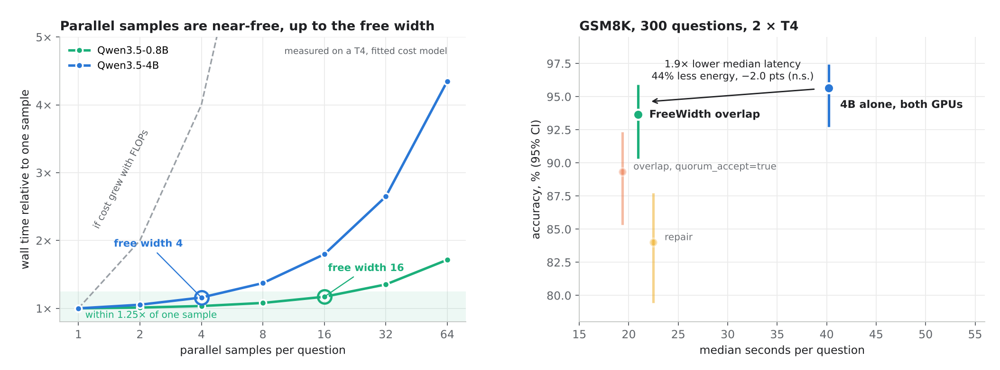
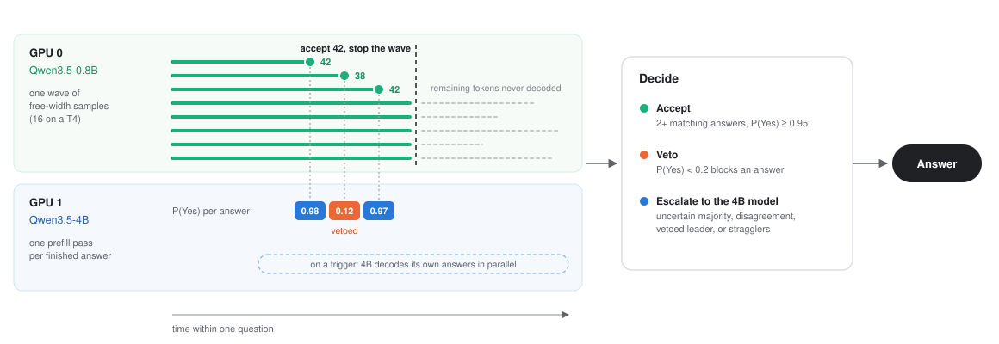
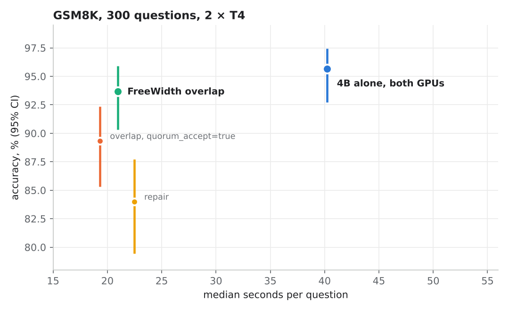

<a id="top"></a>

<div align="center">

# FreeWidth

**Hardware-aware test-time compute for small language models.**<br>
Measure how many parallel samples your GPU gives you for free, then spend them well.

[](https://github.com/Tejascodz/freewidth/actions/workflows/ci.yml)
[](https://github.com/Tejascodz/freewidth/actions/workflows/security.yml)


[Quickstart](#quickstart) · [How it works](#how-it-works) · [Results](#results) · [Positioning](#positioning) · [Limitations](#limitations) · [Reproduce](#reproducing-the-results)



</div>

<table>
<tr>
<td align="center" width="33%"><h2>1.9×</h2>lower median latency<br><sub>20.9 s vs 40.2 s per question</sub></td>
<td align="center" width="33%"><h2>44%</h2>less energy per question<br><sub>3.2 kJ vs 5.7 kJ</sub></td>
<td align="center" width="33%"><h2>−2.0 pts</h2>accuracy, not significant<br><sub>93.7% vs 95.7%, Holm p = 0.21</sub></td>
</tr>
</table>

<sub>FreeWidth `overlap` (Qwen3.5-0.8B with Qwen3.5-4B checking) against Qwen3.5-4B alone on both GPUs. GSM8K, 300 questions, 2 × NVIDIA T4. The accuracy gap is not significant, which is not proof of equivalence (95% CI −4.7 to +0.7 points). The two runs were measured in separate sessions; a same-session confirmation is planned. The 90th-percentile latency is worse for `overlap` (74.6 s vs 62.0 s).</sub>

## Overview

On a single-user GPU, small-batch decoding is limited mostly by memory bandwidth and kernel launches, not by arithmetic. Generating several answers in parallel therefore costs almost the same wall time as generating one, up to a limit set by the model and the device. FreeWidth measures that limit, the **free width**, and builds a small-to-large model ladder around it:

- **Wide sampling.** The small model samples a wave of answers in parallel, sized to the measured free width.
- **Early stopping.** The wave stops as soon as the finished answers settle, and unfinished rows are cut.
- **Live checking.** A larger model on a second GPU scores each answer with one forward pass as it finishes. It accepts the answer, vetoes it, or starts writing its own.

It ships as an OpenAI-compatible server, a calibration tool, a live benchmark and a statistics reporter, with 1-GPU and 2-GPU configurations. Every result in this README comes from pre-registered experiments on free Kaggle GPUs, with the raw per-question rows committed.

---

## Quickstart

```bash
git clone https://github.com/Tejascodz/freewidth && cd freewidth
pip install -r requirements-dev.txt
make lint test                                        # no GPU needed: tests run on a simulated device

# OpenAI-compatible server on the simulated device
python -m freewidth serve --config configs/engine_mock.yaml
curl localhost:8000/v1/chat/completions -H 'Content-Type: application/json' \
  -d '{"messages":[{"role":"user","content":"What is 17 * 23?"}]}'
```

On GPUs (`pip install -r requirements-gpu.txt`):

| task | command |
|---|---|
| Measure your GPU's free width | `python -m freewidth calibrate --config configs/engine_t4.yaml` |
| Serve on two GPUs | `FREEWIDTH_API_KEY=$(openssl rand -hex 32) python -m freewidth serve --config configs/engine_t4.yaml` |
| Benchmark policies live | `python -m freewidth bench --config configs/engine_t4.yaml --dataset gsm8k --limit 300 --policies overlap,big_sc2 --max-hours 5` |
| Statistics for any runs | `python -m freewidth report <run dir> [<run dir> ...] --out <dir> --primary a:b` |
| Free-width sweep across models | `python -m freewidth atlas collect --config configs/atlas_t4.yaml --device cuda:0` |
| Docker | `docker run --gpus all -p 127.0.0.1:8000:8000 -e FREEWIDTH_API_KEY=... freewidth` |

The policy can be chosen per request with the OpenAI SDK:

```python
from openai import OpenAI
client = OpenAI(base_url="http://localhost:8000/v1", api_key=KEY)
client.chat.completions.create(model="freewidth", messages=[{"role": "user", "content": "What is 17 * 23?"}],
                               extra_body={"freewidth": {"name": "overlap"}})
```

---

## How it works

### Free width

For a wave of *w* parallel samples with prompt length *P* and *L* generated tokens, wall time on one device is fitted as

```
T(w, L, P) = e + d·w·P + a·L + b·w·L + g·w·(L·P + L(L+1)/2)
```

by non-negative least squares over timed, forced-length decodes.
- **Grid:** widths 1–32 × generation lengths {1, 32, 128} × prompt lengths {128, 512}.
- **Measurement:** a warm-up pass per shape, then 2 repeats.
- **Quality check:** calibration repeats automatically if R² < 0.97.

The **free width** is the largest *w* with `T(w) ≤ 1.25 · T(1)` at the deployment's typical lengths. Energy is fitted the same way from NVML counters.

| model (NVIDIA T4, fp16, transformers) | architecture | free width | in-sample R² |
|---|---|---|---|
| Qwen3.5-0.8B | hybrid (Gated DeltaNet + attention) | **16** | 0.997–0.998 |
| Qwen3.5-4B | hybrid (Gated DeltaNet + attention) | **4** | 0.997–0.998 |

The same free widths were measured in every calibration session.

<p align="center"></p>

*Figure 1.* Wave time relative to a single sample. Under a FLOP-proportional model, 16 samples cost 16×. On a T4 they cost about 1.2× for the 0.8B model. Within the free width, self-consistency costs at most 1.25× one sample's latency; beyond it, cost grows close to linearly.

### The `overlap` ladder

<p align="center"></p>

*Figure 2.* One question under `overlap`. The small model's sampling and the large model's checking run at the same time on separate GPUs. In this example the second answer is vetoed, the third matches the first, and the wave stops before the remaining rows finish.

| rule | condition | action |
|---|---|---|
| verified accept | an answer has ≥ 2 votes and the large model's P(Yes) ≥ 0.95 | accept |
| uncertain majority | a majority forms and the large model's P(Yes) is between 0.2 and 0.95 | start the large model |
| veto | the leading answer's best P(Yes) < 0.2 | block it; start the large model |
| disagreement | ≥ 4 answers finished and no clear leader (`p_lead` < 0.6) | start the large model early |
| straggler cut | ≥ 4 answers finished and a row runs past 2 × their median length | cut it |

If the small model reaches a verified answer after the large model has started, the large model's run is cancelled.

**One-pass verification.** The large model never decodes to check an answer. The candidate is shown as a proposed solution in a grading prompt, and one forward pass gives `P(Yes) = p(Yes) / (p(Yes) + p(No))` over the next token, summed over the tokenizer's Yes/No variants (as in GenRM).

**QuorumStop.** Each time a row of the small model's wave finishes, the probability that the current leader is the true majority is computed with Adaptive-Consistency's rule:

```
p_lead = P(θ > 0.5),  θ ~ Beta(n₁ + 1, n₂ + 1)
```

Here *n₁* and *n₂* are the votes of the two most common answers.
- **When it stops.** When `p_lead ≥ 0.9`, the whole wave stops, and unfinished rows are cut and do not vote. The earliest possible stop is three agreeing rows (0.9375).
- **Implementation.** It runs as a `transformers` `StoppingCriteria`, so the saving is real wall time.
- **What the score means.** `p_lead` is a stopping score, not a calibrated probability: rows finish shortest-first, so the finished votes are not independent draws.

### Policies

| policy | description | status |
|---|---|---|
| `overlap` | the two-GPU ladder above | recommended for latency and energy |
| `big_sc2` | the large model alone on every GPU (4 + 4 samples at its free width), one shared QuorumStop | recommended for worst-case accuracy and p90 latency |
| `freewidth` | sequential ladder: small-model waves, then one-pass verification, then the large model | baseline |
| `repair` | Read-Locate-Fork: one large-model pass locates the first flawed token, the large model writes that token, the small model resamples from it | experimental, not recommended (see Results) |
| `big_sc`, `sc`, `hwave`, `single` | large model on one GPU; self-consistency; free-width waves without verification; one sample | baselines |

Full engine and API reference: [Appendix B](#appendix-b).

---

## Results

### Setup

| item | setting |
|---|---|
| Hardware | Kaggle, 2 × NVIDIA T4 (16 GB), free tier |
| Models | Qwen3.5-0.8B (GPU 0) and Qwen3.5-4B (GPU 1), fp16, non-thinking mode |
| Data | GSM8K test, 300 questions (fixed sample, seed 0) |
| Decoding | temperature 0.7, top-p 1.0, at most 1,024 new tokens |
| Metrics | accuracy; seconds per question (mean, median, p90); GPU energy per question (NVML); share of questions where the large model decoded |
| Statistics | Wilson 95% intervals; exact McNemar tests on paired questions with Holm correction within each pre-registered family; paired bootstrap 95% intervals (10,000 resamples, fixed seed); McNemar power analysis for sample size |

Comparisons, sample sizes and pass/fail criteria were committed before each run ([Appendix A](#appendix-a)). Every number is produced by `python -m freewidth report` from the per-question rows committed in [`results/`](results).

### Main results

| policy | accuracy (95% CI) | mean s | median s | p90 s | energy (kJ) | large model decoded |
|---|---|---|---|---|---|---|
| `big_sc2` (4B alone, both GPUs) | **95.7%** (92.7–97.5) | 43.4 | 40.2 | **62.0** | 5.71 | 100% |
| **`overlap`** | 93.7% (90.3–95.9) | **37.2** | 20.9 | 74.6 | 3.19 | 43% |
| `overlap`, `quorum_accept: true` (ablation) | 89.3% (85.3–92.3) | 34.5 | **19.3** | 73.9 | **2.85** | 34% |
| `repair` | 84.0% (79.4–87.7) | 60.0 | 22.5 | 185.2 | 3.97 | 14% |

<p align="center"></p>

*Figure 3.* Accuracy (Wilson 95% interval) against median latency. `overlap` (default) was measured in a separate session from the other three, on the same questions with the same seeds.

### Pre-registered comparisons

| comparison (A → B) | B better / worse | Holm p | Δ accuracy, points (95% CI) | Δ mean s (95% CI) | criterion | outcome |
|---|---|---|---|---|---|---|
| `big_sc2` → `overlap` | 5 / 11 | 0.21 | −2.0 (−4.7, +0.7) | −6.2 (−9.3, −3.1) | faster and not significantly less accurate | **met** |
| `overlap` (`quorum_accept: true`) → `overlap` | 14 / 1 | 0.002 | +4.3 (+2.0, +7.0) | +2.8 (+1.3, +4.3) | more accurate | **met** |
| `big_sc2` → `overlap` (`quorum_accept: true`) | 4 / 23 | 6×10⁻⁴ | −6.3 (−9.7, −3.0) | −9.0 (−12.0, −6.0) | faster and not significantly less accurate | not met |
| `overlap` (`quorum_accept: true`) → `repair` | 7 / 23 | 0.005 | −5.3 (−9.0, −2.0) | +25.6 (+20.1, +31.1) | not significantly less accurate | not met |

### What drives accuracy: the acceptance rule

The only difference between `overlap` and its ablation is how it handles a small-model majority that the large model checked and was unsure about (0.2 ≤ P(Yes) < 0.95):

| | accepted on the uncertain majority | escalated to the large model |
|---|---|---|
| the 28 questions where this happens | 13 correct, 19 s mean | 27 correct, 57 s mean |
| the other 272 questions | 255 correct | 254 correct; same answer on 271 |

Escalating instead of accepting recovers almost the whole gap to the large model, for 2.8 s of extra mean latency. The other questions are unaffected, which also shows that the policy is repeatable across sessions.

**Where the remaining errors are.** All 11 questions that `big_sc2` answers correctly and `overlap` does not are *verified accepts*: the large model gave a wrong small-model answer P(Yes) ≥ 0.95. The verifier's confident mistakes, not the scheduling, now limit accuracy.

**`repair`.** The fork step succeeded on 7 of 50 attempts (all 7 correct). The other 43 fell back to a full large-model decode, at 205 s mean. Most of `repair`'s answers come from the small-model quorum (83.5% accurate on 224 questions), which is the weak acceptance path above.

### Verifier framing

How the candidate is presented to the verifier changes its score far more than any threshold does. On the same candidates:

| framing | median P(Yes) | accuracy of verified accepts |
|---|---|---|
| the candidate placed in the verifier's own assistant turn ("is your solution correct?") | 0.99 | 42% |
| the candidate shown as a proposed solution in a grading prompt (used by FreeWidth) | 0.10 | 73% |

- **Direction.** This matches the self-attribution bias reported by Khullar et al. (2026) and the self-correction blind spot reported by Tsui (2025).
- **Confound.** The two framings also differ in wording, so the effect is not yet attributed to placement alone.
- **Conflict with prior work.** Khullar et al. found the effect weak when the text came from a different model, which is the case here.

### Hypotheses

| id | hypothesis | status |
|---|---|---|
| — | Free width is stable and measurable on a given device | supported (one GPU type, two models) |
| H9 | The large model is better used as a reader than a writer | refuted for `quorum_accept: true` (−6.3 points) |
| H10 | Escalating uncertain majorities closes the accuracy gap | supported (−2.0 points, n.s.); same-session confirmation planned |
| H8 | Read-Locate-Fork replaces large-model writing | refuted |
| H11–H15 | Free-width atlas across models, formats and GPUs | planned ([Appendix A](#appendix-a)) |
| H1–H5 | Offline cost-model and strategy hypotheses | planned ([Appendix C](#appendix-c)) |

**Practical guidance (two T4-class GPUs):**
- Use `overlap` for about half the median latency and 44% less energy, at an accuracy within 2 points of the large model.
- Use `big_sc2` when worst-case accuracy and p90 latency matter most.

---

## Positioning

A literature review covering about 90 papers (November 2026) found prior work for every component. FreeWidth is an integration and measurement study, not a new algorithm family.

| component | assessment | closest prior work |
|---|---|---|
| Free width and the fitted latency model, used to size waves | engineering variant; applying the criterion to independent samples with live sizing is distinct in a narrow sense | He et al. 2026 (same criterion, for decode positions per forward pass); EdgeReasoning and SLIM (fitted latency models); Kinetics |
| Free-width measurements for hybrid Gated-DeltaNet models on consumer GPUs | no published batch-latency measurements found | He et al.; NeuSight; KernelSight-LM |
| QuorumStop | engineering variant | DUCHESS; short-m@k; Adaptive-Consistency |
| `overlap` (two GPUs, streaming one-pass verification, veto, speculative start and cancel) | engineering variant; the concurrent two-GPU schedule was not found published | ATTS; SpecReason; FastTTS; streaming MSV; GenRM |
| Read-Locate-Fork | not new; a negative result | speculative-decoding verification; decision-token correction; StepBack |
| Verifier framing effect | known direction; this data point is confounded | Khullar et al. 2026; Tsui 2025 |
| Pre-registered evaluation with exact paired tests | established methods, uncommon in this area | Miller 2024; van Miltenburg et al. 2021 |
| Resource-aware test-time scaling overall | distinct as an integration only | ATEST 2026; EdgeReasoning; mobile-NPU TTS |

**Contribution.**
- **Free width.** FreeWidth applies the near-free-parallelism criterion of He et al. (2026) to the independent self-consistency samples of one question. It fits a per-device latency model and uses that fit at run time to size sampling waves.
- **New measurements.** It reports width–latency curves for hybrid Gated-DeltaNet models on a consumer GPU.
- **The `overlap` schedule.** It composes known components (one-pass P(Yes) verification, small-to-large cascades, asynchronous verification, straggler-driven speculation) into a concurrent two-GPU schedule. That schedule is evaluated end to end, with energy measured, under pre-registered criteria.

**Baselines not yet run.**

| component | missing baselines |
|---|---|
| QuorumStop | short-m@k at matched width; a fixed-quorum stop (DUCHESS style); an online energy-aware stopper (ATEST style) |
| `overlap` | a sequential cascade (mixture-of-thought style); a sequential judge (SpecReason style); the same policy on one GPU |
| Free width | an ε sweep (0.10–0.30); CUDA graphs or `torch.compile` vs eager mode |
| Verifier framing | placement-only and wording-only ablations |

Related work in detail: [Appendix E](#appendix-e).

---

## Limitations

**Scope**
- One GPU type (T4), one model family (Qwen3.5) and one dataset with numeric answers (GSM8K).
- Planned experiments cover MATH-500, a second model pair, a P100 and a dense-model control ([Appendix A](#appendix-a)).

**Serving stack**
- Timings use transformers' static-batch `generate`, not a paged-attention server (vLLM, SGLang). Free widths and absolute latencies will differ there.
- In eager mode, a fixed kernel-launch overhead per step probably raises the free width of small models.

**Concurrency**
- `overlap` and `big_sc2` drive both GPUs from Python threads in one process.
- On identical questions, `big_sc2` had a higher median latency than the large model on one GPU (40.3 s vs 31.0 s); interpreter-lock contention is the likely cause.
- A process-per-GPU baseline would make the large model faster than reported here.

**Cross-session comparison**
- `overlap` and `big_sc2` in the main table come from different Kaggle sessions on identical hardware, questions and seeds.
- Across sessions, `overlap` gave identical answers on 271 of 272 unaffected questions, but a same-session run is planned before treating the comparison as confirmed.

**Statistics**
- "Not significantly less accurate" is not equivalence. Detecting a 2-point difference with 80% power would need about 1,000 questions.

**Energy**
- NVML energy covers the GPUs a policy used. Idle GPUs are not charged, which favours one-GPU policies.

**Cost model**
- The quadratic attention term assumes every layer uses full attention. In the hybrid models only about a quarter of the layers do; the Gated-DeltaNet layers keep a fixed-size state per sample.
- The fit is accurate in-sample. Held-out accuracy is tested in the atlas experiment (H15).

**Verifier**
- All verifier results are specific to the prompt templates in the code.

---

## Reproducing the results

Everything runs on free compute. The per-question rows and generated reports for every run are in [`results/`](results).

```bash
# recompute the statistics in Results from the committed rows
python -m freewidth report results/t4_gsm8k_E1_2026-11-16 results/t4_gsm8k_H10 --out /tmp/stats \
    --ladder q35-0.8b,q35-4b \
    --primary "big_sc2:overlap@t4_gsm8k_H10,overlap@t4_gsm8k_E1_2026-11-16:overlap@t4_gsm8k_H10"
python scripts/make_figures.py                       # Figure 3
```

**On Kaggle** (GPU T4 x2, internet on), clone the repository in a notebook cell and run one script per session:

| experiment | script | GPU time |
|---|---|---|
| `overlap`, `big_sc2`, `repair` on 300 questions | `bash scripts/kaggle_final.sh` | about 11.8 h |
| `overlap` alone on 300 questions | `bash scripts/kaggle_h10.sh` | about 3.5 h |
| free-width sweep (T4) | `bash scripts/kaggle_atlas_t4.sh` | about 2–2.5 h |
| free-width sweep (P100) | `bash scripts/kaggle_atlas_p100.sh` | about 1 h |
| any configuration | `CONFIG=... DATASET=... POLICIES=... bash scripts/kaggle_experiment.sh` | varies |

Each script calibrates the device first. It stops starting new questions before Kaggle's session limit, writes every finished question to disk immediately, and builds the statistics report at the end.

---

## Engineering

**Security** (threat model in [SECURITY.md](SECURITY.md)):
- **Exposure:** the server binds to loopback by default and refuses to serve without authentication on any other interface.
- **Authentication:** Bearer token, compared in constant time.
- **Request limits:** body size, messages, prompt length, samples, waves and new tokens are capped; there is an optional policy allow-list, a bounded queue (503) and a per-request deadline (504).
- **Information exposure:** a liveness probe is the only public endpoint; API docs are disabled; errors carry no internal details.
- **Model loading:** `trust_remote_code` is off, with optional pinning to a Hub revision.
- **Remote backends:** never send credentials over plain HTTP.
- **Container:** the Docker image runs as a non-root user.

**Testing and CI:**
- **Simulated device:** about 110 tests cover controller logic, policies, statistics, server security and limits, configs, and end-to-end runs of the Kaggle scripts with GPU tools stubbed.
- **Real model path:** the `transformers` backend is tested on a tiny model on CPU.
- **CI:** runs on Python 3.10–3.12 with SHA-pinned Actions and read-only permissions.
- **Security scanning:** bandit, pip-audit, detect-secrets and CodeQL run on every push and weekly. Dependabot is enabled.

---

## Appendices

<a id="appendix-a"></a>

### Appendix A. Experiment protocol

<details>
<summary>Show</summary>

For every experiment, the primary comparisons, the sample size and the pass/fail criteria are committed to this file before it runs, so the commit history shows that the plan came first.

**Rules**
- **Claims rest only on primary comparisons.** Holm correction is applied within the primary family (`freewidth report --primary ...`).
- **Everything else is exploratory.** It is corrected as its own family and reported as a lead, not a finding.
- **A failed criterion is reported as a failure.**
- **Sample sizes come from McNemar power estimates** (80% power, α = 0.05) using observed discordance rates.
- **All runs use free compute** (Kaggle T4 x2 or P100) and open-weight models.

#### Experiments

| id | question | setting | status | data |
|---|---|---|---|---|
| E1 | `overlap` (`quorum_accept: true`) and `repair` vs the large model on both GPUs | T4 x2, GSM8K, 300 q | completed | `results/t4_gsm8k_E1_2026-11-16/` |
| E1b | `overlap` (escalating uncertain majorities, H10) vs the same baselines | T4 x2, GSM8K, 300 q | completed | `results/t4_gsm8k_H10/` |
| E1c | `overlap` and `big_sc2` in the same session, with `big_sc` on one GPU as a control | T4 x2, GSM8K, 300 q | planned | — |
| E2 | does the result hold on harder problems | T4 x2, MATH-500, 200 q | planned | — |
| E3 | does it hold for another model pair | T4 x2, Qwen3.5-2B → 4B, GSM8K, 300 q | planned | — |
| E4 | does the strategy ranking change with the hardware | P100, GSM8K, 300 q | planned | — |
| E5 | does a dense model family change the trade-off | T4 x2, Qwen3 0.6B → 4B, GSM8K, 300 q | planned | — |
| E6 | free-width atlas across models, formats and GPUs (H11–H15) | T4 x2 and P100, 10 + 3 settings, calibration only | planned | — |

Raw rows from two earlier 100-question runs are also kept in `results/`.

#### E1c: same-session confirmation

**Run.**
```bash
CONFIG=configs/engine_t4.yaml POLICIES=overlap,big_sc2,big_sc \
  PRIMARY=big_sc2:overlap bash scripts/kaggle_experiment.sh
```
- **Primary:** `overlap` vs `big_sc2`, with the same criteria as E1b.
- **Exploratory:** `big_sc2` vs `big_sc`, which measures the cost of driving two GPUs from one process.
- **Time:** about 9–10 GPU hours. If the session limit is reached first, `big_sc` is the one left incomplete.

#### E2: MATH-500

**Run.**
```bash
CONFIG=configs/engine_t4_math.yaml DATASET=math500 LIMIT=200 \
  POLICIES=overlap,big_sc2 PRIMARY=overlap:big_sc2 bash scripts/kaggle_experiment.sh
```
Answers are graded with math-verify. `max_new_tokens` is 2048, with its own calibration, because free width depends on the generation length.

**Primary.** `overlap` vs `big_sc2`: `overlap` is faster (95% interval of the mean-time difference below 0) and not significantly less accurate (Holm p ≥ 0.05).

**Secondary.** Results by MATH level (1–5). We expect the gap to grow with difficulty, but this is exploratory.

**Size.** 200 questions keeps the run under 12 h. With an expected accuracy gap below 5 points, E2 is reported as a latency comparison with an accuracy confidence interval, not an accuracy claim.

#### E3: second model pair

**Run.**
```bash
CONFIG=configs/engine_t4_2b.yaml POLICIES=overlap,big_sc2,freewidth \
  PRIMARY=overlap:big_sc2,overlap:freewidth bash scripts/kaggle_experiment.sh
```
**Primary.** As in E2, plus `overlap` vs `freewidth` (`overlap` more accurate, Holm p < 0.05).

**Note.** The 2B and the replica 4B on GPU 0 need about 14 GB. If the replica does not fit, `big_sc2` runs on one GPU and the run notes say so. In that case the fair-baseline comparison is **not** claimed for this pair.

#### E4: different hardware (P100)

**Run.**
```bash
CONFIG=configs/engine_p100.yaml POLICIES=freewidth,big_sc,sc \
  PRIMARY=freewidth:big_sc bash scripts/kaggle_experiment.sh
```
**Claim (hardware-conditional ranking).**
- The measured free widths differ from the T4's.
- The ordering of `freewidth` vs `big_sc` by mean seconds at matched accuracy differs from the T4 ordering.

*Fail if* the free widths and the ordering both match the T4. In that case the ranking is not claimed to depend on hardware.

**Risk.** Qwen3.5's linear-attention kernels may not run on the P100's sm_60 architecture. If calibration falls back to the slow path, switch to the dense pair as described in the config header, and report it.

#### E5: dense control (H2)

**Run.**
```bash
CONFIG=configs/engine_t4_dense.yaml POLICIES=overlap,big_sc2,freewidth \
  PRIMARY=overlap:big_sc2 bash scripts/kaggle_experiment.sh
```
**Claim.** Free widths and the overlap vs big-model trade-off differ between hybrid Qwen3.5 and dense Qwen3 at similar sizes. This is reported descriptively, since model families also differ in accuracy.

#### E6: free-width atlas (H11–H15)

**Motivation.**
- Near-free parallelism (He et al. 2026) and batch-saturation studies (*Mind the Memory Gap* 2025) establish the latency criterion. They show that roofline estimates over-predict it, and explain the boundary by idle compute, kernel granularity and CPU overhead.
- They study decode positions per forward pass, or serving batches, on datacenter GPUs with vLLM and SGLang, with dense and MoE models.
- E6 asks whether their conclusions hold on the **sample axis** of test-time scaling, for **hybrid Gated-DeltaNet** models, on **consumer GPUs**, with the transformers stack. Since these are replications and extensions, a failure to replicate is reported as such.

**Run.** Calibration only; no benchmark questions.

| | T4 x2 (`configs/atlas_t4.yaml`) | P100 (`configs/atlas_p100.yaml`) |
|---|---|---|
| fp16, hybrid | Qwen3.5 0.8B, 2B, 4B | — (kernel support uncertain on sm_60) |
| fp16, dense | Qwen3 0.6B, 1.7B, 4B | Qwen3 0.6B, 1.7B, 4B |
| 4-bit NF4 | Qwen3.5 0.8B, 4B, 9B; Qwen3 8B | — |

- **Grid:** widths 1–64 (doubling), generation lengths {1, 32, 128}, prompt lengths {128, 512}, 2 repeats each.
- **Operating points (L, P):** (32, 128), (128, 128), (128, 512).
- **Measured free width:** the largest measured width whose mean time is within 1.25× of a single sample. When the widest measured width still qualifies, the value is flagged as censored (a lower bound).
- **Sharding:** one process per GPU, so there is no shared Python interpreter.

**Hypotheses and criteria.**
- **H11 (replication: the roofline over-predicts).** A weights-only roofline predicts a free width of (1 + ε) · peak FLOP/s · bytes per parameter / (2 · bandwidth), about 254 for fp16 on a T4, independent of model size.
  - *Supported* if the roofline over-predicts the measured free width by at least 4× in every T4 fp16 measurement.
  - *Refuted* if the median over-prediction is below 2×.
- **H12 (free width falls with model size).** Within each group of the same GPU, architecture, format and operating point that has 3 or more models, the Spearman correlation between weight bytes and free width is negative.
  - *Supported* if it is negative in at least 80% of groups.
  - *Refuted* if it is negative in 50% or fewer.
  - A size dependence would contradict the size-independent idle-compute term for dense FFNs, and point to attention, recurrent state or per-step overhead as the binding limit.
- **H13 (predictability, exploratory).** A ridge regression on setting features, evaluated leave-one-model-out (fp16 and 4-bit versions of a model are held out together), reaches a mean absolute error of at most 0.5 in log2 units and beats both the roofline and the median baseline. It is reported regardless of outcome. With only 2 GPU types, leave-one-GPU-out results are descriptive only.
- **H15 (the cost model predicts unmeasured widths).** For each setting, the curve is fitted on widths ≤ 16 and used to predict the measured times at widths 32 and 64.
  - *Supported* if the median absolute percentage error over settings is at most 15%, and the free width from the full fit equals the directly measured free width (within one doubling) in at least 80% of measurements.
  - *Refuted* if the median error exceeds 30%.
  - Settings that ran out of memory before width 32 are excluded and counted.
- **H14 (hybrid vs dense).** At matched size (0.8B vs 0.6B, 2B vs 1.7B, 4B vs 4B) and P = 512, the hybrid model's free width is at least the dense model's in all 3 pairs, and strictly greater in at least 2. The reasoning: Gated-DeltaNet layers keep a fixed-size state instead of a growing KV cache, so per-sample cost should rise more slowly with width.

**Pilot first.** `scripts/kaggle_atlas_t4.sh` with `CONFIG=configs/atlas_t4_pilot.yaml` measures 4 of the 10 T4 settings (Qwen3.5 0.8B and 4B, Qwen3 0.6B and 4B, fp16) in about 1 h. The full run later reuses the same output folder and skips settings already measured. No hypothesis is evaluated on the pilot alone.

**Analysis.** `python -m freewidth atlas analyze <runs> --out <dir>` writes:
- `ATLAS.md` (all measurements, H11–H13 and H15 tables);
- `atlas_summary.json`;
- `atlas.png` (free width vs model size, with the roofline).

H14 is read from the measurement table.

#### Budget

| id | approx. GPU hours |
|---|---|
| E1c | 9–10 |
| E2 | 8–10 |
| E3 | 8 |
| E4 | 6 |
| E5 | 8 |
| E6 | 2.5 (T4) + 1 (P100) |

Kaggle's free tier gives about 30 GPU hours a week.

</details>

<a id="appendix-b"></a>

### Appendix B. Engine and server reference

<details>
<summary>Show</summary>

The research pipeline (`profile → bank → verify → analyze`) studies strategies offline. The engine runs the same ideas **live**, on a ladder of local models, request by request.

#### How a request is answered (policy `freewidth`)

```
question
  │
  ▼
small model: wave of w = free width samples ──► QuorumStop inside the wave
  │   rows finish at different times; once the finished rows agree
  │   (Beta posterior ≥ tau) the wave stops and still-running rows are cut
  │
  ├─ confident? ──► answer (shortest chain that supports the winning answer)
  │
  ├─ up to max_waves waves, votes pooled across waves
  │
  ▼ still unsure
big model: ONE forward pass over the top candidates, P(Yes | "is this correct?")
  │
  ├─ best candidate (vote share + P(Yes)) has P(Yes) ≥ verify_accept ──► answer
  │
  ▼ rejected
big model decodes its own waves (same QuorumStop) ──► answer
```

##### Policy `overlap` (two-device ladder)

`freewidth` is a sequential cascade: the big model only works after the small model has given up. `overlap` puts the second GPU to work while the small model is still decoding:

```
GPU 0 (small)  ── wave of free width ─────────────┬── answer (big model run cancelled)
                 │ row finishes ─► queue           │
GPU 1 (big)      ├─► prefill P(Yes) per row ───────┘  streaming verification
                 └─► failure signal ─► big model starts decoding NOW (speculative escalation)
```

- **Streaming verification.** Each finished small-model row is scored by the big model at once, overlapping with the remaining decode.
- **Veto.** A small-model majority is not accepted if the big model scores all of its chains below `veto_lo` (0.2). This targets confident-but-wrong majorities.
- **Verified accept.** An answer with at least 2 votes and a big-model score ≥ `accept_hi` (0.95) is accepted.
- **Uncertain majority.** A majority the big model has checked but is unsure about (`veto_lo` ≤ P(Yes) < `accept_hi`) is escalated, not accepted. `quorum_accept: true` accepts it instead; that setting is 4.3 points less accurate (see [Results](#results)).
- **Speculative escalation.** The big model starts decoding as soon as the wave signals failure: the finished rows disagree (`trigger_lead_prob`), the lead answer is vetoed, or stragglers outlive the finished rows by `runaway_factor`. If the small model then accepts, the big model's run is cancelled.
- **Straggler cut.** Rows still running beyond `runaway_factor` × the median finished length stop and do not vote.

It needs two ladder models, ideally on different GPUs (the default T4 config). On a single GPU it still runs, but the two models compete for the device. `wall_seconds` reports the overlapped end-to-end time, and `notes` records the trigger, the accept reason, verified rows and cut rows.

##### Policy `repair` (Read-Locate-Fork, experimental)

The big model reads once and writes at most one token:

1. **Read.** The small model's candidate is shown to the big model as a third-party proposed solution in a grading prompt ("Is the final answer of the proposed solution correct?"). One forward pass gives the verdict, P(Yes), and the big model's next-token distribution at every solution token.
2. **Locate.** The flaw is the first solution token (after a short warm-up) that the big model rates below `flaw_p` (0.05) while preferring another token with at least `flaw_conf` (0.5).
3. **Fork.** The big model's token replaces the small model's at the flaw. The small model continues from there in a full free-width batch with QuorumStop, and the samples vote.
4. **Accept or escalate.** A verified candidate (P(Yes) ≥ `accept_hi`) is accepted without repair. A repaired answer is accepted if its batch reaches a quorum and the big model does not veto it. Otherwise the big model decodes as a last resort.

It needs both models to share a tokenizer (one model family); otherwise it falls back to verification and escalation. `notes` records `repaired_from`, `flaw_token`, `repair_failed` and the accept reason.

**Closest prior work:**
- **StepBack (2026):** first-error localization plus suffix resampling, using the same model or an external scorer.
- **Shen et al. 2026:** a few decision tokens carry the gap between a base model and a reasoning model.
- **SpecAgent (2026):** the strong model prefill-verifies a weak draft and repairs the first rejected step itself.

Here the verdict and the location come from the same pass, the strong model writes one token, and the repair is a parallel free-width batch of the weak model. In evaluation it was less accurate and slower than `overlap` (see [Results](#results)), so it is not recommended.

##### Baselines `big_sc` and `big_sc2`

`big_sc`: `sc_n` samples from the **largest** ladder model in one batch on its own device, with a majority vote. Other devices stay idle.

`big_sc2` is the fair "just run the big model on all the GPUs" baseline. The largest model is also loaded on every device in its `replica_devices` list, the first time the policy is used:

```yaml
- {tag: q35-4b, backend: hf, model_id: Qwen/Qwen3.5-4B, device: "cuda:1", dtype: float16,
   replica_devices: ["cuda:0"]}
```

- **Data-parallel waves.** The `sc_n` samples are split evenly over the copies (8 over 2 GPUs = 4 each, the 4B's free width on a T4), and all waves run at the same time.
- **One shared QuorumStop.** The waves pool their votes in a `SharedQuorum`, so every device stops as soon as the pooled votes are confident. `quorum: false` turns this off.
- **Degrades instead of failing.**
  - A replica that fails to load (for example, out of memory next to the small model) is skipped. The policy runs on the devices that did load, and the error appears in `/v1/info` and in the request's `notes`.
  - A replica that runs out of memory mid-request has its share rerun on the primary.
- **Timing.** The reported time is the real wall-clock of the parallel waves. Energy is the sum over all devices used.

Other policies, chosen per request with `freewidth.name`:

| policy | behaviour |
|---|---|
| `single` | one sample from the first model |
| `sc` | `sc_n` parallel samples, majority vote |
| `hwave` | free-width waves with QuorumStop, escalate by decoding (no verification) |
| `freewidth` | `hwave` plus prefill verification before every escalation (default) |
| `overlap` | two-device ladder: streaming verification, veto, verified accept, speculative escalation, straggler cut |
| `repair` | Read-Locate-Fork: one big-model pass gives verdict + flaw; one-token correction; free-width small-model repair batch |
| `big_sc` | baseline: vote over `sc_n` samples of the largest model, one device |
| `big_sc2` | baseline: largest model on every device holding a copy, samples split evenly, one shared QuorumStop |

**Free width** is measured, not guessed. `calibrate` times forced-length decodes at several widths, fits the cost curve `T(w, L, P)`, and picks the widest wave that costs at most (1 + `eps`) times a single sample. The result is stored per model and per device in `calibration/<tag>/device_fit.json`. If the device name changes, the stored calibration is ignored and measured again.

#### Commands

```bash
python -m freewidth calibrate --config configs/engine_t4.yaml          # one-time per device
python -m freewidth solve     --config configs/engine_t4.yaml "question" [--policy hwave] [--json]
python -m freewidth serve     --config configs/engine_t4.yaml [--port 8000] [--log-json]
python -m freewidth bench     --config configs/engine_t4.yaml --dataset gsm8k --limit 100 \
                              --policies single,sc,hwave,freewidth --out runs/bench
```

`bench` measures every number live (wall seconds, NVML joules, tokens) and writes `BENCH.md`, `bench_summary.csv` and per-question `bench_rows.jsonl`. Use it to check the offline replay's predictions on real hardware.

#### HTTP API

`POST /v1/chat/completions` is OpenAI-compatible:

```json
{
  "model": "freewidth",
  "messages": [{"role": "user", "content": "What is 17 * 23?"}],
  "temperature": 0.7,
  "max_tokens": 1024,
  "seed": 1,
  "freewidth": {"name": "freewidth", "tau": 0.9, "max_waves": 2, "verify": true}
}
```

The response has the standard `choices` and `usage`, plus a `freewidth` object:

```json
"freewidth": {
  "request_id": "…", "policy": "freewidth", "answer": "391", "confidence": 0.94,
  "model": "q35-0.8b", "escalated": false, "verified": false, "free_form": false,
  "waves": [{"model": "q35-0.8b", "width": 16, "finished": 9, "cut": 7, "tokens": 3120,
             "seconds": 4.1, "joules": 290.5, "quorum_hit": true}],
  "verifications": [], "tokens": 3120, "seconds": 4.1, "joules": 290.5
}
```

`usage.completion_tokens` counts tokens across **all** samples, because that is the real compute spent.

Allowed `freewidth` keys: `name`, `tau`, `max_waves`, `quorum`, `min_finished`, `width`, `max_width`, `verify`, `verify_accept`, `top_c`, `sc_n`, `free_form_fallback`, `raw_prompt`, and for `overlap`: `veto_lo`, `accept_hi`, `require_verified`, `stream_verify`, `speculative`, `trigger_min_finished`, `trigger_lead_prob`, `runaway_factor`, `runaway_min_finished`, `verify_wait_s`, and for `repair`: `flaw_p`, `flaw_conf`. Values are validated, and server-side caps apply on top (`server.max_samples` for `sc_n`/`width`/`max_width`, `server.max_waves`, `server.max_new_tokens`, `server.allowed_policies`); anything else returns 400.

Other endpoints:

| endpoint | purpose |
|---|---|
| `GET /health` | liveness only (`{"status": "ok"}`); public, for load balancers and container probes |
| `GET /v1/info` | uptime, queue depth, version, ladder with devices, free widths and calibration R² (needs the API key) |
| `GET /v1/models` | the engine name plus every ladder tag |
| `GET /metrics` | needs the API key unless `server.public_metrics`. Prometheus text: requests, waves, quorum stops, escalations, verifications, tokens, joules, latency histogram, queue depth, free width per model |

`stream: true` is accepted for client compatibility. The whole answer arrives as one SSE chunk, because the answer is only known after voting.

#### Operations

- **Single tenant by design.** Requests run one at a time, because the engine owns the GPU and the free width assumes nothing else is running on it. Up to `server.max_queue` requests wait; beyond that the server returns `503` with `Retry-After`.
- **Deadlines.** Each request gets `server.request_timeout_s`. The engine checks the deadline before every wave and every verification pass and returns `504` once it is exceeded. A wave that has already started finishes first.
- **Auth.**
  - If the environment variable named by `server.api_key_env` (default `FREEWIDTH_API_KEY`) is set, every endpoint except `/health` needs `Authorization: Bearer <key>`. The key is compared in constant time.
  - The server binds to `127.0.0.1` by default. On any other address it refuses to start without a key, unless `server.allow_unauthenticated: true` or `--insecure-no-auth` is set.
- **Request limits.** These bound how much GPU time and memory one request can claim:
  - body size (`max_body_bytes`; POST requests must send `Content-Length`);
  - message count (`max_messages`) and prompt length (`max_prompt_chars`);
  - samples, waves and new tokens, as above.
- **Other hardening.**
  - `/docs` and `/openapi.json` are off unless `server.expose_docs` is set.
  - Responses carry `X-Content-Type-Options: nosniff` and `Cache-Control: no-store`.
  - Client-supplied request ids are accepted only if they match `[A-Za-z0-9._-]{1,64}`.
  - Errors return no internal details.
  - See [SECURITY.md](SECURITY.md).
- **Logs.** `--log-json` writes one JSON object per line. Every HTTP request and its solve share a `request_id`, which is also returned in the `x-request-id` header.
- **Docker.**
  - Build and run: `docker build -t freewidth . && docker run --gpus all -p 127.0.0.1:8000:8000 -e FREEWIDTH_API_KEY=<key> -v $PWD/calibration:/app/calibration freewidth`.
  - The image runs as a non-root user and listens on all interfaces inside the container, so it needs the key.
  - Mount `calibration/` so calibration survives restarts. Mount the Hugging Face cache at `/home/app/.cache/huggingface` to avoid re-downloading models.
- **Model provenance.**
  - Models load with `trust_remote_code` off, so no Python from a model repository runs.
  - Set `revision:` on a ladder entry to pin the exact Hub commit. Without it, the engine logs a warning at load.
- **Memory.** The default T4 config puts the small model on `cuda:0` and the big model on `cuda:1`. On one 16 GB GPU, 0.8B + 4B in fp16 fits, but keep `max_width` at 16–32 for 1k-token generations.

#### Limits

- **Checkable answers only.** The engine is built for questions with a checkable final answer (math, multiple choice, short factual answers): voting needs answers it can extract. For free-form prompts, `free_form_fallback` returns the most confident sample after the first wave and does not escalate.
- **No thinking-budget variants yet.** The research pipeline has them; the engine ladder does not.
- **Prompt-sensitive verification.** Prefill verification quality depends on the verifier prompt and model. Measure acceptance accuracy with `bench` before relying on it, and tune `verify_accept`.

</details>

<a id="appendix-c"></a>

### Appendix C. Offline research pipeline

<details>
<summary>Show</summary>

#### Hypotheses (each one can be falsified)

Hypotheses H1–H5 are tested by the offline pipeline; none has been run yet.

- **H1, regime flip.** Kendall tau(FLOPs, device seconds) is well below 1, the Pareto frontiers overlap little (Jaccard < 0.5), and the worst iso-accuracy overrun (FLOPs to device) is above 2×. *Refuted if* the frontiers match.
- **H2, hybrids weaken Kinetics.** The KV-penalty ratio (small model sampling wide vs. big model answering once, under eFLOPs) is lower for hybrid Qwen3.5 than for dense Qwen3 at similar sizes.
- **H3, QuorumStop.** At matched accuracy, `hwave(quorum=True)` costs fewer device seconds than both `short_mk` and full-wave voting, because wrong chains tend to be the long stragglers.
- **H4, prefill verification.** Under device seconds, `pverify` beats both self-consistency on the small model and decoding with the big model at matched accuracy. This reverses Singhi et al.'s FLOPs-based conclusion for a single-tenant device.
- **H5, wide beats long below the free width.** At equal device seconds, *w* ≤ free-width parallel non-thinking samples beat one thinking chain with a matching token budget.

#### Method

##### Three cost models (`freewidth/costs.py`)

For a sample with prompt length *P* and *L* generated tokens, using a model with active parameters *N*, *ℓ* full-attention layers, *h* heads and head dimension *d*:

- **FLOPs:** `2·N·L + 4·ℓ·h·d·Σ_t (P+t)`
- **eFLOPs (multi-tenant):** FLOPs `+ I · bytes(KV + recurrent state)`. *I* is the reference accelerator's arithmetic intensity (default 295 FLOP/byte for H100 BF16). Weight reads are excluded because they are amortised across tenants.
- **Device (single tenant, measured):** a wave of width *w* costs `T(w, L, P) = e + d·w·P + a·L + b·w·L + g·w·(L·P + L(L+1)/2)`. This is fitted with non-negative least squares on microbenchmarks. Energy (joules, via NVML) is fitted the same way. A verification pass is priced as `T(c, 1, P_v)`: one forward pass over *c* candidates plus one decoded token. **Free width** is the widest wave costing at most (1+ε) times one sample.

##### Pipeline

1. `profile`: times forced-length decodes over widths × generation lengths (including L = 1, which anchors prefill) × at least two prompt lengths, then fits `T` and the free width. Check that R² > 0.98.
2. `bank`: draws *K* samples per (model, question) in waves and stores answer, correctness, tokens, self-certainty, entropy and text. Resumable. Thinking-mode tags use budget forcing: when the budget runs out, the thinking block is closed and an answer is forced.
3. `verify`: for each (small, big) pair, the big model scores every stored small-model solution with P(Yes | "is the final answer correct?"). This is one batched forward pass with no decoding.
4. `analyze`: replays every strategy across many random sample orders, prices each trace under every cost model, and writes `results.csv`, `disagreement.json` (tau, Jaccard, budget winners, overruns, saturating fits), `figures/` and `REPORT.md`.
5. `compare`: places several runs side by side (hybrid vs. dense, T4 vs. Mac) for H2.

Device cost always comes from the profile fit, never from the bank's own wall-clock. That means a bank generated with vLLM can be priced with an HF profile.

##### Strategies (`freewidth/strategies.py`)

| family | type | description |
|---|---|---|
| `single` | baseline | one sample |
| `sc` | baseline | *n* parallel samples, majority vote (Wang et al. 2023) |
| `sc_seq` | baseline | the same *n* samples, one per round (identical FLOPs, different device cost) |
| `wvote` | baseline | Borda vote weighted by self-certainty (Kang et al. 2025) |
| `adaptive` | baseline | one sample at a time, Beta stopping (Aggarwal et al. 2023) |
| `short_mk` | baseline | *k* parallel; stop all rows when the first *m* finish (Hassid et al. 2025) |
| `conf_filter` | baseline | keep the most confident fraction, confidence-weighted vote (DeepConf offline style; mean-confidence variant) |
| `cascade` | baseline | vote on the small model; escalate if agreement < τ (FrugalGPT style) |
| `proxy_alloc` | baseline | dataset-level budget split by first-wave disagreement (DIPA style) |
| **`hwave`** | proposed | waves sized to the device's free width; Beta stopping after each wave; escalate a size only after waves fail |
| **`hwave(quorum=True)`** | proposed | **QuorumStop** inside each wave: stop the whole wave once the rows finished so far form a confident quorum; unfinished rows are cut and priced at the stop length |
| **`repair`** (engine) | proposed | Read-Locate-Fork: one big-model pass gives verdict + first flawed token; one-token correction; free-width small-model repair batch |
| `big_sc` (engine) | baseline | vote over samples of the largest model alone, one device |
| `big_sc2` (engine) | baseline | largest model data-parallel over all devices, one shared QuorumStop: the fair "big model on every GPU" reference |
| **`overlap`** (engine) | proposed | two-device ladder: streaming prefill verification with veto and verified accept, speculative big-model escalation, straggler cut |
| **`pverify`** | proposed | **Prefill-Verified Escalation**: free-width wave on the small model; if it is not confident, the big model prefill-scores the top distinct candidates; pick by P(Yes) (`max`) or vote share + P(Yes) (`mix`) |

#### Full bibliography


- Snell, Lee, Xu, Kumar. *Scaling LLM Test-Time Compute Optimally Can Be More Effective than Scaling Model Parameters.* ICLR 2025. arXiv:2408.03314
- Wu et al. *Inference Scaling Laws.* arXiv:2408.00724
- Sadhukhan et al. *Kinetics: Rethinking Test-Time Scaling Laws.* NeurIPS 2025. arXiv:2506.05333
- Singhi et al. *When To Solve, When To Verify.* COLM 2025. arXiv:2504.01005
- Huang et al. *UniScale: Adaptive Unified Inference Scaling.* ICML 2026. arXiv:2605.30898
- *Resample or Reroute? Budget-Aware Test-Time Model Selection.* arXiv:2607.08665
- *Test-Time Scaling Makes Overtraining Compute-Optimal.* arXiv:2604.01411
- Hu, Shu, Ng, Low. *DIPA.* ICML 2026
- Zuo, Zhu. *Strategic Scaling of Test-Time Compute: A Bandit Learning Approach.* arXiv:2506.12721
- Hassid, Synnaeve, Adi, Schwartz. *Don't Overthink It: Preferring Shorter Thinking Chains.* arXiv:2505.17813
- Fu, Wang, Zhang, Tian, Zhao. *Deep Think with Confidence.* ICLR 2026. arXiv:2508.15260
- Aggarwal et al. *Let's Sample Step by Step: Adaptive-Consistency.* EMNLP 2023
- Muennighoff et al. *s1: Simple Test-Time Scaling.* 2025
- *SplitReason: Learning to Offload Reasoning.* arXiv:2504.16379
- Zhang et al. *Generative Verifiers: Reward Modeling as Next-Token Prediction.* 2024
- Wang et al. *Self-Consistency Improves Chain of Thought Reasoning.* ICLR 2023
- Kang et al. *Scalable Best-of-N Selection via Self-Certainty.* 2025
- Chen, Zaharia, Zou. *FrugalGPT.* 2023
- *Democratizing Agentic AI with Fast Test-Time Scaling on the Edge.* arXiv:2509.00195
- Narasimhan et al. *Faster Cascades via Speculative Decoding.* ICLR 2025
- *ConfSpec: confidence-gated cascaded verification for step-level speculative reasoning.* ACL 2026
- *Parallel Test-Time Scaling with Multi-Sequence Verifiers* (streaming MSV). arXiv:2603.03417
- *MARS: Margin-Adversarial Risk-controlled Stopping for Parallel LLM Test-time Scaling.* arXiv:2606.12935
- *Signed Rescue Routing: Harm-Aware Cascades for Efficient LLM Inference.* arXiv:2609.07786
- *Faster and Better LLMs via Latency-Aware Test-Time Scaling.* Findings of EMNLP 2025
- *StepBack: Step-Level Error-Localized Resampling for Efficient Test-Time Reasoning.* arXiv:2611.08403
- Shen, Sheng, Chen, Wang, Zhang. *Reasoning Can Be Restored by Correcting a Few Decision Tokens.* arXiv:2605.16874
- *Trajectory-Level Speculation with Semantic Verification for Tool-Using Agents* (SpecAgent). arXiv:2610.21463
- *DREAM-R: Multimodal Speculative Reasoning with Fully Parallel Execution.* arXiv:2605.28678
- Tsui. *Self-Correction Bench: Uncovering and Addressing the Self-Correction Blind Spot in Large Language Models.* arXiv:2507.02778

</details>

<a id="appendix-d"></a>

### Appendix D. Code architecture

<details>
<summary>Show</summary>

```
freewidth/
├── grading.py        answer extraction + equivalence (boxed, ####, numbers, fractions)
├── data.py           GSM8K, MATH-500, toy, jsonl -> Question
├── costs.py          ModelSpec, FLOPs / eFLOPs pricing, DeviceFit T(w, L, P), free width
├── hw.py             NVML energy meter
├── backends/         one interface, four implementations
│   ├── base.py         generate (one wave), timed_decode, score_yes, spec
│   ├── hf.py           transformers: waves, self-certainty, budget forcing, prefill P(Yes)
│   ├── openai_compat.py  vLLM / llama.cpp / Ollama / free-tier APIs
│   └── mock.py         simulated device for tests and smoke runs
├── profiler.py       measure + fit the device cost curve
├── bank.py           resumable sample bank
├── verify.py         prefill verification pass over a bank
├── replay.py         load banks, sample streams, price traces three ways
├── strategies.py     12 strategy families incl. hwave, QuorumStop, pverify
├── pareto.py         frontiers, Kendall tau, Jaccard, fits, plots
├── analyze.py        replay grid -> results.csv, disagreement.json, REPORT.md
├── compare.py        cross-run table (H2)
├── report.py         live-run statistics: Wilson CIs, McNemar + Holm, paired bootstrap, power
├── atlas.py          free-width atlas: measure across settings, roofline and predictors
├── schema.py         validation for research configs
├── logs.py           text / JSON logging
├── engine/
│   ├── config.py       validated engine config
│   ├── runtime.py      live waves with a QuorumStop stopping criterion
│   ├── core.py         Engine: ladder, calibration, policies, traces
│   ├── metrics.py      Prometheus counters / gauges / histograms
│   ├── server.py       FastAPI app, OpenAI-compatible
│   └── bench.py        live benchmark of policies
└── cli.py            profile, bank, verify, analyze, all, compare, smoke,
                      calibrate, solve, serve, bench
```

**Research path:** profile → bank → verify → analyze → compare. Everything expensive runs once; every strategy is then a cheap replay.

**Production path:** calibrate → serve. The same ideas run online: free width comes from the same cost-curve fit, QuorumStop runs as a transformers `StoppingCriteria`, and verification is the same prefill `score_yes`.

**Shared contract.** A *wave* is `n` parallel samples of one prompt on one device. Strategies, the replay pricer and the live engine all reason in waves, which is what makes the offline predictions comparable with the live benchmark.

</details>

<a id="appendix-e"></a>

### Appendix E. Related work and references

<details>
<summary>Show</summary>

#### Related work

**Near-free parallelism and latency models.**
- **He et al. (2026)** define near-free parallelism: the largest N with T(N) ≤ (1+ε)·T(1), with ε = 0.2, where N counts decode positions per forward pass (speculative decoding, multi-token prediction, diffusion LLMs), on A800, H800 and H20 GPUs with vLLM and SGLang.
  - They explain the boundary by idle compute for dense FFNs, and by kernel tile granularity for MoE layers and attention.
  - A roofline estimate over-predicts the boundary by 2.4× to 23×.
  - FreeWidth uses the same criterion for independent samples.
- **Fitted latency models.**
  - EdgeReasoning (Jetson Orin) fits a decode-latency model of the same form as ours at width 1, and uses it to choose token budgets.
  - SLIM fits a per-GPU model in batch size and sequence lengths, to choose serving batch sizes.
  - Kinetics chooses the number of samples for best-of-N from an analytic cost that assumes large serving batches.
- **Latency predictors**, relevant to the atlas: NeuSight, KernelSight-LM, GenZ, LLMCompass, Vidur and LLM-Viewer predict latency on unseen GPUs or kernels. None of them targets the near-free boundary itself.
- **Batch saturation:** *Mind the Memory Gap* studies the saturation ("knee") batch size in large-batch serving.
- **Hybrid and state-space models:**
  - M1 sweeps batch sizes for a Mamba hybrid on an H100.
  - Mitra et al. measure state-space and hybrid models on an RTX 4090 and a Jetson at batch size 1.
  - No batch-latency sweep for a Gated-DeltaNet hybrid was found.

**Resource-aware test-time scaling.**
- **ATEST (2026), the closest competitor:** stops sampling online using live GPU load and measured energy, on an A100 and an L40S.
- **Measured costs on constrained hardware, used to characterise trade-offs:**
  - EdgeReasoning;
  - mobile-NPU TTS (EuroSys 2026);
  - *Sample Count Is Not Enough*: batched candidate generation uses 4.6–4.9× less energy than serial calls;
  - *The Energy Cost of Reasoning*.
- **Latency-oriented methods:**
  - FastTTS (ASPLOS 2026) speculates on idle GPU time while waiting on straggler beams, on consumer GPUs.
  - Latency-aware TTS (Findings of EMNLP 2025) shows that latency-optimal and compute-optimal scaling differ.
  - *Efficient Reasoning on the Edge* covers related techniques on Qualcomm hardware.
- **Compute-optimal scaling under FLOPs:** Snell et al., Wu et al., Large Language Monkeys, and *When To Solve, When To Verify*.

**Early stopping and in-batch truncation.**
- **Sequential adaptive stopping:**
  - Adaptive-Consistency, ReASC and CGES use a Beta or Bayesian posterior.
  - ESC stops when a window of samples agrees.
  - ConSol uses a sequential probability ratio test, and shows that repeated checking inflates the error rate of Adaptive-Consistency's rule.
  - CASE, RASC, DeepConf and Certaindex also stop early.
- **Concurrent samples that stop the batch and cancel the rest:**
  - short-m@k (stop at the first *m* finished);
  - First Finish Search (*m* = 1);
  - SART;
  - **DUCHESS** (a fixed agreement quorum, the closest to QuorumStop);
  - Parallel-Probe and MARS (which force partial answers from unfinished samples);
  - Funnel of Thoughts.
- **Truncation by quality signals:** ST-BoN, Speculative Rejection and Slim-SC.

**Verification and cascades.**
- **Single-pass P(Yes) verification** is the GenRM formulation.
- **Large-model prefill judging of small-model output** is used by SpecReason (which names overlapping the two models as future work) and SpecAgent.
- **Asynchronous and streaming verification:** ATTS (asynchronous draft sampling and target verification), and streaming multi-sequence verifiers (MSV), which stop as soon as one candidate passes.
- **Cascades:** FrugalGPT, speculative cascades, C3PO, AutoMix, and mixture-of-thought consistency cascades, which escalate from a weak model to a strong one on low agreement among the weak model's samples. The last is the closest to `overlap`'s disagreement trigger.
- **Comparison with `overlap`:** no published system was found that runs per-candidate verification on a second GPU concurrently with the small model's sampling, with veto and speculative start and cancel of the large model.

**Error localisation and repair.**
- Speculative-decoding verification (find the first rejected token; the target writes it; the draft continues) is the structural template for Read-Locate-Fork.
- Decision-token correction (Shen et al. 2026), StepBack, SpecAgent, R2R and MentorCollab localise and repair errors at the token or step level.

**Verifier bias.**
- Khullar et al. (2026) define self-attribution bias in monitors, and find it weak for content written by another model.
- Tsui (2025) documents the self-correction blind spot.
- Self-preference in LLM judges is studied by Panickssery et al. (2024).

**Statistical practice.**
- Miller (2024) recommends standard errors, paired analysis and power analysis for LLM evaluations.
- Hochlehnert et al. (2025) show seed variance of 5–15 points on reasoning benchmarks.
- van Miltenburg et al. (2021) propose pre-registration for NLP research.

#### References

- Aggarwal et al. *Let's Sample Step by Step: Adaptive-Consistency for Efficient Reasoning.* EMNLP 2023.
- Agrawal et al. *Vidur: A Large-Scale Simulation Framework for LLM Inference.* MLSys 2024. arXiv:2405.05465.
- Bondarenko et al. *Efficient Reasoning on the Edge.* arXiv:2603.16867.
- *FastTTS: Accelerating Test-Time Scaling for Edge LLM Reasoning.* ASPLOS 2026. arXiv:2509.00195.
- He, Zhang, Liu, Zhou, Liu. *How Much Parallelism Is "Free"? A Principle of Near-Free Parallelism for Parallel Decoding.* arXiv:2605.30851.
- Hao et al. *Scaling LLM Test-Time Compute with Mobile NPU on Smartphones.* EuroSys 2026. arXiv:2509.23324.
- Kashaniyan, Jannesari. *ATEST: Adaptive Resource-Aware Test-Time Scaling for LLM Inference.* arXiv:2610.25519.
- Kubwimana, Huang. *EdgeReasoning: Characterizing Reasoning LLM Deployment on Edge GPUs.* arXiv:2511.01866.
- *KernelSight-LM: A Kernel-Level LLM Inference Simulator.* arXiv:2606.28565.
- *Mind the Memory Gap: Unveiling GPU Bottlenecks in Large-Batch LLM Inference.* arXiv:2503.08311.
- *Sample Count Is Not Enough: Candidate-Generation Strategy Shapes the Energy and Performance of LLM Test-Time Scaling.* arXiv:2609.19499.
- *SLIM: Saturation-Aware Lightweight Performance Modeling for LLM Serving.* arXiv:2607.29575.
- Sun et al. *Fast Best-of-N Decoding via Speculative Rejection.* NeurIPS 2024. arXiv:2410.20290.
- Xiong et al. *ATTS: Asynchronous Test-Time Scaling via Conformal Prediction.* ICLR 2026. arXiv:2509.15148.
- Chen, Zaharia, Zou. *FrugalGPT.* 2023.
- Fu, Wang, Zhang, Tian, Zhao. *Deep Think with Confidence.* ICLR 2026. arXiv:2508.15260.
- Hassid, Synnaeve, Adi, Schwartz. *Don't Overthink It: Preferring Shorter Thinking Chains.* arXiv:2505.17813.
- *Faster and Better LLMs via Latency-Aware Test-Time Scaling.* Findings of EMNLP 2025.
- Narasimhan et al. *Faster Cascades via Speculative Decoding.* ICLR 2025.
- Sadhukhan et al. *Kinetics: Rethinking Test-Time Scaling Laws.* NeurIPS 2025. arXiv:2506.05333.
- Shen et al. *Reasoning Can Be Restored by Correcting a Few Decision Tokens.* arXiv:2605.16874.
- Singhi et al. *When To Solve, When To Verify.* COLM 2025. arXiv:2504.01005.
- Snell, Lee, Xu, Kumar. *Scaling LLM Test-Time Compute Optimally Can Be More Effective than Scaling Model Parameters.* ICLR 2025. arXiv:2408.03314.
- *StepBack: Step-Level Error-Localized Resampling for Efficient Test-Time Reasoning.* arXiv:2611.08403.
- *Trajectory-Level Speculation with Semantic Verification for Tool-Using Agents* (SpecAgent). arXiv:2610.21463.
- Tsui. *Self-Correction Bench: Uncovering and Addressing the Self-Correction Blind Spot in Large Language Models.* arXiv:2507.02778.
- Wang et al. *Self-Consistency Improves Chain of Thought Reasoning.* ICLR 2023.
- Wu et al. *Inference Scaling Laws.* arXiv:2408.00724.
- Agarwal, Sengupta, Chakraborty. *First Finish Search.* arXiv:2505.18149.
- Aghazadeh et al. *Confidence-Guided Early Stopping for Efficient and Accurate Self-Consistency* (CGES). arXiv:2511.02603.
- Brown et al. *Large Language Monkeys.* arXiv:2407.21787.
- Chen et al. *MARS: Margin-Adversarial Risk-controlled Stopping for Parallel LLM Test-time Scaling.* arXiv:2606.12935.
- Hochlehnert et al. *A Sober Look at Progress in Language Model Reasoning: Pitfalls and Paths to Reproducibility.* COLM 2025. arXiv:2504.07086.
- Hong et al. *Slim-SC: Thought Pruning for Efficient Scaling with Self-Consistency.* arXiv:2509.13990.
- Jiang, Shahout, Du, Mitzenmacher, Yu. *Intra-Request Branch Orchestration for Efficient LLM Reasoning* (DUCHESS). arXiv:2509.24957.
- Jin, Wei, Brooks. *The Energy Cost of Reasoning: Analyzing Energy Usage in LLMs with Test-time Compute.* arXiv:2505.14733.
- Khullar, Hopkins, Wang, Roger. *Self-Attribution Bias: When AI Monitors Go Easy on Themselves.* arXiv:2603.04582.
- Kim, Yang, Min, Jung. *Reliability-Aware Adaptive Self-Consistency* (ReASC). arXiv:2601.02970.
- Lee et al. ConSol (sequential probability ratio test over the top-two answers). arXiv:2503.17587.
- Lee, Phanishayee, Mahajan. *Forecasting GPU Performance for Deep Learning Training and Inference* (NeuSight). ASPLOS 2025. arXiv:2407.13853.
- Li et al. *Escape Sky-high Cost: Early-stopping Self-Consistency for Multi-step Reasoning* (ESC). ICLR 2024. arXiv:2401.10480.
- Miller. *Adding Error Bars to Evals: A Statistical Approach to Language Model Evaluations.* arXiv:2411.00640.
- Mitra et al. *Characterizing State Space Model and Hybrid Language Model Performance with Long Context.* ISPASS 2026. arXiv:2507.12442.
- Panickssery, Bowman, Feng. *LLM Evaluators Recognize and Favor Their Own Generations.* arXiv:2404.13076.
- Park et al. *Funnel of Thoughts.* arXiv:2608.15065.
- *SpecReason: Fast and Accurate Inference-Time Compute via Speculative Reasoning.* NeurIPS 2025. arXiv:2504.07891.
- *Parallel Test-Time Scaling with Multi-Sequence Verifiers* (MSV). arXiv:2603.03417.
- Ouyang, Kim. *StepBack.* NeurIPS 2026. arXiv:2611.08403.
- van Miltenburg, van der Lee, Krahmer. *Preregistering NLP Research.* NAACL 2021. arXiv:2103.06944.
- Wang et al. *M1: Towards Scalable Test-Time Compute with Mamba Reasoning Models.* arXiv:2504.10449.
- Wang, Jiang, Cui, Fu. *Thinking Short and Right Over Thinking Long: Serving LLM Reasoning Efficiently and Accurately* (SART). arXiv:2505.13326.
- Wang et al. *Sampling-Efficient Test-Time Scaling: Self-Estimating the Best-of-N Sampling in Early Decoding* (ST-BoN). NeurIPS 2025. arXiv:2503.01422.
- Wang, Wang, Feng, Hajishirzi, Tsvetkov. *MentorCollab.* arXiv:2602.05307.
- Yue et al. *Large Language Model Cascades with Mixture of Thought Representations for Cost-Efficient Reasoning.* ICLR 2024. arXiv:2310.03094.
- Zhang et al. *Generative Verifiers: Reward Modeling as Next-Token Prediction* (GenRM). ICLR 2025. arXiv:2408.15240.
- Zheng et al. *Parallel-Probe.* arXiv:2602.03845.
- Fu et al. *Roads to Rome* (R2R). NeurIPS 2025.

The bibliography of the offline pipeline is in [Appendix C](#appendix-c).

</details>

---

## Citation

```bibtex
@software{freewidth2026,
  author = {Tejas},
  title  = {FreeWidth: Hardware-Aware Test-Time Compute for Small Language Models},
  year   = {2026},
  url    = {https://github.com/Tejascodz/freewidth}
}
```

Released under the MIT License · [Security policy](SECURITY.md) · [Contributing](CONTRIBUTING.md) · [Changelog](CHANGELOG.md)
