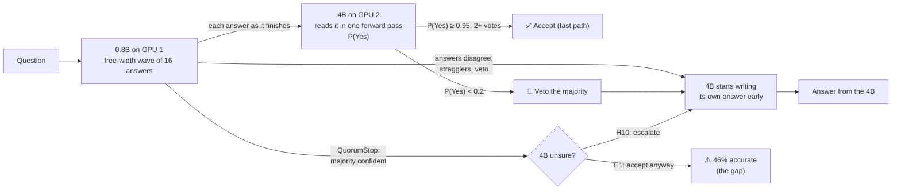
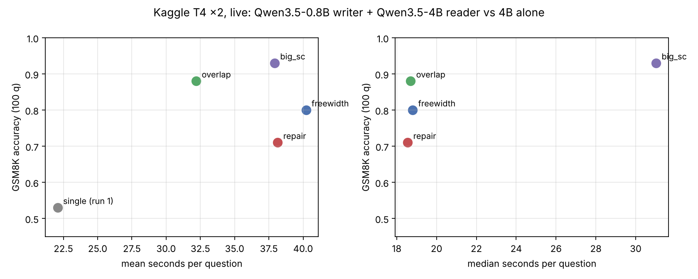
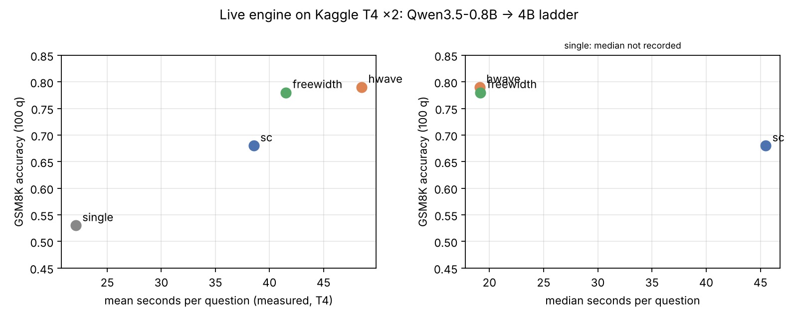

<a id="top"></a>
<div align="center">

# FreeWidth

### Your GPU gives you free samples. FreeWidth measures how many, and spends them wisely.

Hardware-aware test-time compute for LLMs: measured per-GPU **free width**, small→big model ladders with **live early stopping** and **cross-GPU verification**, and **pre-registered, statistically tested** results on free Kaggle GPUs.

[](https://github.com/Tejascodz/freewidth/actions/workflows/ci.yml)
[](https://github.com/Tejascodz/freewidth/actions/workflows/security.yml)


[The idea](#-the-idea-in-one-picture) · [Results](#-results-300-math-problems-two-free-t4-gpus) · [How it works](#-how-the-overlap-ladder-works) · [Quickstart](#-quickstart) · [What failed](#-what-worked-what-failed) · [Full docs](#-full-documentation)

</div>

---

## 💡 The idea in one picture

A small GPU like the T4 is **memory-bound** when it generates text. Each decoding step reads every weight of the model once, and that read costs about the same whether it serves 1 sequence or 16. So up to a hardware-specific limit, **extra parallel answers are almost free**. FreeWidth calls that limit the **free width**.

<div align="center">

</div>

**Measured on a Kaggle T4:**

| model | free width | fit R² | what it means |
|---|---|---|---|
| Qwen3.5-0.8B | **16** | 0.998 | 16 answers for about the time of 1 |
| Qwen3.5-4B | **4** | 0.997 | 4 answers for about the time of 1 |

Most research ranks "sample many answers", "think longer" and "ask a bigger model" by FLOPs. On single-user hardware that is the wrong price tag. FreeWidth measures the real price on your device and runs the strategies live.

---

## 📊 Results: 300 math problems, two free T4 GPUs

GSM8K, 300 questions, all methods in the same Kaggle session. **Both main claims were written down before the run** ([pre-registration](#experiments)).

| method | what it does | accuracy (95% CI) | median | mean | energy |
|---|---|---|---|---|---|
| **4B on both GPUs** | the big model alone, 8 samples, vote | **95.7%** (92.7–97.5) | 40.2 s | 43.4 s | 5.7 kJ |
| **overlap** | 0.8B answers on GPU 1, 4B checks live on GPU 2 | 89.3% (85.3–92.3) | **19.3 s** | **34.5 s** | **2.8 kJ** |
| **repair** | 4B finds the first wrong token, 0.8B resamples from there | 84.0% (79.4–87.7) | 22.5 s | 60.0 s | 4.0 kJ |

<div align="center">

</div>

**The honest reading**
- **Overlap answers in half the time with half the energy**, but it is **6.3 points less accurate** than the big model alone. Exact McNemar test, Holm-corrected p = 0.0006. It's a trade-off, not a win.
- **The gap has one cause.** 28 questions were accepted on the small model's majority while the 4B's check was unsure. Overlap got 13 of them right; the 4B got 26. On the other 272 questions, overlap is **93.8%** accurate.
- **Next experiment (H10, ready to run).** When the 4B is unsure, don't accept; hand the question to the 4B. If it works, overlap gets close to big-model accuracy while staying faster. Details: [E1 write-up](#results-e1).

Every number above comes from `python -m freewidth report` run on the committed rows in [`results/`](results/t4_gsm8k_E1_2026-11-16). Nothing is calculated by hand.

---

## ⚙️ How the overlap ladder works



- **QuorumStop:** the wave stops as soon as the finished answers form a confident majority (Beta posterior), so slow wrong chains are cut.
- **Streaming verification:** the big model only *reads* candidates (a single prefill pass), which is far cheaper than writing.
- **Speculative escalation:** the big model starts early on warning signs, on its own GPU, while the small model is still generating.

---

## 🚀 Quickstart

```bash
git clone https://github.com/Tejascodz/freewidth && cd freewidth
pip install -r requirements-dev.txt
make lint test                                        # 97 tests, no GPU needed

# OpenAI-compatible server on a simulated GPU (no GPU, no download)
python -m freewidth serve --config configs/engine_mock.yaml
curl localhost:8000/v1/chat/completions -H 'Content-Type: application/json' \
  -d '{"messages":[{"role":"user","content":"What is 17 * 23?"}]}'
```

Use the official OpenAI SDK against it ([example](examples/openai_sdk.py)), and pick a method per request:

```python
client.chat.completions.create(model="freewidth", messages=[...],
                               extra_body={"freewidth": {"name": "overlap", "quorum_accept": False}})
```

**On real GPUs (free):**

| goal | command |
|---|---|
| Serve on 2 GPUs | `FREEWIDTH_API_KEY=$(openssl rand -hex 32) python -m freewidth serve --config configs/engine_t4.yaml` |
| Measure your GPU's free width | `python -m freewidth calibrate --config configs/engine_t4.yaml` |
| Benchmark methods live | `python -m freewidth bench --config configs/engine_t4.yaml --dataset gsm8k --limit 300 --policies overlap,big_sc2 --max-hours 5` |
| Statistics for any run | `python -m freewidth report <run dir> --out <dir> --primary overlap:big_sc2` |
| Next experiment (H10) on Kaggle | `bash scripts/kaggle_h10.sh` |
| Docker | `docker run --gpus all -p 127.0.0.1:8000:8000 -e FREEWIDTH_API_KEY=... freewidth` |

---

## ✅ What worked, what failed

Research that only reports wins can't be trusted, so every hypothesis is listed here with its outcome.

| | hypothesis | outcome |
|---|---|---|
| ✅ | Free width is real and measurable on a T4 | 16 (0.8B) and 4 (4B), R² ≥ 0.997, the same in every session |
| ✅ | **H6**: overlap cuts escalation latency | Hard questions: 69 s vs 112 s for the sequential ladder (run 2) |
| ✅ | **H7**: the live veto rescues confident-but-wrong majorities | 12 of 13 vetoed questions right, vs 8 of 13 without overlap (run 2) |
| ✅ | Results are reproducible | Same answer on 96 of 100 (freewidth) and 85 of 100 (overlap) across sessions |
| ❌ | **H9**: the big model is better as a reader than a writer | Refuted: the 4B alone is 6.3 points more accurate (p = 0.0006) |
| ❌ | **H8**: Read-Locate-Fork replaces big-model writing | Refuted: repair worked on only 7 of 50 attempts, and is slower |
| 🔍 | Why repair first failed | The 4B rated answers framed as its *own* at P(Yes) 0.99 vs 0.10 when framed as someone else's (a self-correction blind spot) |
| ⏳ | **H10**: escalate when the 4B is unsure | Pre-registered, ready to run |

Other honest notes:
- The first big-model baseline used only one GPU (unfair, fixed).
- The two-GPU baseline is slower than one GPU because of Python thread contention (fix planned).
- A seeding bug was found and fixed; the data showed it did not affect results.

Every one of these is written up in [`docs/`](docs).

---

## 🧰 What's inside

| | |
|---|---|
| **Live engine** | OpenAI-compatible server and Python library. Policies: `freewidth`, `hwave`, `overlap`, `repair`, `sc`, `single`, `big_sc`, `big_sc2`. Automatic free-width calibration with retry. Energy from NVML. |
| **Research pipeline** | Profile the device, then bank samples, verify them, and replay 12 strategy families offline under **3 cost models** (FLOPs, datacenter eFLOPs, measured device seconds and joules). |
| **Statistics** | Wilson intervals; exact McNemar with Holm correction over pre-declared comparisons; paired bootstrap; sample size for 80% power. |
| **Reproducibility** | Pre-registered experiments, committed raw rows, seeded analysis, per-run time budgets, a citation file. |
| **Security** | Loopback by default, refuses unauthenticated public binds, constant-time API key check, request limits, no remote code at model load, non-root Docker. CI runs bandit, pip-audit, detect-secrets and CodeQL. Threat model in [SECURITY.md](SECURITY.md). |
| **Engineering** | 97 tests (simulated GPU plus real transformers on CPU), CI on Python 3.10–3.12, SHA-pinned Actions, Dependabot, typed package, structured JSON logs, Prometheus metrics. |

<details>
<summary><b>Repository map</b></summary>

```text
freewidth/
├── engine/          live engine: core, policies (overlap, repair, runtime), server, bench, metrics
├── backends/        HF transformers, simulated device, OpenAI-compatible APIs
├── profiler.py      device timing → free width (cost curve fit)
├── costs.py         FLOPs, eFLOPs and measured-device cost models
├── strategies.py    12 strategy families for offline replay
├── report.py        statistics for live runs
└── ...              bank, verify, analyze, compare, grading, data
configs/             engine and research configs (T4, P100, MATH-500, mock, ...)
scripts/             Kaggle scripts with time budgets
results/             committed raw rows and reports for every live run
docs/figures/        figures used in this README
```

</details>

---

## 📚 Full documentation

Everything is on this page. Click a section to expand it. Only the files GitHub itself uses live elsewhere: [SECURITY.md](SECURITY.md) (security policy and threat model), [CONTRIBUTING.md](CONTRIBUTING.md) and [CHANGELOG.md](CHANGELOG.md). Raw data and generated statistics for every run are in [`results/`](results).

<a id="results-e1"></a>
<details>
<summary><b>📊 Latest results in full: E1, 300 questions (breakdowns, what failed and why)</b></summary>

**Status: complete.** All three policies finished all 300 questions, 10 minutes before Kaggle's 12-hour limit. The plan was pre-registered in [experiments.md](#experiments).

**Data**
- Raw rows: `results/t4_gsm8k_E1_2026-11-16/bench_rows.jsonl`.
- Statistics: `results/t4_gsm8k_E1_2026-11-16/report/REPORT.md`, built with `python -m freewidth report ... --primary big_sc2:overlap,overlap:repair`.

**Setup**
- FreeWidth 0.5.0, GSM8K test, 300 questions. Sampler seed 0, so the 300 include runs 1–2's 100.
- Qwen3.5-0.8B on GPU 0 and Qwen3.5-4B on GPU 1, fp16, transformers with flash-linear-attention.
- Calibration (same session): 0.8B free width 16 (R² 0.998), 4B free width 4 (R² 0.997). This matches runs 1 and 2.
- `big_sc2` loaded a second 4B copy on GPU 0 (8.2 s, no memory problems). It split 8 samples 4 + 4 across the GPUs, with one shared QuorumStop.

### Results

| policy | accuracy (95% Wilson CI) | mean s | median s | p90 s | mean J | 4B decoded on |
|---|---|---|---|---|---|---|
| **big_sc2** (4B on both GPUs) | **95.7%** (92.7–97.5) | 43.4 | 40.2 | **62.0** | 5,713 | 100% |
| **overlap** | 89.3% (85.3–92.3) | **34.5** | **19.3** | 73.9 | **2,849** | 34% |
| **repair** (0.4.1 third-party read) | 84.0% (79.4–87.7) | 60.0 | 22.5 | 185.2 | 3,968 | 14% |


### Pre-registered comparisons (Holm over the two)

| comparison | wins / losses | Holm p | Δ accuracy (95% CI) | Δ mean seconds (95% CI) | verdict |
|---|---|---|---|---|---|
| big_sc2 → overlap | 4 / 23 | **0.0006** | −6.3 points (−9.7 to −3.0) | −9.0 s (−12.0 to −6.0) | **E1.1 fails** |
| overlap → repair | 7 / 23 | **0.005** | −5.3 points (−9.0 to −2.0) | +25.6 s (+20.1 to +31.1) | **E1.2 fails** |

**E1.1: overlap does not beat the big model on two GPUs.**
- Overlap is faster: 9 s lower mean, half the median and half the energy.
- But it is significantly less accurate (6.3 points). The criterion required "not significantly less accurate".
- Honest reading: overlap is a latency and energy trade-off, not a better system. When accuracy matters most, run the 4B.

**E1.2: repair is worse than overlap on both axes.** It is 5.3 points less accurate and 25.6 s slower on average. **H8 is refuted** against the best ladder.

### What the decisions show

**Overlap, by how each answer was accepted:**

| accepted by | n | accuracy | mean s |
|---|---|---|---|
| 4B verified the 0.8B's answer | 188 | 93.6% | 17.2 |
| 4B wrote the answer | 82 | 95.1% | 77.1 |
| **0.8B majority, 4B checked but unsure (0.2 ≤ P(Yes) < 0.95)** | **28** | **46.4%** | 19.0 |
| other | 2 | — | — |

Almost all of overlap's accuracy gap comes from **28 questions accepted on the small model's majority while the 4B's check was unsure**. The 4B gave them P(Yes) between the veto threshold (0.2) and the accept threshold (0.95):
- On those 28, overlap was right 13 times. `big_sc2` was right 26 times.
- On the other 272, overlap's accuracy is 93.8% (255/272).

This gives a concrete, testable fix: when the 4B is unsure about the majority answer, don't accept it; start the 4B on the question instead. It is pre-registered as **H10 / E1b** in [experiments.md](#experiments).
- **Upper bound if it works:** about 93.7%. That is 13 more correct, assuming the 4B is as accurate on those questions as `big_sc2` was.
- **Cost:** roughly +4–5 s mean.
- These are estimates from this run, not results.

**Repair, by how each answer was accepted:**

| accepted by | n | accuracy | mean s |
|---|---|---|---|
| 0.8B quorum | 224 | 83.5% | 25.5 |
| 4B wrote the answer after a failed repair | 43 | 90.7% | 205.1 |
| 4B verified a candidate (third-party read) | 26 | 73.1% | 104.0 |
| **repaired (locate flaw → fork from it)** | **7** | **100%** | 110.7 |

- **The verifier fix worked in part.** In 0.4.0, verified accepts were 42% accurate (19 accepts). Now they are 73% (26 accepts). That is still not a reliable gate.
- **Read-Locate-Fork itself:**
  - It tried 50 forks. 7 succeeded, and all 7 were correct. 43 failed and fell back to a 4B decode.
  - That decode came after the failed repair, so those questions took 205 s on average. The fallback is what makes repair slow.
- **Repair's real problem is upstream.** 224 of 300 questions were accepted on the small model's quorum (83.5%), the same weak gate that hurts overlap.
- **H8 as originally stated (vs freewidth), exploratory.** On the 100 questions shared with run 2, cross-session: repair 80 vs freewidth 80 correct (7 / 7, p = 1.0), at higher mean latency (60 s vs 40 s). Not supported.

### Repeatability (exploratory, the 100 questions shared with run 2)

- **overlap:** 86 (E1) vs 88 (run 2) correct, 6 / 8 discordant, p = 0.79. Same answer on 85 of 100.
- **4B baseline:** `big_sc2` (E1) 94 vs `big_sc` (run 2) 93. Median 40.3 s vs 31.0 s **on the same 100 questions**.

### The two-GPU baseline is slower than the one-GPU baseline

On identical questions, the 4B on two GPUs had a 40.3 s median, against 31.0 s on one GPU with the other idle. The split was 4 + 4 at the 4B's free width, which should have made it faster.

**Likely cause: thread contention.** Both GPUs are driven by Python threads in one process. At small batch sizes, HF `generate` is limited by Python-side kernel launches, and the two threads take turns on the interpreter lock. This is the leading explanation, not yet proven.

**Effect:** a process-per-GPU `big_sc2` would be faster still, which strengthens E1.1's conclusion.

#### Correction: the seeding bug did not duplicate samples

After the run, a code review found that every wave reseeded *all* GPUs (`torch.manual_seed`). The 0.5.1 notes said this had probably made `big_sc2`'s two GPUs draw identical samples. **The data does not support that.**
- The two waves' generated token counts match on only 11 of 300 questions.
- The numbers of rows that finished in each wave match on only 16 of 300.
- Identical samples would match on nearly all of them.

The bug was real and is fixed: each backend now seeds only its own device. But it did not visibly duplicate E1's samples. The two GPUs' random streams may still have been partly correlated, which per-device seeding removes.

### Also learned

- **The run was too long.** It needed 11.8 h of a 12 h limit. Repair took 300 min, against an estimated 190, because failed repairs fall back to slow big-model decodes.
- From 0.5.0 onward, `bench --max-hours` and the Kaggle scripts' session clock stop new questions in time and keep every finished result.
- **Reporting bug fixed (0.5.2).** `report`'s "largest model decoded" column read 0% for `big_sc2` and `repair`, because tags like `q35-4b (cancelled)` and `q35-4b.r1` were not normalised. The corrected table is above.

</details>

<a id="experiments"></a>
<details>
<summary><b>🧪 Pre-registered experiments E1–E5 (pass/fail criteria written before each run)</b></summary>

Each experiment's primary comparisons, sample size and pass/fail criteria are written here **before** it runs. This file is version-controlled, so the commit history shows that the plan came first.

**Rules**
- **Primary comparisons are the only basis for a claim.** Holm correction is applied within the primary family (`freewidth report --primary ...`).
- **Everything else is exploratory.** It is corrected as its own family and reported as a lead, not a finding.
- **A failed criterion is reported as a failure.** It is not reworded or moved to a different subset.
- **Sample sizes come from the power estimates** in `freewidth report` (80% power, α = 0.05, exact McNemar) using the previous run's discordant rates.
- **All runs are free:** Kaggle T4 x2 or P100, open-weight models.

### Status

| id | question | setting | status |
|---|---|---|---|
| E0 | first live results | T4 x2, GSM8K, 100 q | done (runs 1–2): `docs/results-t4-gsm8k*.md` |
| E1 | does overlap still win against a fair two-GPU big-model baseline; does repair work once its verifier is fixed | T4 x2, GSM8K, 300 q | **done**: E1.1 failed (overlap is 6.3 points less accurate, faster); E1.2 failed (repair worse than overlap). See `docs/results-t4-gsm8k-E1.md` |
| E1b | H10: overlap with uncertain majorities escalated (`quorum_accept: false`) | T4 x2, GSM8K, 300 q | **ready**: `scripts/kaggle_h10.sh` (about 3.5–4 h, capped at 5 h) |
| E1c | process-per-GPU big_sc2 with a same-session one-GPU control | T4 x2, GSM8K, 300 q | planned (after the weekly GPU quota resets) |
| E2 | does it hold on harder problems | T4 x2, MATH-500, 200 q | planned |
| E3 | does it hold for another model pair | T4 x2, Qwen3.5-2B → 4B, GSM8K, 300 q | planned |
| E4 | does the strategy ranking change with the hardware | P100 (one GPU), GSM8K, 300 q | planned |
| E5 | do hybrid (linear-attention) models change the small-vs-big trade-off (H2) | T4 x2, dense Qwen3 0.6B → 4B, GSM8K, 300 q | planned |

### E1: fair baseline and the repair retest

**Run.** `bash scripts/kaggle_final.sh`. Policies `overlap,big_sc2,repair` on GSM8K test, 300 questions (sampler seed 0; a superset of the 100 used before), Qwen3.5-0.8B on GPU 0 and Qwen3.5-4B on GPU 1. `big_sc2` runs the 4B on both GPUs: 8 samples split 4 + 4 (the 4B's free width), with a shared QuorumStop.

**Why 300.** From run 2's discordant rates:
- overlap vs the 4B alone needs about 280 questions;
- overlap vs freewidth needs about 145.

**Primary comparisons (Holm over these two)**
1. **overlap vs big_sc2**
   - *Claim if:* overlap's mean seconds are lower with a 95% interval below 0, and its accuracy is not significantly lower (Holm p ≥ 0.05, or overlap higher).
   - *Fail if:* big_sc2 is as fast or faster (interval includes 0 or favours big_sc2). Then the headline becomes "on two GPUs, run the big model on both", and overlap's speed claim is withdrawn.
2. **repair vs overlap**
   - *Claim if:* repair is not significantly less accurate than overlap (Holm p ≥ 0.05, or repair higher) **and** the largest model decodes on fewer questions.
   - *Fail if:* repair is significantly less accurate. Then H8 is refuted in this setting.

**Secondary, exploratory**
- **H8 as originally stated**, repair vs `freewidth`: on the 100 questions shared with run 2. These are cross-session, so the result is exploratory.
- **Overlap repeatability:** overlap run 2 vs overlap E1, on the shared 100 questions.
- **Verifier calibration under the 0.4.1 framing:** the distribution of repair's P(Yes) on correct vs incorrect candidates.
- **How often big_sc2's shared QuorumStop fires**, and its effect on latency.

### E1b: escalate majorities the 4B is unsure about (H10)

**Motivation (from E1, written before E1b runs).**
- Overlap accepted 28 of 300 questions on the 0.8B's majority after the 4B had checked the answer and was unsure (0.2 ≤ P(Yes) < 0.95; `accept_reason = quorum`).
- It was right on 13 of them; `big_sc2` was right on 26.
- On every other question, overlap was 93.8% accurate (255/272).

**H10.** With `quorum_accept: false`, overlap does not accept such a majority. It starts the 4B on the question at that moment (trigger `uncertain_quorum`). Confidently verified answers (P(Yes) ≥ 0.95 with two or more votes) are still accepted. Everything else is unchanged from E1.

**Run.** `bash scripts/kaggle_h10.sh`: `configs/engine_t4_h10.yaml`, policy `overlap`, the same 300 questions and seeds as E1, one Kaggle commit with the session capped at 5 h.

**Primary comparisons**, against E1's rows on the same questions (Holm over the two):

1. **overlap(H10) vs big_sc2(E1).**
   - *Claim if:* accuracy is not significantly lower (Holm p ≥ 0.05, or H10 is higher) **and** mean seconds are lower (95% interval below 0).
   - *Fail if:* either condition fails.
2. **overlap(H10) vs overlap(E1).**
   - *Claim if:* accuracy is higher with Holm p < 0.05.
   - The expected mean-time cost is +3 to +6 s. This is reported, not tested.

**Caveat, stated in advance.** These comparisons are cross-session: same hardware type, code and questions, but a different Kaggle session. E1 showed overlap is repeatable across sessions: 86 vs 88 correct on 100 shared questions, the same answer on 85.
- If (1) passes, E1c reruns `big_sc2` (process-per-GPU) in the same session before the claim goes in the README headline.
- If (1) fails, the trade-off stands as reported.

### E2: MATH-500

**Run.**
```bash
CONFIG=configs/engine_t4_math.yaml DATASET=math500 LIMIT=200 \
  POLICIES=overlap,big_sc2 PRIMARY=overlap:big_sc2 bash scripts/kaggle_experiment.sh
```
Answers are graded with math-verify. `max_new_tokens` is 2048, with its own calibration, because free width depends on the generation length.

**Primary.** overlap vs big_sc2, with the same criteria as E1.1.

**Secondary.** Results by MATH level (1–5). We expect the gap to grow with difficulty, but this is exploratory.

**Size.** 200 questions keeps the run under 12 h. If E1 shows an accuracy gap smaller than 5 points, E2 is reported as a latency comparison with an accuracy confidence interval, not an accuracy claim.

### E3: second model pair

**Run.**
```bash
CONFIG=configs/engine_t4_2b.yaml POLICIES=overlap,big_sc2,freewidth \
  PRIMARY=overlap:big_sc2,overlap:freewidth bash scripts/kaggle_experiment.sh
```
**Primary.** As in E1.1, plus overlap vs freewidth (overlap more accurate, Holm p < 0.05).

**Note.** The 2B and the replica 4B on GPU 0 need about 14 GB. If the replica does not fit, `big_sc2` runs on one GPU and the run notes say so. In that case the fair-baseline comparison is **not** claimed for this pair.

### E4: different hardware (P100)

**Run.**
```bash
CONFIG=configs/engine_p100.yaml POLICIES=freewidth,big_sc,sc \
  PRIMARY=freewidth:big_sc bash scripts/kaggle_experiment.sh
```
**Claim (hardware-conditional ranking).**
- The measured free widths differ from the T4's.
- The ordering of `freewidth` vs `big_sc` by mean seconds at matched accuracy differs from the T4 ordering.

*Fail if* the free widths and the ordering both match the T4. In that case the paper does not claim that the ranking depends on hardware.

**Risk.** Qwen3.5's linear-attention kernels may not run on the P100's sm_60 architecture. If calibration falls back to the slow path, switch to the dense pair as described in the config header, and report it.

### E5: dense control (H2)

**Run.**
```bash
CONFIG=configs/engine_t4_dense.yaml POLICIES=overlap,big_sc2,freewidth \
  PRIMARY=overlap:big_sc2 bash scripts/kaggle_experiment.sh
```
**Claim.** Free widths and the overlap vs big-model trade-off differ between hybrid Qwen3.5 and dense Qwen3 at similar sizes. This is reported descriptively, since model families also differ in accuracy.

### Budget

| id | approx. GPU hours |
|---|---|
| E1 | 8 |
| E2 | 8–10 |
| E3 | 8 |
| E4 | 6 |
| E5 | 8 |

Kaggle gives about 30 GPU hours a week, so the plan takes about two weeks of free quota.

</details>

<a id="engine"></a>
<details>
<summary><b>⚙️ Engine and server reference (policies, API, operations)</b></summary>

The research pipeline (`profile → bank → verify → analyze`) studies strategies offline. The engine runs the same ideas **live**, on a ladder of local models, request by request.

### How a request is answered (policy `freewidth`)

```
question
  │
  ▼
small model: wave of w = free width samples ──► QuorumStop inside the wave
  │   rows finish at different times; once the finished rows agree
  │   (Beta posterior ≥ tau) the wave stops and still-running rows are cut
  │
  ├─ confident? ──► answer (shortest chain that supports the winning answer)
  │
  ├─ up to max_waves waves, votes pooled across waves
  │
  ▼ still unsure
big model: ONE forward pass over the top candidates, P(Yes | "is this correct?")
  │
  ├─ best candidate (vote share + P(Yes)) has P(Yes) ≥ verify_accept ──► answer
  │
  ▼ rejected
big model decodes its own waves (same QuorumStop) ──► answer
```

#### Policy `overlap` (two-device ladder, proposed in 0.3.0)

`freewidth` is a sequential cascade: the big model only works after the small model has given up. In the T4 run, that left GPU 1 idle 90% of the time, and escalated questions spent about 99 s on the small model before escalating. `overlap` puts the idle GPU to work while the small model is still decoding:

```
GPU 0 (small)  ── wave of free width ─────────────┬── answer (big model run cancelled)
                 │ row finishes ─► queue           │
GPU 1 (big)      ├─► prefill P(Yes) per row ───────┘  streaming verification
                 └─► failure signal ─► big model starts decoding NOW (speculative escalation)
```

- **Streaming verification.** Each finished small-model row is scored by the big model at once, overlapping with the remaining decode.
- **Veto.** A confident small-model majority is not accepted if the big model scores all of its chains below `veto_lo`. That targets confident-but-wrong answers: 17 of the 82 quorum answers in the T4 run were wrong.
- **Verified accept.** An answer with at least 2 votes and a big-model score ≥ `accept_hi` (0.95) is accepted even without a quorum. In the T4 run, the wrong answers the verifier accepted all scored between 0.78 and 0.91.
- **Speculative escalation.** The big model starts decoding as soon as the wave signals failure: the finished rows disagree (`trigger_lead_prob`), the lead answer is vetoed, or stragglers outlive the finished rows by `runaway_factor`. If the small model then accepts, the big model's run is cancelled.
- **Straggler cut.** Rows still running beyond `runaway_factor` × the median finished length stop and do not vote.

It needs two ladder models, ideally on different GPUs (the default T4 config). On a single GPU it still runs, but the two models compete for the device. `wall_seconds` reports the overlapped end-to-end time, and `notes` records the trigger, the accept reason, verified rows and cut rows.

#### Policy `repair` (Read-Locate-Fork, proposed in 0.4.0)

The big model reads once and writes at most one token:

1. **Read.** The small model's candidate is placed as the big model's own answer to the question, followed by "Is the final answer of your solution above correct?". One forward pass gives the verdict, P(Yes), and the big model's next-token distribution at every solution token.
2. **Locate.** The flaw is the first solution token (after a short warm-up) that the big model rates below `flaw_p` (0.05) while preferring another token with at least `flaw_conf` (0.5).
3. **Fork.** The big model's token replaces the small model's at the flaw. The small model continues from there in a full free-width batch with QuorumStop, and the samples vote.
4. **Accept or escalate.** A verified candidate (P(Yes) ≥ `accept_hi`) is accepted without repair. A repaired answer is accepted if its batch reaches a quorum and the big model does not veto it. Otherwise the big model decodes as a last resort.

It needs both models to share a tokenizer (one model family); otherwise it falls back to verification and escalation. `notes` records `repaired_from`, `flaw_token`, `repair_failed` and the accept reason.

**Closest prior work:**
- **StepBack (2026):** first-error localization plus suffix resampling, using the same model or an external scorer.
- **Shen et al. 2026:** a few decision tokens carry the gap between a base model and a reasoning model.
- **SpecAgent (2026):** the strong model prefill-verifies a weak draft and repairs the first rejected step itself.

What's new here: the verdict and the location come from the **same pass**, the strong model writes **one token**, and the repair is a **parallel free-width batch** of the weak model.

#### Baselines `big_sc` and `big_sc2`

`big_sc`: `sc_n` samples from the **largest** ladder model in one batch on its own device, with a majority vote. Other devices stay idle.

`big_sc2` is the fair "just run the big model on all the GPUs" baseline. The largest model is also loaded on every device in its `replica_devices` list, the first time the policy is used:

```yaml
- {tag: q35-4b, backend: hf, model_id: Qwen/Qwen3.5-4B, device: "cuda:1", dtype: float16,
   replica_devices: ["cuda:0"]}
```

- **Data-parallel waves.** The `sc_n` samples are split evenly over the copies (8 over 2 GPUs = 4 each, the 4B's free width on a T4), and all waves run at the same time.
- **One shared QuorumStop.** The waves pool their votes in a `SharedQuorum`, so every device stops as soon as the pooled votes are confident. `quorum: false` turns this off.
- **Degrades instead of failing.**
  - A replica that fails to load (for example, out of memory next to the small model) is skipped. The policy runs on the devices that did load, and the error appears in `/v1/info` and in the request's `notes`.
  - A replica that runs out of memory mid-request has its share rerun on the primary.
- **Timing.** The reported time is the real wall-clock of the parallel waves. Energy is the sum over all devices used.

Other policies, chosen per request with `freewidth.name`:

| policy | behaviour |
|---|---|
| `single` | one sample from the first model |
| `sc` | `sc_n` parallel samples, majority vote |
| `hwave` | free-width waves with QuorumStop, escalate by decoding (no verification) |
| `freewidth` | `hwave` plus prefill verification before every escalation (default) |
| `overlap` | two-device ladder: streaming verification, veto, verified accept, speculative escalation, straggler cut |
| `repair` | Read-Locate-Fork: one big-model pass gives verdict + flaw; one-token correction; free-width small-model repair batch |
| `big_sc` | baseline: vote over `sc_n` samples of the largest model, one device |
| `big_sc2` | baseline: largest model on every device holding a copy, samples split evenly, one shared QuorumStop |

**Free width** is measured, not guessed. `calibrate` times forced-length decodes at several widths, fits the cost curve `T(w, L, P)`, and picks the widest wave that costs at most (1 + `eps`) times a single sample. The result is stored per model and per device in `calibration/<tag>/device_fit.json`. If the device name changes, the stored calibration is ignored and measured again.

### Commands

```bash
python -m freewidth calibrate --config configs/engine_t4.yaml          # one-time per device
python -m freewidth solve     --config configs/engine_t4.yaml "question" [--policy hwave] [--json]
python -m freewidth serve     --config configs/engine_t4.yaml [--port 8000] [--log-json]
python -m freewidth bench     --config configs/engine_t4.yaml --dataset gsm8k --limit 100 \
                              --policies single,sc,hwave,freewidth --out runs/bench
```

`bench` measures every number live (wall seconds, NVML joules, tokens) and writes `BENCH.md`, `bench_summary.csv` and per-question `bench_rows.jsonl`. Use it to check the offline replay's predictions on real hardware.

### HTTP API

`POST /v1/chat/completions` is OpenAI-compatible:

```json
{
  "model": "freewidth",
  "messages": [{"role": "user", "content": "What is 17 * 23?"}],
  "temperature": 0.7,
  "max_tokens": 1024,
  "seed": 1,
  "freewidth": {"name": "freewidth", "tau": 0.9, "max_waves": 2, "verify": true}
}
```

The response has the standard `choices` and `usage`, plus a `freewidth` object:

```json
"freewidth": {
  "request_id": "…", "policy": "freewidth", "answer": "391", "confidence": 0.94,
  "model": "q35-0.8b", "escalated": false, "verified": false, "free_form": false,
  "waves": [{"model": "q35-0.8b", "width": 16, "finished": 9, "cut": 7, "tokens": 3120,
             "seconds": 4.1, "joules": 290.5, "quorum_hit": true}],
  "verifications": [], "tokens": 3120, "seconds": 4.1, "joules": 290.5
}
```

`usage.completion_tokens` counts tokens across **all** samples, because that is the real compute spent.

Allowed `freewidth` keys: `name`, `tau`, `max_waves`, `quorum`, `min_finished`, `width`, `max_width`, `verify`, `verify_accept`, `top_c`, `sc_n`, `free_form_fallback`, `raw_prompt`, and for `overlap`: `veto_lo`, `accept_hi`, `require_verified`, `stream_verify`, `speculative`, `trigger_min_finished`, `trigger_lead_prob`, `runaway_factor`, `runaway_min_finished`, `verify_wait_s`, and for `repair`: `flaw_p`, `flaw_conf`. Values are validated, and server-side caps apply on top (`server.max_samples` for `sc_n`/`width`/`max_width`, `server.max_waves`, `server.max_new_tokens`, `server.allowed_policies`); anything else returns 400.

Other endpoints:

| endpoint | purpose |
|---|---|
| `GET /health` | liveness only (`{"status": "ok"}`); public, for load balancers and container probes |
| `GET /v1/info` | uptime, queue depth, version, ladder with devices, free widths and calibration R² (needs the API key) |
| `GET /v1/models` | the engine name plus every ladder tag |
| `GET /metrics` | needs the API key unless `server.public_metrics`. Prometheus text: requests, waves, quorum stops, escalations, verifications, tokens, joules, latency histogram, queue depth, free width per model |

`stream: true` is accepted for client compatibility. The whole answer arrives as one SSE chunk, because the answer is only known after voting.

### Operations

- **Single tenant by design.** Requests run one at a time, because the engine owns the GPU and the free width assumes nothing else is running on it. Up to `server.max_queue` requests wait; beyond that the server returns `503` with `Retry-After`.
- **Deadlines.** Each request gets `server.request_timeout_s`. The engine checks the deadline before every wave and every verification pass and returns `504` once it is exceeded. A wave that has already started finishes first.
- **Auth.**
  - If the environment variable named by `server.api_key_env` (default `FREEWIDTH_API_KEY`) is set, every endpoint except `/health` needs `Authorization: Bearer <key>`. The key is compared in constant time.
  - The server binds to `127.0.0.1` by default. On any other address it refuses to start without a key, unless `server.allow_unauthenticated: true` or `--insecure-no-auth` is set.
- **Request limits.** These bound how much GPU time and memory one request can claim:
  - body size (`max_body_bytes`; POST requests must send `Content-Length`);
  - message count (`max_messages`) and prompt length (`max_prompt_chars`);
  - samples, waves and new tokens, as above.
- **Other hardening.**
  - `/docs` and `/openapi.json` are off unless `server.expose_docs` is set.
  - Responses carry `X-Content-Type-Options: nosniff` and `Cache-Control: no-store`.
  - Client-supplied request ids are accepted only if they match `[A-Za-z0-9._-]{1,64}`.
  - Errors return no internal details.
  - See [SECURITY.md](SECURITY.md).
- **Logs.** `--log-json` writes one JSON object per line. Every HTTP request and its solve share a `request_id`, which is also returned in the `x-request-id` header.
- **Docker.**
  - Build and run: `docker build -t freewidth . && docker run --gpus all -p 127.0.0.1:8000:8000 -e FREEWIDTH_API_KEY=<key> -v $PWD/calibration:/app/calibration freewidth`.
  - The image runs as a non-root user and listens on all interfaces inside the container, so it needs the key.
  - Mount `calibration/` so calibration survives restarts. Mount the Hugging Face cache at `/home/app/.cache/huggingface` to avoid re-downloading models.
- **Model provenance.**
  - Models load with `trust_remote_code` off, so no Python from a model repository runs.
  - Set `revision:` on a ladder entry to pin the exact Hub commit. Without it, the engine logs a warning at load.
- **Memory.** The default T4 config puts the small model on `cuda:0` and the big model on `cuda:1`. On one 16 GB GPU, 0.8B + 4B in fp16 fits, but keep `max_width` at 16–32 for 1k-token generations.

### Limits

- **Checkable answers only.** The engine is built for questions with a checkable final answer (math, multiple choice, short factual answers): voting needs answers it can extract. For free-form prompts, `free_form_fallback` returns the most confident sample after the first wave and does not escalate.
- **No thinking-budget variants yet.** The research pipeline has them; the engine ladder does not.
- **Prompt-sensitive verification.** Prefill verification quality depends on the verifier prompt and model. Measure acceptance accuracy with `bench` before relying on it, and tune `verify_accept`.

</details>

<a id="research"></a>
<details>
<summary><b>🔬 Research design (literature gaps, hypotheses, cost models, strategies, references)</b></summary>

This page holds the research background that used to live in the README:
- the gaps in the literature and how FreeWidth addresses them;
- the falsifiable hypotheses;
- the cost models and pipeline;
- the strategy catalogue;
- threats to validity and references.

### Coverage map: gaps found, and how this repo addresses them

| # | Gap in the literature (as of November 2026) | Closest prior work | What FreeWidth does |
|---|---|---|---|
| G1 | Frontiers are computed under one cost model. Latency-aware work shows compute-optimal is not latency-optimal on datacenter GPUs, but no measured per-device "free width" on single-user consumer hardware | Snell et al. 2024; Kinetics 2025; UniScale 2026; Latency-Aware Test-Time Scaling (EMNLP Findings 2025) | Prices identical traces under FLOPs, multi-tenant eFLOPs and a cost curve measured on the device. Reports Kendall tau, Pareto overlap, and a new **iso-accuracy overrun** metric (how much slower you run if you trust the wrong frontier) |
| G2 | Kinetics' conclusion that small models are over-estimated assumes full attention in every layer | Kinetics (dense Qwen3 models) | Runs hybrid Qwen3.5 (Gated DeltaNet) against a dense Qwen3 control on the same device; `compare` reports the KV-penalty ratio (H2) |
| G3 | Parallel early-stop methods use a fixed *m* (short-m@k) or per-trace confidence (DeepConf), priced in tokens | Hassid et al. 2025; Fu et al. ICLR 2026; Aggarwal et al. 2023 | **QuorumStop:** a posterior-adaptive stop over the order in which rows finish inside a lock-step wave, priced on static-batch hardware, where the slowest row sets the cost (H3) |
| G4 | Verification is priced as decoding (GenRM verification chains), so self-consistency wins under FLOPs | Singhi et al. COLM 2025; GenRM; SplitReason 2025 (uses prefill to decide hand-offs, not to verify answers) | **Prefill-Verified Escalation:** the big model never decodes; it scores the small model's distinct candidates in one forward pass. Tests whether "self-consistency beats verification" reverses under device cost (H4) |
| G5 | "Think longer" (thinking-mode budgets) and "think wider" are rarely compared on one measured-cost frontier | s1 budget forcing (Muennighoff et al. 2025); short-m@k | Thinking-budget variants (budget forcing) are banked as extra model tags and replayed on the same frontier (H5) |
| G6 | Answer-level cascades run sequentially, so on a multi-GPU single-user box the big model's device sits idle while the small model decodes, and escalated questions pay the small model's full time first | Speculative cascades (token level, Narasimhan et al. 2025); ConfSpec (step level, ACL 2026); MSV streaming verifier (single verifier, selection only, 2026); MARS mid-generation stopping (one model, simulated, 2026); Signed Rescue Routing (sequential, learned router, 2026) | **Overlap** (engine policy `overlap`): streaming cross-model verification with veto, verified accept, and speculative escalation triggered by the wave's own dynamics (disagreement, vetoed lead, stragglers), on separate GPUs. Measured live, not simulated |
| G7 | When a small model fails, either the big model writes a whole new answer (cascades) or someone locates the error with the same model or a separate scorer (StepBack) | StepBack (2026); Shen et al. *Reasoning Can Be Restored by Correcting a Few Decision Tokens* (2026); SpecAgent (2026) | **Read-Locate-Fork** (engine policy `repair`): one big-model forward pass gives both the verdict and the first flawed token; the big model writes one token; the small model repairs in a parallel free-width batch |

The literature check behind this table found **short-m@k** and **DeepConf** already published, so both are included as **baselines**, not claimed as new. Check arXiv again before calling anything a first. Searches cannot prove that something was never tried; they can only show that it was not found.

**Not covered (deliberately):** PRM-guided beam or tree search, multi-agent debate, and RL-trained adaptive-length models. All three need online generation with branching, which offline bank replay cannot reproduce. They are listed as future work.

### Hypotheses (each one can be falsified)

Current status is in [What worked, what failed](#-what-worked-what-failed). Each test is detailed in [results](#results-e1) and [experiments](#experiments).

- **H1, regime flip.** Kendall tau(FLOPs, device seconds) is well below 1, the Pareto frontiers overlap little (Jaccard < 0.5), and the worst iso-accuracy overrun (FLOPs to device) is above 2×. *Refuted if* the frontiers match.
- **H2, hybrids weaken Kinetics.** The KV-penalty ratio (small model sampling wide vs. big model answering once, under eFLOPs) is lower for hybrid Qwen3.5 than for dense Qwen3 at similar sizes.
- **H3, QuorumStop.** At matched accuracy, `hwave(quorum=True)` costs fewer device seconds than both `short_mk` and full-wave voting, because wrong chains tend to be the long stragglers.
- **H4, prefill verification.** Under device seconds, `pverify` beats both self-consistency on the small model and decoding with the big model at matched accuracy. This reverses Singhi et al.'s FLOPs-based conclusion for a single-tenant device.
- **Status after E1:**
  - H6 and H7 supported (run 2).
  - H8 refuted: repair is less accurate and slower than overlap, and no better than freewidth.
  - H9 refuted: the 4B alone is 6.3 points more accurate than overlap (Holm p = 0.0006). Overlap keeps a latency and energy advantage.
  - H10 (escalate majorities the 4B is unsure about) is pre-registered for E1b.
- **H6, overlap cuts escalation latency.** On escalated questions, `overlap` has lower median wall time than `freewidth`, because the big model starts during the first wave instead of after two failed waves. *Refuted if* escalated-question latency does not drop.
- **H7, the veto rescues confident-wrong answers.** `overlap` is more accurate than `freewidth` on questions the small model answers with a quorum, at mean time within 15% of `freewidth`. *Refuted if* the accuracy gain is zero or the time cost is larger.
- **H8, read-locate-fork replaces writing.** On questions where the small model is unsure, `repair` reaches at least the accuracy of `freewidth` (which escalates to big-model decoding) with lower mean latency, and the big model writes a full answer on fewer than half as many questions. *Refuted if* repaired batches are no more accurate than fresh small-model batches.
- **H9, the big model is better as a reader than a writer.** `freewidth`, `overlap` or `repair` beats `big_sc` (the 4B model alone) on accuracy per second **and** accuracy per joule on the T4. *Refuted if* `big_sc` dominates.
- **H5, wide beats long below the free width.** At equal device seconds, *w* ≤ free-width parallel non-thinking samples beat one thinking chain with a matching token budget.

### Method

#### Three cost models (`freewidth/costs.py`)

For a sample with prompt length *P* and *L* generated tokens, using a model with active parameters *N*, *ℓ* full-attention layers, *h* heads and head dimension *d*:

- **FLOPs:** `2·N·L + 4·ℓ·h·d·Σ_t (P+t)`
- **eFLOPs (multi-tenant):** FLOPs `+ I · bytes(KV + recurrent state)`. *I* is the reference accelerator's arithmetic intensity (default 295 FLOP/byte for H100 BF16). Weight reads are excluded because they are amortised across tenants.
- **Device (single tenant, measured):** a wave of width *w* costs `T(w, L, P) = e + d·w·P + a·L + b·w·L + g·w·(L·P + L(L+1)/2)`. This is fitted with non-negative least squares on microbenchmarks. Energy (joules, via NVML) is fitted the same way. A verification pass is priced as `T(c, 1, P_v)`: one forward pass over *c* candidates plus one decoded token. **Free width** is the widest wave costing at most (1+ε) times one sample.

#### Pipeline

1. `profile`: times forced-length decodes over widths × generation lengths (including L = 1, which anchors prefill) × at least two prompt lengths, then fits `T` and the free width. Check that R² > 0.98.
2. `bank`: draws *K* samples per (model, question) in waves and stores answer, correctness, tokens, self-certainty, entropy and text. Resumable. Thinking-mode tags use budget forcing: when the budget runs out, the thinking block is closed and an answer is forced.
3. `verify`: for each (small, big) pair, the big model scores every stored small-model solution with P(Yes | "is the final answer correct?"). This is one batched forward pass with no decoding.
4. `analyze`: replays every strategy across many random sample orders, prices each trace under every cost model, and writes `results.csv`, `disagreement.json` (tau, Jaccard, budget winners, overruns, saturating fits), `figures/` and `REPORT.md`.
5. `compare`: places several runs side by side (hybrid vs. dense, T4 vs. Mac) for H2.

Device cost always comes from the profile fit, never from the bank's own wall-clock. That means a bank generated with vLLM can be priced with an HF profile.

#### Strategies (`freewidth/strategies.py`)

| family | type | description |
|---|---|---|
| `single` | baseline | one sample |
| `sc` | baseline | *n* parallel samples, majority vote (Wang et al. 2023) |
| `sc_seq` | baseline | the same *n* samples, one per round (identical FLOPs, different device cost) |
| `wvote` | baseline | Borda vote weighted by self-certainty (Kang et al. 2025) |
| `adaptive` | baseline | one sample at a time, Beta stopping (Aggarwal et al. 2023) |
| `short_mk` | baseline | *k* parallel; stop all rows when the first *m* finish (Hassid et al. 2025) |
| `conf_filter` | baseline | keep the most confident fraction, confidence-weighted vote (DeepConf offline style; mean-confidence variant) |
| `cascade` | baseline | vote on the small model; escalate if agreement < τ (FrugalGPT style) |
| `proxy_alloc` | baseline | dataset-level budget split by first-wave disagreement (DIPA style) |
| **`hwave`** | proposed | waves sized to the device's free width; Beta stopping after each wave; escalate a size only after waves fail |
| **`hwave(quorum=True)`** | proposed | **QuorumStop** inside each wave: stop the whole wave once the rows finished so far form a confident quorum; unfinished rows are cut and priced at the stop length |
| **`repair`** (engine) | proposed | Read-Locate-Fork: one big-model pass gives verdict + first flawed token; one-token correction; free-width small-model repair batch |
| `big_sc` (engine) | baseline | vote over samples of the largest model alone, one device |
| `big_sc2` (engine) | baseline | largest model data-parallel over all devices, one shared QuorumStop: the fair "big model on every GPU" reference |
| **`overlap`** (engine) | proposed | two-device ladder: streaming prefill verification with veto and verified accept, speculative big-model escalation, straggler cut |
| **`pverify`** | proposed | **Prefill-Verified Escalation**: free-width wave on the small model; if it is not confident, the big model prefill-scores the top distinct candidates; pick by P(Yes) (`max`) or vote share + P(Yes) (`mix`) |

### Threats to validity

Full list with what the repo does about each: [limitations.md](#limitations).


- **Engine:** HF `generate` is not a production server. Compare it with a vLLM profile where possible.
- **Hybrid kernels:** Gated DeltaNet layers need optimised kernels. The fallback path on a T4 may inflate device cost; record which kernels are installed.
- **Fit form:** `T` is linear in its features. Inspect residuals at large widths.
- **Verifier prompt:** P(Yes) depends on the prompt and on how the tokenizer splits Yes/No. Report the template, and check calibration with the `small_correct` field stored in each verify file.
- **Grading:** answer matching is rule-based. Spot-check disagreements using the stored texts.
- **Finite bank:** strategies that need more samples than the bank holds are truncated. Keep `samples_per_question` at least the largest *n* in the grid.

### References

- Snell, Lee, Xu, Kumar. *Scaling LLM Test-Time Compute Optimally Can Be More Effective than Scaling Model Parameters.* ICLR 2025. arXiv:2408.03314
- Wu et al. *Inference Scaling Laws.* arXiv:2408.00724
- Sadhukhan et al. *Kinetics: Rethinking Test-Time Scaling Laws.* NeurIPS 2025. arXiv:2506.05333
- Singhi et al. *When To Solve, When To Verify.* COLM 2025. arXiv:2504.01005
- Huang et al. *UniScale: Adaptive Unified Inference Scaling.* ICML 2026. arXiv:2605.30898
- *Resample or Reroute? Budget-Aware Test-Time Model Selection.* arXiv:2607.08665
- *Test-Time Scaling Makes Overtraining Compute-Optimal.* arXiv:2604.01411
- Hu, Shu, Ng, Low. *DIPA.* ICML 2026
- Zuo, Zhu. *Strategic Scaling of Test-Time Compute: A Bandit Learning Approach.* arXiv:2506.12721
- Hassid, Synnaeve, Adi, Schwartz. *Don't Overthink It: Preferring Shorter Thinking Chains.* arXiv:2505.17813
- Fu, Wang, Zhang, Tian, Zhao. *Deep Think with Confidence.* ICLR 2026. arXiv:2508.15260
- Aggarwal et al. *Let's Sample Step by Step: Adaptive-Consistency.* EMNLP 2023
- Muennighoff et al. *s1: Simple Test-Time Scaling.* 2025
- *SplitReason: Learning to Offload Reasoning.* arXiv:2504.16379
- Zhang et al. *Generative Verifiers: Reward Modeling as Next-Token Prediction.* 2024
- Wang et al. *Self-Consistency Improves Chain of Thought Reasoning.* ICLR 2023
- Kang et al. *Scalable Best-of-N Selection via Self-Certainty.* 2025
- Chen, Zaharia, Zou. *FrugalGPT.* 2023
- *Democratizing Agentic AI with Fast Test-Time Scaling on the Edge.* arXiv:2509.00195
- Narasimhan et al. *Faster Cascades via Speculative Decoding.* ICLR 2025
- *ConfSpec: confidence-gated cascaded verification for step-level speculative reasoning.* ACL 2026
- *Parallel Test-Time Scaling with Multi-Sequence Verifiers* (streaming MSV). arXiv:2603.03417
- *MARS: Margin-Adversarial Risk-controlled Stopping for Parallel LLM Test-time Scaling.* arXiv:2606.12935
- *Signed Rescue Routing: Harm-Aware Cascades for Efficient LLM Inference.* arXiv:2609.07786
- *Faster and Better LLMs via Latency-Aware Test-Time Scaling.* Findings of EMNLP 2025
- *StepBack: Step-Level Error-Localized Resampling for Efficient Test-Time Reasoning.* arXiv:2611.08403
- Shen, Sheng, Chen, Wang, Zhang. *Reasoning Can Be Restored by Correcting a Few Decision Tokens.* arXiv:2605.16874
- *Trajectory-Level Speculation with Semantic Verification for Tool-Using Agents* (SpecAgent). arXiv:2610.21463
- *DREAM-R: Multimodal Speculative Reasoning with Fully Parallel Execution.* arXiv:2605.28678
- Tsui. *Self-Correction Bench: Uncovering and Addressing the Self-Correction Blind Spot in Large Language Models.* arXiv:2507.02778

</details>

<a id="limitations"></a>
<details>
<summary><b>⚠️ Limitations (everything a careful reviewer would raise)</b></summary>

The things a careful reviewer would raise, and what the repo does about each.

### Scope of the evidence
- **Sample sizes.** Runs 1–2 used 100 questions per policy, which gives roughly ±8 points on accuracy. E1 used 300 questions, sized from power estimates (see [experiments](#experiments)), which gives about ±3–5 points.
- **One GPU type and one model family** (T4, Qwen3.5) so far. E3–E5 add a second model pair, the P100 and a dense model family. Until they run, the results describe one setting.
- **Grade-school math first.** GSM8K answers are numbers. MATH-500 (E2) tests harder, symbolic answers.

### Measurement
- **HF `generate`, not a serving engine.** Wall-clock times come from transformers' static-batch generation. A paged-attention server such as vLLM or SGLang has different batching costs, so free widths and timings may differ there.
- **Two models in one process.** This matters most for `big_sc2`. In E1 its two-GPU median (40 s) was slower than the one-GPU baseline's median from run 2 (31 s, different sample). The likely cause is interpreter-lock contention between the two decoding threads. A process-per-GPU version is planned (E1b).
  - `overlap` and `big_sc2` run GPU work from Python threads. Both GPUs are driven truly in parallel, but the Python-side overhead per decoding step is shared.
  - Before 0.5.1, every wave reseeded all GPUs with `torch.manual_seed`. In E1 the two GPUs' samples were nonetheless not duplicated ([details](#results-e1)). Since 0.5.1 each backend seeds only its own device.
  - Concurrent waves are still not bit-reproducible run to run. Per-question answers agreed on 96 of 100 questions across two runs.
- **Energy** is read from NVML for the GPUs a policy uses. An idle GPU's draw is not counted, which favours one-GPU policies on joules.
- **Verifier framing matters a great deal.** The same 4B model gave a median P(Yes) of 0.99 when the candidate was framed as its own answer, and 0.10 as a third-party answer. Every verifier result is specific to its prompt; templates are in `freewidth/engine/core.py` and `repair.py`.
- **Grading is automatic.**
  - GSM8K: exact number match after normalisation.
  - MATH-500: math-verify, with a string and number fallback.
  - Disagreements between policies can be spot-checked from the stored answers.

### Comparisons
- **Baselines.**
  - `big_sc` (runs 1–2) used one GPU and no early stopping. That was unfair to it on latency, and it is replaced by `big_sc2` from E1.
  - Comparisons with published methods (DeepConf, short-m@k and others) are offline replays on banked samples, not live reimplementations.
- **Multiple comparisons.** Each report corrects within its pre-declared primary family. Run 2's overlap vs freewidth result was p = 0.039 uncorrected and p = 0.077 after correcting for both primary comparisons, so it is reported as suggestive until E1.
- **Cross-session comparisons**, for example repair (E1) vs freewidth (run 2), are exploratory. GPU clocks, thermals and library versions can differ between Kaggle sessions.

### Novelty
- **Prior work.**
  - Latency-aware test-time scaling (EMNLP Findings 2025) already showed that compute-optimal is not latency-optimal.
  - Prefill verification, speculative cascades and early-stopped self-consistency all have prior work, cited in the README.
- **What is new here is narrower:**
  - free width measured per device and per model on single-tenant hardware, and used live;
  - QuorumStop inside a lock-step wave;
  - streaming verification with veto across two GPUs;
  - the Read-Locate-Fork repair loop.
- Each is tested against a fair baseline before it is claimed.

</details>

<a id="architecture"></a>
<details>
<summary><b>🏗️ Architecture (how the code fits together)</b></summary>

```
freewidth/
├── grading.py        answer extraction + equivalence (boxed, ####, numbers, fractions)
├── data.py           GSM8K, MATH-500, toy, jsonl -> Question
├── costs.py          ModelSpec, FLOPs / eFLOPs pricing, DeviceFit T(w, L, P), free width
├── hw.py             NVML energy meter
├── backends/         one interface, four implementations
│   ├── base.py         generate (one wave), timed_decode, score_yes, spec
│   ├── hf.py           transformers: waves, self-certainty, budget forcing, prefill P(Yes)
│   ├── openai_compat.py  vLLM / llama.cpp / Ollama / free-tier APIs
│   └── mock.py         simulated device for tests and smoke runs
├── profiler.py       measure + fit the device cost curve
├── bank.py           resumable sample bank
├── verify.py         prefill verification pass over a bank
├── replay.py         load banks, sample streams, price traces three ways
├── strategies.py     12 strategy families incl. hwave, QuorumStop, pverify
├── pareto.py         frontiers, Kendall tau, Jaccard, fits, plots
├── analyze.py        replay grid -> results.csv, disagreement.json, REPORT.md
├── compare.py        cross-run table (H2)
├── report.py         live-run statistics: Wilson CIs, McNemar + Holm, paired bootstrap, power
├── schema.py         validation for research configs
├── logs.py           text / JSON logging
├── engine/
│   ├── config.py       validated engine config
│   ├── runtime.py      live waves with a QuorumStop stopping criterion
│   ├── core.py         Engine: ladder, calibration, policies, traces
│   ├── metrics.py      Prometheus counters / gauges / histograms
│   ├── server.py       FastAPI app, OpenAI-compatible
│   └── bench.py        live benchmark of policies
└── cli.py            profile, bank, verify, analyze, all, compare, smoke,
                      calibrate, solve, serve, bench
```

**Research path:** profile → bank → verify → analyze → compare. Everything expensive runs once; every strategy is then a cheap replay.

**Production path:** calibrate → serve. The same ideas run online: free width comes from the same cost-curve fit, QuorumStop runs as a transformers `StoppingCriteria`, and verification is the same prefill `score_yes`.

**Shared contract.** A *wave* is `n` parallel samples of one prompt on one device. Strategies, the replay pricer and the live engine all reason in waves, which is what makes the offline predictions comparable with the live benchmark.

</details>

<a id="run-2"></a>
<details>
<summary><b>🗂️ Earlier run 2: four policies, 100 questions</b></summary>

**Setup.** FreeWidth 0.4.0, same 100 GSM8K questions and per-question seeds as run 1. Ladder: Qwen3.5-0.8B on GPU 0, Qwen3.5-4B on GPU 1, fp16, transformers with `flash-linear-attention`. Calibration: 0.8B free width 16 (R² 0.997), 4B free width 4 (R² 0.998), reproducing run 1. All numbers are measured live. Raw data: `results/t4_gsm8k_4way_2026-11-16/bench_rows.jsonl`.

### Main table

| policy | accuracy (95% CI) | mean s | median s | p90 s | mean J | big model wrote an answer |
|---|---|---|---|---|---|---|
| **big_sc** (4B alone, 8 samples, vote) | **0.93** (0.88–0.98) | 37.9 | 31.0 | 78.6 | 2,579 | 100% |
| **overlap** | **0.88** (0.81–0.94) | **32.2** | **18.7** | **73.7** | 2,694 | 28% |
| freewidth | 0.80 (0.72–0.88) | 40.2 | 18.8 | 102.5 | 2,631 | 5% |
| repair (0.4.0) | 0.71 (0.62–0.80) | 38.1 | 18.6 | 101.6 | 2,501 | 1% |



### Paired comparisons (same questions; exact McNemar; bootstrap CI on per-question time differences)

These are uncorrected p-values. Overlap vs freewidth and overlap vs big_sc were the two comparisons that mattered for this run. After Holm correction over those two, overlap vs freewidth is **p = 0.077**: suggestive, not significant. The full corrected table: `python -m freewidth report results/t4_gsm8k_4way_2026-11-16 --out <dir> --primary overlap:freewidth,overlap:big_sc`.

| A → B | B wins / loses | p | Δ mean seconds (95% CI) |
|---|---|---|---|
| freewidth → **overlap** | 10 / 2 | **0.039** | **−8.0 (−13.7 to −2.5)** |
| freewidth → big_sc | 16 / 3 | **0.004** | −2.3 (−9.3 to +4.4) |
| overlap → big_sc | 7 / 2 | 0.18 | +5.7 (+0.6 to +10.6) |
| freewidth → repair | 0 / 9 | **0.004** | −2.1 (−5.0 to +0.2) |

**Reproducibility.** `freewidth` scored 0.78 in run 1 and 0.80 in run 2 on the same questions and seeds. It gave the same answer on 96 of 100 questions.

### Findings

1. **Overlap is the best ladder.** It is more accurate than `freewidth` (+8 points; p = 0.039 uncorrected, 0.077 after Holm over the two primary comparisons, so suggestive until E1's 300 questions) and faster (−8.0 s mean, CI excludes 0), with a 28% lower p90. On the 20 hard questions (those `freewidth` could not settle by quorum), it was 43 s faster on average (68.8 s vs 111.8 s) at similar accuracy (0.80 vs 0.85). **H6 supported.**
2. **The veto works.** On 13 questions the big model vetoed the small model's confident majority. On those questions, `freewidth`'s final answer was right 8 times; `overlap`'s was right 12 times. Most of overlap's gain comes from questions the small model had "already settled" (accuracy 0.79 → 0.90 on that set): confident-but-wrong majorities caught by streaming verification. **H7 supported.**
3. **The big model alone is the most accurate.** `big_sc` reaches 0.93. That is significantly better than `freewidth` (p = 0.004), and not significantly better than `overlap` (+5 points, p = 0.18). `overlap` is faster: 5.7 s lower mean, about 12 s lower median, and 5 s lower p90. Energy per question is within noise across all four. **H9, "the big model is better as a reader than a writer", is refuted on accuracy.** What survives is a latency trade-off: `overlap` answers the typical question in about 60% of `big_sc`'s median time, at an accuracy cost that this sample cannot distinguish from zero.
4. **Read-Locate-Fork failed, and the cause is informative.** Version 0.4.0 showed the candidate solution to the big model as **its own assistant turn**. In that framing, the same 4B model gave P(Yes) ≥ 0.95 to 75% of candidates (median 0.99). In `freewidth`'s third-party framing ("Proposed solution: … is it correct?"), the median was 0.10. Consequences:
   - 19 candidates were accepted as "verified", and only 42% of them were correct.
   - The locate-and-fork step ran on only one question.

   This is the self-correction blind spot (Tsui 2025: models fail to correct their own errors but fix identical errors from external sources) showing up as verifier miscalibration. **H8 was therefore not tested.** Version 0.4.1 reads the candidate as a third-party solution in the same single pass.

### What this changes

- **Where to run what.** On a T4 x2, use `overlap` when latency matters (median 18.7 s, 88%). Use the big model alone when accuracy matters most (93%, median 31 s).
- **Verifier prompt design.** Verifier framing is not a detail. The same model and the same candidates go from a discriminating verifier to a rubber stamp when the candidate is presented as the model's own answer.
- **Device use (caveat).** Only `overlap` used both GPUs at the same time. `freewidth` and `repair` use them in turn. `big_sc` ran all 8 samples as one batch on GPU 1 (past the 4B's free width of 4) with GPU 0 idle and no early stopping. That favours the two-GPU ladders on latency. The fair baseline, `big_sc2` (4B on both GPUs, 4 samples each, shared QuorumStop), was added in 0.5.0 for the next run.
- **Limits.** 100 questions, one dataset, one GPU type. The paired tests are the reliable part. The overlap vs big_sc accuracy gap needs about 400–500 questions to resolve.

### Next

1. Rerun `repair` (0.4.1, third-party read) to actually test H8, and compare `overlap` against `big_sc2` in the same session.
2. Run 300–500 questions for `overlap` vs `big_sc`.
3. Run MATH-500, where the 4B model alone is slower and the ladder's advantage may grow.

</details>

<a id="run-1"></a>
<details>
<summary><b>🗂️ Earlier run 1: first live results, 100 questions</b></summary>

**Setup.** FreeWidth 0.2.2 live engine. Ladder: Qwen3.5-0.8B on GPU 0 → Qwen3.5-4B on GPU 1, fp16, transformers with `flash-linear-attention` (causal-conv1d not available on T4). Workload: 100 GSM8K test questions (fixed sample, seed 0), temperature 0.7, up to 1024 new tokens per sample. All times and energies are measured live on the device (wall clock, NVML). Raw data: `results/t4_gsm8k_2026-11-15/`.

### Calibration

| model | free width | fit R² |
|---|---|---|
| Qwen3.5-0.8B | 16 | 0.998 |
| Qwen3.5-4B | 4 | 0.997 |


At a 128-token prompt with 128 new tokens, 16 parallel samples on the 0.8B model take 1.14× the time of one sample (5.99 s vs 5.24 s). One sample from the 4B model takes 7.65 s. Free width also depends on the software stack: with the reference PyTorch kernels instead of `flash-linear-attention`, the 4B model's free width was 2.

### Main table

| policy | accuracy (95% CI) | mean s | median s | p90 s | mean J | mean tokens | escalated | verified |
|---|---|---|---|---|---|---|---|---|
| single¹ | 0.53 | 22.1 | — | 41.9 | 915 | 531 | 0 | 0 |
| sc (8 samples) | 0.68 (0.59–0.77) | 38.5 | 45.5 | 46.4 | 2,529 | 4,255 | 0 | 0 |
| hwave | 0.79 (0.71–0.87) | 48.5 | 19.1 | 139.9 | 3,232 | 10,025 | 0.18 | 0 |
| **freewidth** | **0.78 (0.70–0.86)** | **41.5** | **19.2** | **105.2** | **2,713** | 9,591 | 0.07 | 0.11 |

¹ Same 100 questions, measured in an earlier commit with identical code paths. Per-question rows were not kept, so it is excluded from the paired tests.



### Findings

1. **Free width shows up live.** `sc` generates 8× the tokens of `single` (and roughly 8× the FLOPs), but costs 1.75× the time and 2.8× the energy, for +15 accuracy points.
2. **QuorumStop + escalation beats plain voting on accuracy at similar mean cost.** Against `sc` on the same questions, `freewidth` wins 15 and loses 5 (exact McNemar p = 0.041). The mean-time difference is +3.0 s (bootstrap 95% CI −4.6 to +11.4, not significant). Median time drops from 45.5 s to 19.2 s, because 73% of questions finish in one wave. In `hwave`, 96 of 151 waves stopped early on a quorum, and 43% of all generated rows were cut before finishing.
3. **Prefill verification replaces most big-model decoding at no accuracy cost.** Against `hwave`, `freewidth` has the same accuracy (2 wins, 3 losses, p = 1.0) and is 7.0 s faster per question (CI −12.6 to −2.3 s), with a 25% lower p90 and 16% less energy. Escalations to 4B decoding fall from 18% to 7%. A verification pass costs 3.6 s, compared with about 150 s for an escalated question, and big-model decode time per question falls from 11.2 s to 3.3 s.
4. **Stragglers dominate fixed-width voting.** In 61 of 100 `sc` waves, at least one sample ran to the 1024-token cap. Those waves averaged 46.0 s, against 26.8 s for waves where every sample finished.

### Weak spots

- **The verifier's "accept" is only moderately reliable.** It accepted 11 candidates and 7 of them were correct; the accepted wrong answers scored P(Yes) between 0.78 and 0.91. Its "reject" was reliable: 6 of the 7 rejected questions were then solved by escalation. Every correct acceptance scored at least 0.82 and four scored at least 0.98, so a higher `verify_accept` (for example 0.95) is the next thing to test.
- **Runaway generations.** 14–17% of all samples hit the 1024-token cap. They rarely finish with an answer, and they set the wave time.
- **Answer format.** Question 906 accepted "4 blue and 6 red shoe boxes" as the answer, which the numeric grader can't match. Answer formatting matters to the grader as well as to the verifier.
- **Small sample.** 100 questions, one dataset, one GPU type, one seed; accuracy CIs are about ±9 points. The paired tests above are the right comparison; absolute accuracies should be read with the CIs.

### Next experiments

1. Rerun `freewidth` with `verify_accept: 0.95`.
2. Add a repetition/runaway stop, or lower `max_new_tokens`, to cut length-capped stragglers.
3. Scale to 300–500 GSM8K questions, then MATH-500.
4. Run the dense Qwen3 ladder (`engine_t4_dense.yaml`) as the H2 control.
5. Compare these live numbers with the offline replay pipeline's predictions for the same models.

</details>

---

## 🗺️ Roadmap

- [x] Free width measured on T4; live engine; 300-question pre-registered evaluation
- [ ] **H10:** escalate when the verifier is unsure (ready, `scripts/kaggle_h10.sh`)
- [ ] Process-per-GPU big-model baseline, with a same-session one-GPU control
- [ ] MATH-500 · a second model pair (Qwen3.5-2B → 4B) · P100 · dense-model control ([plan](#experiments))
- [ ] Timing on a vLLM serving engine

---

## Citation

```bibtex
@software{freewidth2026,
  author  = {Tejas},
  title   = {FreeWidth: Hardware-Aware Test-Time Compute for LLMs},
  year    = {2026},
  url     = {https://github.com/Tejascodz/freewidth},
  version = {0.6.0}
}
```

MIT licensed. Built and evaluated entirely on free compute.
