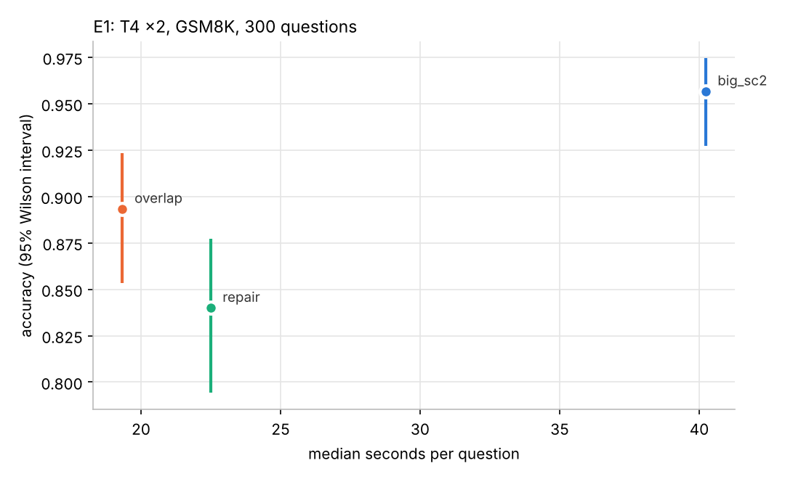
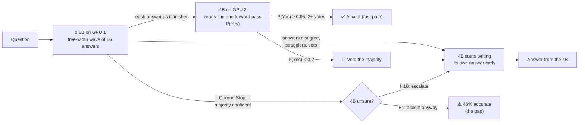

<div align="center">

# FreeWidth

### Your GPU gives you free samples. FreeWidth measures how many, and spends them wisely.

Hardware-aware test-time compute for LLMs: measured per-GPU **free width**, small→big model ladders with **live early stopping** and **cross-GPU verification**, and **pre-registered, statistically tested** results on free Kaggle GPUs.

[](https://github.com/Tejascodz/freewidth/actions/workflows/ci.yml)
[](https://github.com/Tejascodz/freewidth/actions/workflows/security.yml)


[The idea](#-the-idea-in-one-picture) · [Results](#-results-300-math-problems-two-free-t4-gpus) · [How it works](#-how-the-overlap-ladder-works) · [Quickstart](#-quickstart) · [What failed](#-what-worked-what-failed) · [Docs](#-documentation)

</div>

---

## 💡 The idea in one picture

A small GPU like the T4 is **memory-bound** when it generates text. Each decoding step reads every weight of the model once, and that read costs about the same whether it serves 1 sequence or 16. So up to a hardware-specific limit, **extra parallel answers are almost free**. FreeWidth calls that limit the **free width**.

<div align="center">

</div>

**Measured on a Kaggle T4:**

| model | free width | fit R² | what it means |
|---|---|---|---|
| Qwen3.5-0.8B | **16** | 0.998 | 16 answers for about the time of 1 |
| Qwen3.5-4B | **4** | 0.997 | 4 answers for about the time of 1 |

Most research ranks "sample many answers", "think longer" and "ask a bigger model" by FLOPs. On single-user hardware that is the wrong price tag. FreeWidth measures the real price on your device and runs the strategies live.

---

## 📊 Results: 300 math problems, two free T4 GPUs

GSM8K, 300 questions, all methods in the same Kaggle session. **Both main claims were written down before the run** ([pre-registration](docs/experiments.md)).

| method | what it does | accuracy (95% CI) | median | mean | energy |
|---|---|---|---|---|---|
| **4B on both GPUs** | the big model alone, 8 samples, vote | **95.7%** (92.7–97.5) | 40.2 s | 43.4 s | 5.7 kJ |
| **overlap** | 0.8B answers on GPU 1, 4B checks live on GPU 2 | 89.3% (85.3–92.3) | **19.3 s** | **34.5 s** | **2.8 kJ** |
| **repair** | 4B finds the first wrong token, 0.8B resamples from there | 84.0% (79.4–87.7) | 22.5 s | 60.0 s | 4.0 kJ |

<div align="center">

</div>

**The honest reading**
- **Overlap answers in half the time with half the energy**, but it is **6.3 points less accurate** than the big model alone. Exact McNemar test, Holm-corrected p = 0.0006. It's a trade-off, not a win.
- **The gap has one cause.** 28 questions were accepted on the small model's majority while the 4B's check was unsure. Overlap got 13 of them right; the 4B got 26. On the other 272 questions, overlap is **93.8%** accurate.
- **Next experiment (H10, ready to run).** When the 4B is unsure, don't accept; hand the question to the 4B. If it works, overlap gets close to big-model accuracy while staying faster. Details: [E1 write-up](docs/results-t4-gsm8k-E1.md).

Every number above comes from `python -m freewidth report` run on the committed rows in [`results/`](results/t4_gsm8k_E1_2026-11-16). Nothing is calculated by hand.

---

## ⚙️ How the overlap ladder works



- **QuorumStop:** the wave stops as soon as the finished answers form a confident majority (Beta posterior), so slow wrong chains are cut.
- **Streaming verification:** the big model only *reads* candidates (a single prefill pass), which is far cheaper than writing.
- **Speculative escalation:** the big model starts early on warning signs, on its own GPU, while the small model is still generating.

---

## 🚀 Quickstart

```bash
git clone https://github.com/Tejascodz/freewidth && cd freewidth
pip install -r requirements-dev.txt
make lint test                                        # 97 tests, no GPU needed

# OpenAI-compatible server on a simulated GPU (no GPU, no download)
python -m freewidth serve --config configs/engine_mock.yaml
curl localhost:8000/v1/chat/completions -H 'Content-Type: application/json' \
  -d '{"messages":[{"role":"user","content":"What is 17 * 23?"}]}'
```

Use the official OpenAI SDK against it ([example](examples/openai_sdk.py)), and pick a method per request:

```python
client.chat.completions.create(model="freewidth", messages=[...],
                               extra_body={"freewidth": {"name": "overlap", "quorum_accept": False}})
```

**On real GPUs (free):**

| goal | command |
|---|---|
| Serve on 2 GPUs | `FREEWIDTH_API_KEY=$(openssl rand -hex 32) python -m freewidth serve --config configs/engine_t4.yaml` |
| Measure your GPU's free width | `python -m freewidth calibrate --config configs/engine_t4.yaml` |
| Benchmark methods live | `python -m freewidth bench --config configs/engine_t4.yaml --dataset gsm8k --limit 300 --policies overlap,big_sc2 --max-hours 5` |
| Statistics for any run | `python -m freewidth report <run dir> --out <dir> --primary overlap:big_sc2` |
| Next experiment (H10) on Kaggle | `bash scripts/kaggle_h10.sh` |
| Docker | `docker run --gpus all -p 127.0.0.1:8000:8000 -e FREEWIDTH_API_KEY=... freewidth` |

---

## ✅ What worked, what failed

Research that only reports wins can't be trusted, so every hypothesis is listed here with its outcome.

| | hypothesis | outcome |
|---|---|---|
| ✅ | Free width is real and measurable on a T4 | 16 (0.8B) and 4 (4B), R² ≥ 0.997, the same in every session |
| ✅ | **H6**: overlap cuts escalation latency | Hard questions: 69 s vs 112 s for the sequential ladder (run 2) |
| ✅ | **H7**: the live veto rescues confident-but-wrong majorities | 12 of 13 vetoed questions right, vs 8 of 13 without overlap (run 2) |
| ✅ | Results are reproducible | Same answer on 96 of 100 (freewidth) and 85 of 100 (overlap) across sessions |
| ❌ | **H9**: the big model is better as a reader than a writer | Refuted: the 4B alone is 6.3 points more accurate (p = 0.0006) |
| ❌ | **H8**: Read-Locate-Fork replaces big-model writing | Refuted: repair worked on only 7 of 50 attempts, and is slower |
| 🔍 | Why repair first failed | The 4B rated answers framed as its *own* at P(Yes) 0.99 vs 0.10 when framed as someone else's (a self-correction blind spot) |
| ⏳ | **H10**: escalate when the 4B is unsure | Pre-registered, ready to run |

Other honest notes:
- The first big-model baseline used only one GPU (unfair, fixed).
- The two-GPU baseline is slower than one GPU because of Python thread contention (fix planned).
- A seeding bug was found and fixed; the data showed it did not affect results.

Every one of these is written up in [`docs/`](docs).

---

## 🧰 What's inside

| | |
|---|---|
| **Live engine** | OpenAI-compatible server and Python library. Policies: `freewidth`, `hwave`, `overlap`, `repair`, `sc`, `single`, `big_sc`, `big_sc2`. Automatic free-width calibration with retry. Energy from NVML. |
| **Research pipeline** | Profile the device, then bank samples, verify them, and replay 12 strategy families offline under **3 cost models** (FLOPs, datacenter eFLOPs, measured device seconds and joules). |
| **Statistics** | Wilson intervals; exact McNemar with Holm correction over pre-declared comparisons; paired bootstrap; sample size for 80% power. |
| **Reproducibility** | Pre-registered experiments, committed raw rows, seeded analysis, per-run time budgets, a citation file. |
| **Security** | Loopback by default, refuses unauthenticated public binds, constant-time API key check, request limits, no remote code at model load, non-root Docker. CI runs bandit, pip-audit, detect-secrets and CodeQL. Threat model in [SECURITY.md](SECURITY.md). |
| **Engineering** | 97 tests (simulated GPU plus real transformers on CPU), CI on Python 3.10–3.12, SHA-pinned Actions, Dependabot, typed package, structured JSON logs, Prometheus metrics. |

<details>
<summary><b>Repository map</b></summary>

```text
freewidth/
├── engine/          live engine: core, policies (overlap, repair, runtime), server, bench, metrics
├── backends/        HF transformers, simulated device, OpenAI-compatible APIs
├── profiler.py      device timing → free width (cost curve fit)
├── costs.py         FLOPs, eFLOPs and measured-device cost models
├── strategies.py    12 strategy families for offline replay
├── report.py        statistics for live runs
└── ...              bank, verify, analyze, compare, grading, data
configs/             engine and research configs (T4, P100, MATH-500, mock, ...)
scripts/             Kaggle scripts with time budgets
results/             committed raw rows and reports for every live run
docs/                results, experiments, engine, research design, limitations
```

</details>

---

## 📚 Documentation

| doc | what's in it |
|---|---|
| [docs/results-t4-gsm8k-E1.md](docs/results-t4-gsm8k-E1.md) | **Latest results** (300 questions), breakdowns, what failed and why |
| [docs/experiments.md](docs/experiments.md) | Pre-registered experiments E1–E5 with pass/fail criteria |
| [docs/engine.md](docs/engine.md) | Engine policies, server API, operations |
| [docs/research.md](docs/research.md) | Literature gaps, hypotheses, cost models, strategies, references |
| [docs/limitations.md](docs/limitations.md) | Everything a careful reviewer would raise |
| [docs/architecture.md](docs/architecture.md) | How the code fits together |
| [SECURITY.md](SECURITY.md) · [CONTRIBUTING.md](CONTRIBUTING.md) · [CHANGELOG.md](CHANGELOG.md) | Security policy, contribution rules, history |

Earlier runs: [run 1](docs/results-t4-gsm8k.md) and [run 2](docs/results-t4-gsm8k-4way.md), 100 questions each.

---

## 🗺️ Roadmap

- [x] Free width measured on T4; live engine; 300-question pre-registered evaluation
- [ ] **H10:** escalate when the verifier is unsure (ready, `scripts/kaggle_h10.sh`)
- [ ] Process-per-GPU big-model baseline, with a same-session one-GPU control
- [ ] MATH-500 · a second model pair (Qwen3.5-2B → 4B) · P100 · dense-model control ([plan](docs/experiments.md))
- [ ] Timing on a vLLM serving engine

---

## Citation

```bibtex
@software{freewidth2026,
  author  = {Tejas},
  title   = {FreeWidth: Hardware-Aware Test-Time Compute for LLMs},
  year    = {2026},
  url     = {https://github.com/Tejascodz/freewidth},
  version = {0.6.0}
}
```

MIT licensed. Built and evaluated entirely on free compute.
