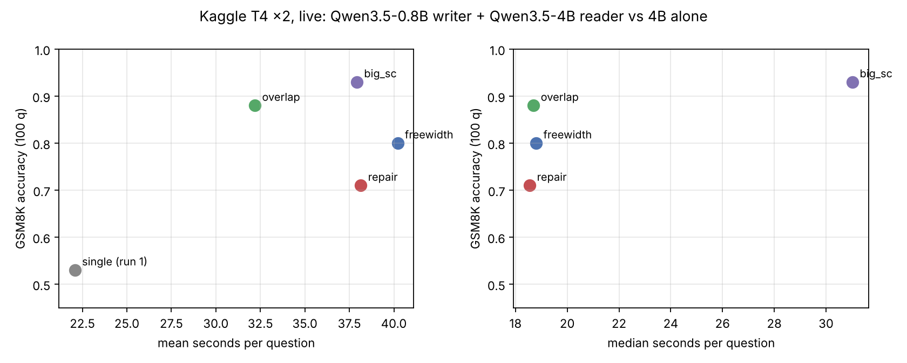

# Live results, run 2: four policies on Kaggle T4 x2, GSM8K (16 Nov 2026)

**Setup.** FreeWidth 0.4.0, same 100 GSM8K questions and per-question seeds as run 1. Ladder: Qwen3.5-0.8B on GPU 0, Qwen3.5-4B on GPU 1, fp16, transformers with `flash-linear-attention`. Calibration: 0.8B free width 16 (R² 0.997), 4B free width 4 (R² 0.998), reproducing run 1. All numbers are measured live. Raw data: `results/t4_gsm8k_4way_2026-11-16/bench_rows.jsonl`.

## Main table

| policy | accuracy (95% CI) | mean s | median s | p90 s | mean J | big model wrote an answer |
|---|---|---|---|---|---|---|
| **big_sc** (4B alone, 8 samples, vote) | **0.93** (0.88–0.98) | 37.9 | 31.0 | 78.6 | 2,579 | 100% |
| **overlap** | **0.88** (0.81–0.94) | **32.2** | **18.7** | **73.7** | 2,694 | 28% |
| freewidth | 0.80 (0.72–0.88) | 40.2 | 18.8 | 102.5 | 2,631 | 5% |
| repair (0.4.0) | 0.71 (0.62–0.80) | 38.1 | 18.6 | 101.6 | 2,501 | 1% |

## Paired comparisons (same questions; exact McNemar; bootstrap CI on per-question time differences)

These are uncorrected p-values. Overlap vs freewidth and overlap vs big_sc were the two comparisons that mattered for this run. After Holm correction over those two, overlap vs freewidth is **p = 0.077**: suggestive, not significant. The full corrected table: `python -m freewidth report results/t4_gsm8k_4way_2026-11-16 --out <dir> --primary overlap:freewidth,overlap:big_sc`.

| A → B | B wins / loses | p | Δ mean seconds (95% CI) |
|---|---|---|---|
| freewidth → **overlap** | 10 / 2 | **0.039** | **−8.0 (−13.7 to −2.5)** |
| freewidth → big_sc | 16 / 3 | **0.004** | −2.3 (−9.3 to +4.4) |
| overlap → big_sc | 7 / 2 | 0.18 | +5.7 (+0.6 to +10.6) |
| freewidth → repair | 0 / 9 | **0.004** | −2.1 (−5.0 to +0.2) |

**Reproducibility.** `freewidth` scored 0.78 in run 1 and 0.80 in run 2 on the same questions and seeds. It gave the same answer on 96 of 100 questions.

## Findings

1. **Overlap is the best ladder.** It is more accurate than `freewidth` (+8 points; p = 0.039 uncorrected, 0.077 after Holm over the two primary comparisons, so suggestive until E1's 300 questions) and faster (−8.0 s mean, CI excludes 0), with a 28% lower p90. On the 20 hard questions (those `freewidth` could not settle by quorum), it was 43 s faster on average (68.8 s vs 111.8 s) at similar accuracy (0.80 vs 0.85). **H6 supported.**
2. **The veto works.** On 13 questions the big model vetoed the small model's confident majority. On those questions, `freewidth`'s final answer was right 8 times; `overlap`'s was right 12 times. Most of overlap's gain comes from questions the small model had "already settled" (accuracy 0.79 → 0.90 on that set): confident-but-wrong majorities caught by streaming verification. **H7 supported.**
3. **The big model alone is the most accurate.** `big_sc` reaches 0.93. That is significantly better than `freewidth` (p = 0.004), and not significantly better than `overlap` (+5 points, p = 0.18). `overlap` is faster: 5.7 s lower mean, about 12 s lower median, and 5 s lower p90. Energy per question is within noise across all four. **H9, "the big model is better as a reader than a writer", is refuted on accuracy.** What survives is a latency trade-off: `overlap` answers the typical question in about 60% of `big_sc`'s median time, at an accuracy cost that this sample cannot distinguish from zero.
4. **Read-Locate-Fork failed, and the cause is informative.** Version 0.4.0 showed the candidate solution to the big model as **its own assistant turn**. In that framing, the same 4B model gave P(Yes) ≥ 0.95 to 75% of candidates (median 0.99). In `freewidth`'s third-party framing ("Proposed solution: … is it correct?"), the median was 0.10. Consequences:
   - 19 candidates were accepted as "verified", and only 42% of them were correct.
   - The locate-and-fork step ran on only one question.

   This is the self-correction blind spot (Tsui 2025: models fail to correct their own errors but fix identical errors from external sources) showing up as verifier miscalibration. **H8 was therefore not tested.** Version 0.4.1 reads the candidate as a third-party solution in the same single pass.

## What this changes

- **Where to run what.** On a T4 x2, use `overlap` when latency matters (median 18.7 s, 88%). Use the big model alone when accuracy matters most (93%, median 31 s).
- **Verifier prompt design.** Verifier framing is not a detail. The same model and the same candidates go from a discriminating verifier to a rubber stamp when the candidate is presented as the model's own answer.
- **Device use (caveat).** Only `overlap` used both GPUs at the same time. `freewidth` and `repair` use them in turn. `big_sc` ran all 8 samples as one batch on GPU 1 (past the 4B's free width of 4) with GPU 0 idle and no early stopping. That favours the two-GPU ladders on latency. The fair baseline, `big_sc2` (4B on both GPUs, 4 samples each, shared QuorumStop), was added in 0.5.0 for the next run.
- **Limits.** 100 questions, one dataset, one GPU type. The paired tests are the reliable part. The overlap vs big_sc accuracy gap needs about 400–500 questions to resolve.

## Next

1. Rerun `repair` (0.4.1, third-party read) to actually test H8, and compare `overlap` against `big_sc2` in the same session.
2. Run 300–500 questions for `overlap` vs `big_sc`.
3. Run MATH-500, where the 4B model alone is slower and the ladder's advantage may grow.
