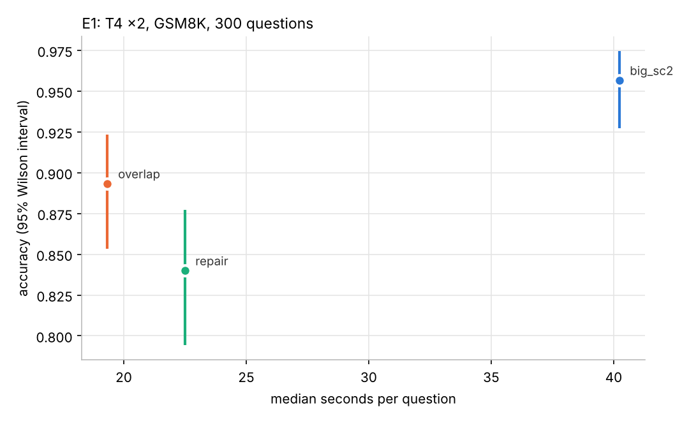

# E1: fair two-GPU baseline and the repair retest, Kaggle T4 x2, GSM8K, 300 questions (16 Nov 2026)

**Status: complete.** All three policies finished all 300 questions, 10 minutes before Kaggle's 12-hour limit. The plan was pre-registered in [experiments.md](experiments.md#e1-fair-baseline-and-the-repair-retest).

**Data**
- Raw rows: `results/t4_gsm8k_E1_2026-11-16/bench_rows.jsonl`.
- Statistics: `results/t4_gsm8k_E1_2026-11-16/report/REPORT.md`, built with `python -m freewidth report ... --primary big_sc2:overlap,overlap:repair`.

**Setup**
- FreeWidth 0.5.0, GSM8K test, 300 questions. Sampler seed 0, so the 300 include runs 1–2's 100.
- Qwen3.5-0.8B on GPU 0 and Qwen3.5-4B on GPU 1, fp16, transformers with flash-linear-attention.
- Calibration (same session): 0.8B free width 16 (R² 0.998), 4B free width 4 (R² 0.997). This matches runs 1 and 2.
- `big_sc2` loaded a second 4B copy on GPU 0 (8.2 s, no memory problems). It split 8 samples 4 + 4 across the GPUs, with one shared QuorumStop.

## Results

| policy | accuracy (95% Wilson CI) | mean s | median s | p90 s | mean J | 4B decoded on |
|---|---|---|---|---|---|---|
| **big_sc2** (4B on both GPUs) | **95.7%** (92.7–97.5) | 43.4 | 40.2 | **62.0** | 5,713 | 100% |
| **overlap** | 89.3% (85.3–92.3) | **34.5** | **19.3** | 73.9 | **2,849** | 34% |
| **repair** (0.4.1 third-party read) | 84.0% (79.4–87.7) | 60.0 | 22.5 | 185.2 | 3,968 | 14% |

## Pre-registered comparisons (Holm over the two)

| comparison | wins / losses | Holm p | Δ accuracy (95% CI) | Δ mean seconds (95% CI) | verdict |
|---|---|---|---|---|---|
| big_sc2 → overlap | 4 / 23 | **0.0006** | −6.3 points (−9.7 to −3.0) | −9.0 s (−12.0 to −6.0) | **E1.1 fails** |
| overlap → repair | 7 / 23 | **0.005** | −5.3 points (−9.0 to −2.0) | +25.6 s (+20.1 to +31.1) | **E1.2 fails** |

**E1.1: overlap does not beat the big model on two GPUs.**
- Overlap is faster: 9 s lower mean, half the median and half the energy.
- But it is significantly less accurate (6.3 points). The criterion required "not significantly less accurate".
- Honest reading: overlap is a latency and energy trade-off, not a better system. When accuracy matters most, run the 4B.

**E1.2: repair is worse than overlap on both axes.** It is 5.3 points less accurate and 25.6 s slower on average. **H8 is refuted** against the best ladder.

## What the decisions show

**Overlap, by how each answer was accepted:**

| accepted by | n | accuracy | mean s |
|---|---|---|---|
| 4B verified the 0.8B's answer | 188 | 93.6% | 17.2 |
| 4B wrote the answer | 82 | 95.1% | 77.1 |
| **0.8B majority, 4B checked but unsure (0.2 ≤ P(Yes) < 0.95)** | **28** | **46.4%** | 19.0 |
| other | 2 | — | — |

Almost all of overlap's accuracy gap comes from **28 questions accepted on the small model's majority while the 4B's check was unsure**. The 4B gave them P(Yes) between the veto threshold (0.2) and the accept threshold (0.95):
- On those 28, overlap was right 13 times. `big_sc2` was right 26 times.
- On the other 272, overlap's accuracy is 93.8% (255/272).

This gives a concrete, testable fix: when the 4B is unsure about the majority answer, don't accept it; start the 4B on the question instead. It is pre-registered as **H10 / E1b** in [experiments.md](experiments.md).
- **Upper bound if it works:** about 93.7%. That is 13 more correct, assuming the 4B is as accurate on those questions as `big_sc2` was.
- **Cost:** roughly +4–5 s mean.
- These are estimates from this run, not results.

**Repair, by how each answer was accepted:**

| accepted by | n | accuracy | mean s |
|---|---|---|---|
| 0.8B quorum | 224 | 83.5% | 25.5 |
| 4B wrote the answer after a failed repair | 43 | 90.7% | 205.1 |
| 4B verified a candidate (third-party read) | 26 | 73.1% | 104.0 |
| **repaired (locate flaw → fork from it)** | **7** | **100%** | 110.7 |

- **The verifier fix worked in part.** In 0.4.0, verified accepts were 42% accurate (19 accepts). Now they are 73% (26 accepts). That is still not a reliable gate.
- **Read-Locate-Fork itself:**
  - It tried 50 forks. 7 succeeded, and all 7 were correct. 43 failed and fell back to a 4B decode.
  - That decode came after the failed repair, so those questions took 205 s on average. The fallback is what makes repair slow.
- **Repair's real problem is upstream.** 224 of 300 questions were accepted on the small model's quorum (83.5%), the same weak gate that hurts overlap.
- **H8 as originally stated (vs freewidth), exploratory.** On the 100 questions shared with run 2, cross-session: repair 80 vs freewidth 80 correct (7 / 7, p = 1.0), at higher mean latency (60 s vs 40 s). Not supported.

## Repeatability (exploratory, the 100 questions shared with run 2)

- **overlap:** 86 (E1) vs 88 (run 2) correct, 6 / 8 discordant, p = 0.79. Same answer on 85 of 100.
- **4B baseline:** `big_sc2` (E1) 94 vs `big_sc` (run 2) 93. Median 40.3 s vs 31.0 s **on the same 100 questions**.

## The two-GPU baseline is slower than the one-GPU baseline

On identical questions, the 4B on two GPUs had a 40.3 s median, against 31.0 s on one GPU with the other idle. The split was 4 + 4 at the 4B's free width, which should have made it faster.

**Likely cause: thread contention.** Both GPUs are driven by Python threads in one process. At small batch sizes, HF `generate` is limited by Python-side kernel launches, and the two threads take turns on the interpreter lock. This is the leading explanation, not yet proven.

**Effect:** a process-per-GPU `big_sc2` would be faster still, which strengthens E1.1's conclusion.

### Correction: the seeding bug did not duplicate samples

After the run, a code review found that every wave reseeded *all* GPUs (`torch.manual_seed`). The 0.5.1 notes said this had probably made `big_sc2`'s two GPUs draw identical samples. **The data does not support that.**
- The two waves' generated token counts match on only 11 of 300 questions.
- The numbers of rows that finished in each wave match on only 16 of 300.
- Identical samples would match on nearly all of them.

The bug was real and is fixed: each backend now seeds only its own device. But it did not visibly duplicate E1's samples. The two GPUs' random streams may still have been partly correlated, which per-device seeding removes.

## Also learned

- **The run was too long.** It needed 11.8 h of a 12 h limit. Repair took 300 min, against an estimated 190, because failed repairs fall back to slow big-model decodes.
- From 0.5.0 onward, `bench --max-hours` and the Kaggle scripts' session clock stop new questions in time and keep every finished result.
- **Reporting bug fixed (0.5.2).** `report`'s "largest model decoded" column read 0% for `big_sc2` and `repair`, because tags like `q35-4b (cancelled)` and `q35-4b.r1` were not normalised. The corrected table is above.
