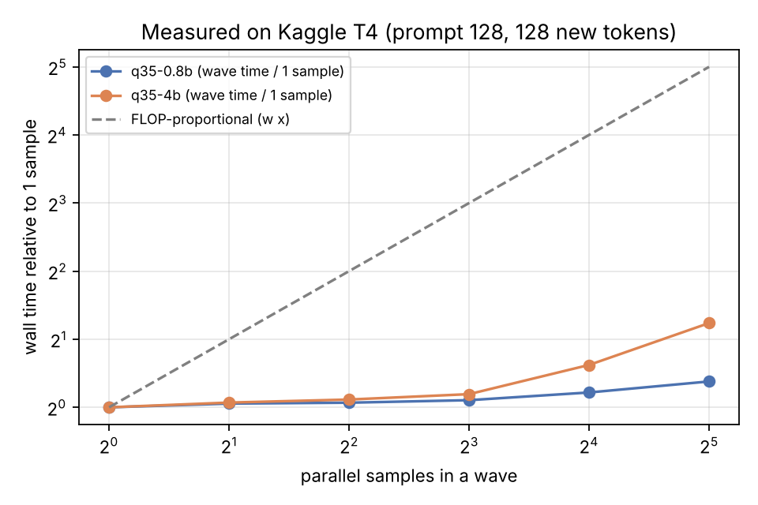
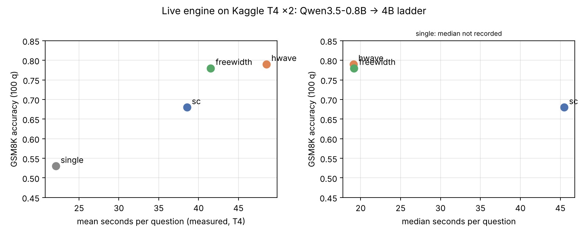

# Live results: Kaggle T4 x2, GSM8K (15 Nov 2026)

**Setup.** FreeWidth 0.2.2 live engine. Ladder: Qwen3.5-0.8B on GPU 0 → Qwen3.5-4B on GPU 1, fp16, transformers with `flash-linear-attention` (causal-conv1d not available on T4). Workload: 100 GSM8K test questions (fixed sample, seed 0), temperature 0.7, up to 1024 new tokens per sample. All times and energies are measured live on the device (wall clock, NVML). Raw data: `results/t4_gsm8k_2026-11-15/`.

## Calibration

| model | free width | fit R² |
|---|---|---|
| Qwen3.5-0.8B | 16 | 0.998 |
| Qwen3.5-4B | 4 | 0.997 |

At a 128-token prompt with 128 new tokens, 16 parallel samples on the 0.8B model take 1.14× the time of one sample (5.99 s vs 5.24 s). One sample from the 4B model takes 7.65 s. Free width also depends on the software stack: with the reference PyTorch kernels instead of `flash-linear-attention`, the 4B model's free width was 2.

## Main table

| policy | accuracy (95% CI) | mean s | median s | p90 s | mean J | mean tokens | escalated | verified |
|---|---|---|---|---|---|---|---|---|
| single¹ | 0.53 | 22.1 | — | 41.9 | 915 | 531 | 0 | 0 |
| sc (8 samples) | 0.68 (0.59–0.77) | 38.5 | 45.5 | 46.4 | 2,529 | 4,255 | 0 | 0 |
| hwave | 0.79 (0.71–0.87) | 48.5 | 19.1 | 139.9 | 3,232 | 10,025 | 0.18 | 0 |
| **freewidth** | **0.78 (0.70–0.86)** | **41.5** | **19.2** | **105.2** | **2,713** | 9,591 | 0.07 | 0.11 |

¹ Same 100 questions, measured in an earlier commit with identical code paths. Per-question rows were not kept, so it is excluded from the paired tests.

## Findings

1. **Free width shows up live.** `sc` generates 8× the tokens of `single` (and roughly 8× the FLOPs), but costs 1.75× the time and 2.8× the energy, for +15 accuracy points.
2. **QuorumStop + escalation beats plain voting on accuracy at similar mean cost.** Against `sc` on the same questions, `freewidth` wins 15 and loses 5 (exact McNemar p = 0.041). The mean-time difference is +3.0 s (bootstrap 95% CI −4.6 to +11.4, not significant). Median time drops from 45.5 s to 19.2 s, because 73% of questions finish in one wave. In `hwave`, 96 of 151 waves stopped early on a quorum, and 43% of all generated rows were cut before finishing.
3. **Prefill verification replaces most big-model decoding at no accuracy cost.** Against `hwave`, `freewidth` has the same accuracy (2 wins, 3 losses, p = 1.0) and is 7.0 s faster per question (CI −12.6 to −2.3 s), with a 25% lower p90 and 16% less energy. Escalations to 4B decoding fall from 18% to 7%. A verification pass costs 3.6 s, compared with about 150 s for an escalated question, and big-model decode time per question falls from 11.2 s to 3.3 s.
4. **Stragglers dominate fixed-width voting.** In 61 of 100 `sc` waves, at least one sample ran to the 1024-token cap. Those waves averaged 46.0 s, against 26.8 s for waves where every sample finished.

## Weak spots

- **The verifier's "accept" is only moderately reliable.** It accepted 11 candidates and 7 of them were correct; the accepted wrong answers scored P(Yes) between 0.78 and 0.91. Its "reject" was reliable: 6 of the 7 rejected questions were then solved by escalation. Every correct acceptance scored at least 0.82 and four scored at least 0.98, so a higher `verify_accept` (for example 0.95) is the next thing to test.
- **Runaway generations.** 14–17% of all samples hit the 1024-token cap. They rarely finish with an answer, and they set the wave time.
- **Answer format.** Question 906 accepted "4 blue and 6 red shoe boxes" as the answer, which the numeric grader can't match. Answer formatting matters to the grader as well as to the verifier.
- **Small sample.** 100 questions, one dataset, one GPU type, one seed; accuracy CIs are about ±9 points. The paired tests above are the right comparison; absolute accuracies should be read with the CIs.

## Next experiments

1. Rerun `freewidth` with `verify_accept: 0.95`.
2. Add a repetition/runaway stop, or lower `max_new_tokens`, to cut length-capped stragglers.
3. Scale to 300–500 GSM8K questions, then MATH-500.
4. Run the dense Qwen3 ladder (`engine_t4_dense.yaml`) as the H2 control.
5. Compare these live numbers with the offline replay pipeline's predictions for the same models.
