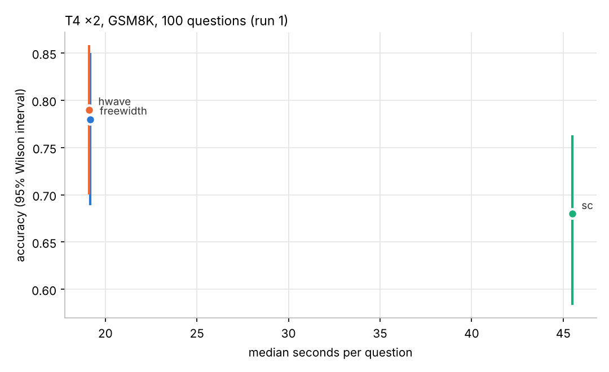

# T4 x2, GSM8K, 100 questions (run 1)

Runs: t4_gsm8k_2026-11-15. Generated by `python -m freewidth report`.

## Policies

| policy | n | accuracy % (95% CI) | mean s | median s | p90 s | mean J | mean tokens | largest model decoded |
|---|---|---|---|---|---|---|---|---|
| hwave | 100 | 79.0 (70.0–85.8) | 48.5 | 19.1 | 139.9 | 3,232 | 10,025 | 18% |
| freewidth | 100 | 78.0 (68.9–85.0) | 41.5 | 19.2 | 105.2 | 2,713 | 9,591 | 7% |
| sc | 100 | 68.0 (58.3–76.3) | 38.5 | 45.5 | 46.4 | 2,529 | 4,255 | 0% |

## Paired comparisons

Same questions only. *B wins / loses*: questions B got right and A wrong, and the reverse. *p*: exact McNemar; *Holm p*: adjusted within its family (the comparisons declared primary before the run, or all the exploratory ones). Intervals are paired bootstrap (10,000 resamples, seeded). *n for 80% power*: questions a McNemar test would need to detect the observed accuracy difference at α = 0.05.

| A → B | family | n | B wins / loses | p | Holm p | Δ accuracy, points (95% CI) | Δ mean s (95% CI) | n for 80% power |
|---|---|---|---|---|---|---|---|---|
| hwave → freewidth | exploratory | 100 | 2 / 3 | 1 | 1 | -1.0 (-5.0 to +3.0) | -7.0 (-12.5 to -2.3) | 3,923 |
| hwave → sc | exploratory | 100 | 4 / 15 | 0.0192 | 0.0576 | -11.0 (-19.0 to -3.0) | -10.0 (-21.3 to +0.3) | 121 |
| freewidth → sc | exploratory | 100 | 5 / 15 | 0.0414 | 0.0828 | -10.0 (-19.0 to -2.0) | -3.0 (-11.4 to +4.8) | 155 |

