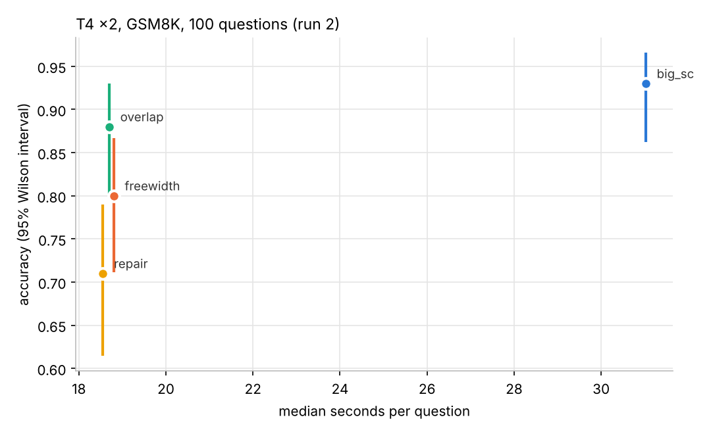

# T4 x2, GSM8K, 100 questions (run 2)

Runs: t4_gsm8k_4way_2026-11-16. Generated by `python -m freewidth report`.

## Policies

| policy | n | accuracy % (95% CI) | mean s | median s | p90 s | mean J | mean tokens | largest model decoded |
|---|---|---|---|---|---|---|---|---|
| big_sc | 100 | 93.0 (86.3–96.6) | 37.9 | 31.0 | 78.6 | 2,579 | 3,395 | 100% |
| overlap | 100 | 88.0 (80.2–93.0) | 32.2 | 18.7 | 73.7 | 2,694 | 7,047 | 28% |
| freewidth | 100 | 80.0 (71.1–86.7) | 40.2 | 18.8 | 102.5 | 2,631 | 9,732 | 5% |
| repair | 100 | 71.0 (61.5–79.0) | 38.1 | 18.6 | 101.6 | 2,501 | 9,719 | 1% |

## Paired comparisons

Same questions only. *B wins / loses*: questions B got right and A wrong, and the reverse. *p*: exact McNemar; *Holm p*: adjusted within its family (the comparisons declared primary before the run, or all the exploratory ones). Intervals are paired bootstrap (10,000 resamples, seeded). *n for 80% power*: questions a McNemar test would need to detect the observed accuracy difference at α = 0.05.

| A → B | family | n | B wins / loses | p | Holm p | Δ accuracy, points (95% CI) | Δ mean s (95% CI) | n for 80% power |
|---|---|---|---|---|---|---|---|---|
| big_sc → overlap | **primary** | 100 | 2 / 7 | 0.18 | 0.18 | -5.0 (-11.0 to +1.0) | -5.7 (-10.8 to -0.6) | 281 |
| overlap → freewidth | **primary** | 100 | 2 / 10 | 0.0386 | 0.0771 | -8.0 (-15.0 to -1.0) | +8.0 (+2.4 to +13.8) | 145 |
| big_sc → freewidth | exploratory | 100 | 3 / 16 | 0.00443 | 0.00781 | -13.0 (-21.0 to -5.0) | +2.3 (-4.3 to +9.2) | 86 |
| big_sc → repair | exploratory | 100 | 2 / 24 | 1.05e-05 | 4.2e-05 | -22.0 (-31.0 to -13.0) | +0.2 (-5.8 to +6.8) | 40 |
| overlap → repair | exploratory | 100 | 2 / 19 | 0.000221 | 0.000664 | -17.0 (-25.0 to -9.0) | +6.0 (+0.9 to +10.9) | 55 |
| freewidth → repair | exploratory | 100 | 0 / 9 | 0.00391 | 0.00781 | -9.0 (-15.0 to -4.0) | -2.1 (-5.2 to +0.1) | 85 |

## Breakdowns by engine decision

**overlap**, by `accept_reason`:

| group | n | accuracy % | mean s |
|---|---|---|---|
| verified | 63 | 93.7 | 15.9 |
| big_model | 28 | 85.7 | 72.8 |
| quorum | 9 | 55.6 | 20.1 |

**overlap**, by `trigger`:

| group | n | accuracy % | mean s |
|---|---|---|---|
| none | 68 | 91.2 | 16.3 |
| disagreement | 18 | 72.2 | 70.6 |
| lead_vetoed | 13 | 92.3 | 52.8 |
| sequential_fallback | 1 | 100.0 | 153.1 |

**repair**, by `accept_reason`:

| group | n | accuracy % | mean s |
|---|---|---|---|
| quorum | 80 | 78.8 | 22.2 |
| verified | 19 | 42.1 | 98.3 |
| big_model | 1 | 0.0 | 173.9 |

