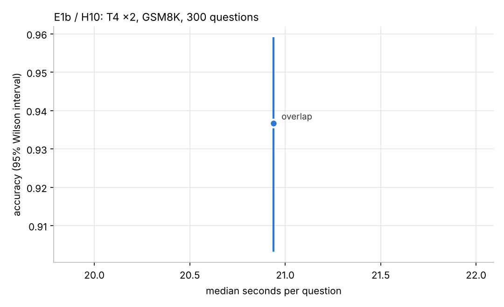

# E1b / H10: T4 x2, GSM8K, 300 questions

Runs: t4_gsm8k_H10. Generated by `python -m freewidth report`.

## Policies

| policy | n | accuracy % (95% CI) | mean s | median s | p90 s | mean J | mean tokens | largest model decoded |
|---|---|---|---|---|---|---|---|---|
| overlap | 300 | 93.7 (90.3–95.9) | 37.2 | 20.9 | 74.6 | 3,186 | 7,677 | 43% |

## Paired comparisons

Same questions only. *B wins / loses*: questions B got right and A wrong, and the reverse. *p*: exact McNemar; *Holm p*: adjusted within its family (the comparisons declared primary before the run, or all the exploratory ones). Intervals are paired bootstrap (10,000 resamples, seeded). *n for 80% power*: questions a McNemar test would need to detect the observed accuracy difference at α = 0.05.

| A → B | family | n | B wins / loses | p | Holm p | Δ accuracy, points (95% CI) | Δ mean s (95% CI) | n for 80% power |
|---|---|---|---|---|---|---|---|---|

## Breakdowns by engine decision

**overlap**, by `accept_reason`:

| group | n | accuracy % | mean s |
|---|---|---|---|
| verified | 192 | 93.2 | 17.0 |
| big_model | 106 | 95.3 | 72.3 |
| fallback | 1 | 0.0 | 188.7 |
| verified_end | 1 | 100.0 | 51.1 |

**overlap**, by `trigger`:

| group | n | accuracy % | mean s |
|---|---|---|---|
| none | 171 | 93.6 | 16.8 |
| disagreement | 53 | 92.5 | 64.9 |
| lead_vetoed | 43 | 97.7 | 63.9 |
| uncertain_quorum | 27 | 96.3 | 56.7 |
| sequential_fallback | 6 | 66.7 | 95.7 |

