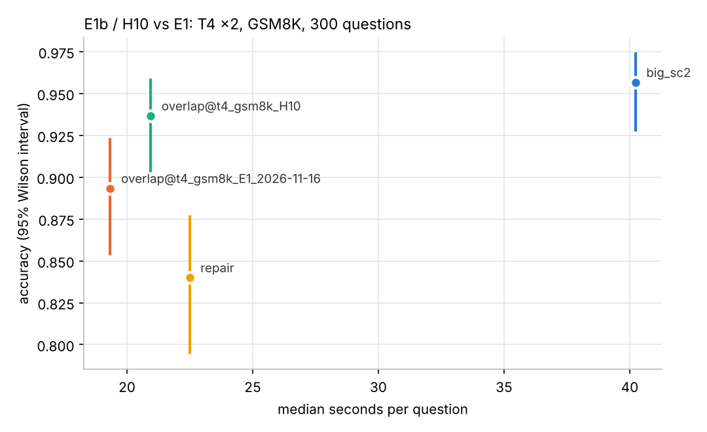

# E1b / H10 vs E1: T4 x2, GSM8K, 300 questions

Runs: t4_gsm8k_E1_2026-11-16, t4_gsm8k_H10. Generated by `python -m freewidth report`.

## Policies

| policy | n | accuracy % (95% CI) | mean s | median s | p90 s | mean J | mean tokens | largest model decoded |
|---|---|---|---|---|---|---|---|---|
| big_sc2 | 300 | 95.7 (92.7–97.5) | 43.4 | 40.2 | 62.0 | 5,713 | 3,200 | 100% |
| overlap@t4_gsm8k_H10 | 300 | 93.7 (90.3–95.9) | 37.2 | 20.9 | 74.6 | 3,186 | 7,677 | 43% |
| overlap@t4_gsm8k_E1_2026-11-16 | 300 | 89.3 (85.3–92.3) | 34.5 | 19.3 | 73.9 | 2,849 | 7,380 | 34% |
| repair | 300 | 84.0 (79.4–87.7) | 60.0 | 22.5 | 185.2 | 3,968 | 12,681 | 14% |

## Paired comparisons

Same questions only. *B wins / loses*: questions B got right and A wrong, and the reverse. *p*: exact McNemar; *Holm p*: adjusted within its family (the comparisons declared primary before the run, or all the exploratory ones). Intervals are paired bootstrap (10,000 resamples, seeded). *n for 80% power*: questions a McNemar test would need to detect the observed accuracy difference at α = 0.05.

| A → B | family | n | B wins / loses | p | Holm p | Δ accuracy, points (95% CI) | Δ mean s (95% CI) | n for 80% power |
|---|---|---|---|---|---|---|---|---|
| big_sc2 → overlap@t4_gsm8k_H10 | **primary** | 300 | 5 / 11 | 0.21 | 0.21 | -2.0 (-4.7 to +0.7) | -6.2 (-9.3 to -3.1) | 1,045 |
| overlap@t4_gsm8k_H10 → overlap@t4_gsm8k_E1_2026-11-16 | **primary** | 300 | 1 / 14 | 0.000977 | 0.00195 | -4.3 (-7.0 to -2.0) | -2.8 (-4.3 to -1.3) | 207 |
| big_sc2 → overlap@t4_gsm8k_E1_2026-11-16 | exploratory | 300 | 4 / 23 | 0.000311 | 0.000621 | -6.3 (-9.7 to -3.0) | -9.0 (-11.9 to -5.9) | 174 |
| big_sc2 → repair | exploratory | 300 | 4 / 39 | 3.11e-08 | 1.24e-07 | -11.7 (-15.7 to -7.7) | +16.6 (+9.9 to +23.7) | 81 |
| overlap@t4_gsm8k_H10 → repair | exploratory | 300 | 7 / 36 | 8.96e-06 | 2.69e-05 | -9.7 (-14.0 to -5.7) | +22.8 (+16.9 to +28.7) | 119 |
| overlap@t4_gsm8k_E1_2026-11-16 → repair | exploratory | 300 | 7 / 23 | 0.00522 | 0.00522 | -5.3 (-9.0 to -2.0) | +25.6 (+20.0 to +31.2) | 274 |

## Breakdowns by engine decision

**overlap@t4_gsm8k_E1_2026-11-16**, by `accept_reason`:

| group | n | accuracy % | mean s |
|---|---|---|---|
| verified | 188 | 93.6 | 17.2 |
| big_model | 82 | 95.1 | 77.1 |
| quorum | 28 | 46.4 | 19.0 |
| fallback | 1 | 0.0 | 189.7 |
| verified_end | 1 | 100.0 | 50.5 |

**overlap@t4_gsm8k_E1_2026-11-16**, by `trigger`:

| group | n | accuracy % | mean s |
|---|---|---|---|
| none | 198 | 87.4 | 17.3 |
| disagreement | 53 | 94.3 | 67.0 |
| lead_vetoed | 43 | 95.3 | 64.6 |
| sequential_fallback | 6 | 66.7 | 96.8 |

**repair**, by `accept_reason`:

| group | n | accuracy % | mean s |
|---|---|---|---|
| quorum | 224 | 83.5 | 25.5 |
| big_model | 43 | 90.7 | 205.1 |
| verified | 26 | 73.1 | 104.0 |
| repaired | 7 | 100.0 | 110.7 |

**overlap@t4_gsm8k_H10**, by `accept_reason`:

| group | n | accuracy % | mean s |
|---|---|---|---|
| verified | 192 | 93.2 | 17.0 |
| big_model | 106 | 95.3 | 72.3 |
| fallback | 1 | 0.0 | 188.7 |
| verified_end | 1 | 100.0 | 51.1 |

**overlap@t4_gsm8k_H10**, by `trigger`:

| group | n | accuracy % | mean s |
|---|---|---|---|
| none | 171 | 93.6 | 16.8 |
| disagreement | 53 | 92.5 | 64.9 |
| lead_vetoed | 43 | 97.7 | 63.9 |
| uncertain_quorum | 27 | 96.3 | 56.7 |
| sequential_fallback | 6 | 66.7 | 95.7 |

